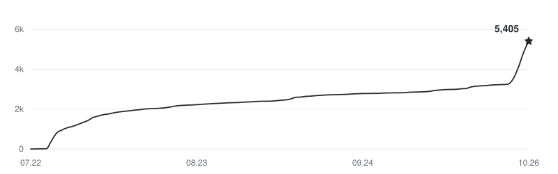

<p align="center">
  <a href="https://cindy.cn"></a>
</p>

<p align="center">
  <a href="README.md">English</a> · <strong>简体中文</strong>
</p>

<p align="center">
  <a href="LICENSE"></a>
  <a href="https://github.com/makecindy/cindy/actions/workflows/ci.yml"></a>
</p>

<p align="center">
  <strong><a href="https://cindy.cn/download">下载中国大陆版</a></strong> &nbsp;·&nbsp; <strong><a href="https://cindy.app/download">下载国际版</a></strong> &nbsp;·&nbsp; <a href="CONTRIBUTING.md">一起共创</a> &nbsp;·&nbsp; <a href="SUPPORT.md">使用帮助</a>
</p>

<p align="center">
  <a href="https://cindy.cn">中国大陆官网</a> &nbsp;·&nbsp; <a href="https://cindy.app">国际版官网</a>
</p>

<p align="center">
  <a href=".github/assets/star-history/trending-2026-10-26.png">★ GitHub Trending #1 · 2026.10.26</a>
</p>

Cindy 是一个**开源、开箱即用的 AI Agent**。连接你的多台电脑与手机，把熟悉的
Agent、模型和已有订阅放在一起，培养一个懂你工作方式的伙伴。

## 所有设备，同一个 Cindy。

办公室的电脑、家里的主机、随身笔记本和手机，连在一起用。

- **换屏幕，不换任务。** 在另一台设备打开同一个任务，继续对话、访问文件，不用重新搬运资料。
- **不只共享画面，也共享模型。** 其他电脑上配置好的订阅、API 供应商和本地模型，开启远程访问后也能调用。
- **手机，也是电脑的遥控器。** 内置远程桌面，需要时直接打开应用、输入和操作自己的电脑。

**你的电脑，变身免费的服务器，全球畅联。** 不用另租服务器，也不必自己搭服务。

<details>
<summary>连接与数据如何处理</summary>

远程访问自己的电脑，需要电脑在线、设备登录同一账号，并开启相应权限。
模型共享需要允许对应供应商被远程调用，远程桌面也有独立的授权与系统权限。
项目文件仍在原电脑上，可远程访问不等于整盘自动同步。云伙伴的对话、记忆、
自有 Skill 和共享附件会通过 Cindy 服务同步；模型供应商会处理发送给它的请求。
模型和服务费用仍按相应规则计费。

</details>

## 熟悉的 Agent，更顺手的体验。

已经在用 Claude Code 或 Codex？Cindy 把它们和 **Pi** 放在一起，再加入对交互、
多设备访问、工具协作的理解。

| Harness | 带来的能力 |
| --- | --- |
| **Claude Code** | 熟悉的 Claude Code 工作方式，接上 Cindy 的界面与工具。 |
| **Codex** | Codex 的代码工作流，与其他 Agent 在同一个产品里配合。 |
| **Pi** | 轻量、开源、可扩展，原生支持多种模型供应商。 |

在支持的组合中选择 Harness 和模型，随任务需要切换。任务仍留在 Cindy，
跨 Harness 时会交接或重建引擎上下文，并非把不同引擎的内部状态原样搬过去。

**一个不够？让她带队。** 把规划、并行执行和独立 Review 交给不同 Agent，
围绕同一个目标和验收标准一起开工。

## 在真实工具里，把工作做完。

使用你的文件、浏览器和软件，从交办到检查结果，都在工作的现场。
回答也不只有文字：**图表、交互控件和丰富的 HTML 内容**，都能出现在对话里。

把重复的事情设成**自动化**，或者从接入的 Slack、飞书等聊天渠道交办。
通过 **Skill、插件和 MCP**，继续连接自己的工具与工作方法。

## 一开始就好用，任你打扮，任你培养。

- **培养自己的伙伴。** 给她角色、指令、Skill 和日常工作：代码审阅、资料研究、项目跟进，都可以有专门的搭档。
- **让经验留下来。** 把偏好和知识留在记忆中，把有效的方法写成可复用、可分享的 Skill。
- **把能力接进来。** 从 SkillHub 发现 Skill 和插件，连接自己的工具，也可以从[官方插件](https://github.com/makecindy/cindy-official-plugins)开始开发。
- **一起打磨 Cindy。** 审计、fork、改进交互、修复问题，或者贡献一个有用的集成。客户端以 Apache-2.0 开源。

开源，不只是看得见，更是改得动。[一起打造 Cindy →](CONTRIBUTING.md)

## 用你已经有的，开始就好。

**客户端免费。** 授权已有的 Claude Code、Codex 等受支持订阅，接自己的 API key，
或者使用本地模型；也可以选择 Cindy 官方模型服务。已有订阅仍按供应商的限额和
规则使用，软件免费不等于模型调用无限量。

**macOS · Windows · Linux · iOS · Android**

[下载中国大陆版](https://cindy.cn/download) · [下载国际版](https://cindy.app/download)
· [中国大陆定价](https://cindy.cn/pricing) · [国际版定价](https://cindy.app/pricing)

Linux 用户可参考 [Ubuntu、Arch Linux 与 Omarchy 安装指南](docs/linux.md)。

<h3 align="center">好吧，是有一点受欢迎。</h3>

<p align="center">
  <a href="https://github.com/makecindy/cindy/stargazers">
    <picture>
      <source media="(prefers-color-scheme: dark) and (max-width: 600px)" srcset="https://raw.githubusercontent.com/makecindy/cindy/readme-star-history/stars-dark-mobile.svg">
      <source media="(max-width: 600px)" srcset="https://raw.githubusercontent.com/makecindy/cindy/readme-star-history/stars-light-mobile.svg">
      <source media="(prefers-color-scheme: dark)" srcset="https://raw.githubusercontent.com/makecindy/cindy/readme-star-history/stars-dark.svg">
      <source media="(prefers-color-scheme: light)" srcset="https://raw.githubusercontent.com/makecindy/cindy/readme-star-history/stars-light.svg">
      
    </picture>
  </a>
</p>
<p align="center"><sub>每一颗星，都有好好记着。</sub></p>

---

## 给开发者

本仓库包含 Cindy 的开源**桌面端、手机端及其共享 packages**，以 pnpm monorepo 组织。

### 本仓包含什么

| 路径 | 说明 |
| --- | --- |
| `apps/desktop` | Electron 桌面客户端 |
| `apps/mobile` | Expo / React Native 手机客户端 |
| `packages/*` | 客户端共享能力（鉴权、device-link、agent 编排、模型供应商等） |
| `apps/*-bin` | 桌面端附带的工具二进制，均不入库；claude-code / codex / ripgrep 由 `pnpm install` 按平台自动下载，Android platform-tools 在 Windows 打包前按 pin 版本下载并校验 sha256 |

**服务端不在本仓库：** 服务端位于独立仓库，不属于本 monorepo。

| 使用方式 | 账号要求 | 可用范围 |
| --- | --- | --- |
| 远程托管 | Cindy 云端账号 | 使用 Cindy 的完整托管服务；[中国大陆定价](https://cindy.cn/pricing) · [国际版定价](https://cindy.app/pricing)。 |
| 跳过登录 | 无需登录 Cindy 账号 | 在登录页选择「跳过登录」即可使用本机 agent 功能，应用内显示为「未登录」。依赖服务端的能力在该状态下不可用。 |

### 前置要求

- **Node.js** 22.x
- **pnpm** 10.x（暂不支持 v11）
- **Git LFS**

### 开始开发

开发者安装、Git LFS、依赖更新和权限说明统一见
[`CONTRIBUTING.md`](CONTRIBUTING.md)。插件通过 SkillHub 或手动安装。

最短入口：

```bash
git clone https://github.com/makecindy/cindy.git
cd cindy
git lfs pull
pnpm install
```

### 开发入口

```bash
# 中国大陆版 Cindy 账号
pnpm restart:desktop:remote --region=cn

# 国际版 Cindy 账号
pnpm restart:desktop:remote --region=global
```

Remote 开发会使用你自己的 Cindy 云端账号和现有登录态，因此可以继续已有的会话与工作。
中国大陆账号必须使用 `cn`，国际版账号必须使用 `global`，不要依赖内部默认值。完整的
桌面端、手机端、数据隔离和验证流程见 [`CONTRIBUTING.md`](CONTRIBUTING.md)。

登录页的「跳过登录」不是连接本地服务端，而是无需登录 Cindy 账号即可使用本机
agent；进入后应用内的账号状态显示为「未登录」。依赖服务端的能力在该状态下不可用。

**关于默认服务器：** 客户端默认连接 Cindy 官方云服务（端点清单见
[`config/endpoint.json`](config/endpoint.json) 与
[`config/endpoint.global.json`](config/endpoint.global.json)，桌面端自动更新
同样来自官方 CDN）。这是有意的设计——外部开发者不需要自建服务端，用 dev
构建登录自己的 Cindy 账号即可直接对着官方服务器开发和测试。

### 架构

- [`DESIGN.md`](DESIGN.md) —— 视觉设计系统、颜色 token 与 UI 规范
- [`docs/README.md`](docs/README.md) —— 完整文档与规则索引
- [`CONTRIBUTING.md`](CONTRIBUTING.md) —— 面向社区贡献者的环境、验证与提交流程
- [`AGENTS.md`](AGENTS.md) —— 工程规范、启动 / 运行时契约、模块边界
- [`docs/dev-rules/`](docs/dev-rules/) —— 架构深度文档（如 Orca 多 agent 协同）

## 贡献

改动通过 pull request 合入 `main`。请先阅读
[`CONTRIBUTING.md`](CONTRIBUTING.md)，再按
[`.github/PULL_REQUEST_TEMPLATE.md`](.github/PULL_REQUEST_TEMPLATE.md) 提交。
每个 commit 需带 [DCO](DCO) 签名（`git commit -s`），由 PR 上的 DCO check 校验；
不需要签 CLA。
同时请遵守 [`CODE_OF_CONDUCT.md`](CODE_OF_CONDUCT.md)；普通使用问题见
[`SUPPORT.md`](SUPPORT.md)，安全问题仍按 [`SECURITY.md`](SECURITY.md) 私下报告。

## 安全

任何凭证 / 授权文件都不得提交进工作区。发现安全问题请按照
[`SECURITY.md`](SECURITY.md) 的说明私下报告，不要开公开 issue。

## 隐私与遥测

**官方分发的安装包**包含 [TapDB](https://www.taptap.cn/tapdb) 使用统计，用于
产品层面的汇总分析，包括设备标识、系统 / 应用版本、启动与活跃事件；登录后会
关联账号 ID，因此不应理解为完全匿名。TapDB **不采集**聊天内容、文件内容或
工作目录数据。

**无需修改代码即可关闭使用统计**：桌面端在「设置 → 关于 → 使用统计」，移动端在
设置页的「使用统计」关闭。SDK 检查本地记录的隐私同意状态和统计开关，统计开关
默认开启。同意《隐私政策》会记录同意状态；符合条件的存量已登录用户也会通过一次性
迁移记录为已同意。

**移动端已知例外**：企业 SSO 跳过协议勾选。如果本机尚无统计同意记录，并在重启应用后
恢复该登录态，当前迁移逻辑可能把新装用户也标记为已同意。在已配置 TapDB 且统计开启时，
即使用户未明确接受隐私政策，也可能开始上报。实现见
[移动端登录恢复](apps/mobile/src/auth/AuthContext.tsx)与
[同意状态迁移](apps/mobile/src/analytics/analyticsConsentStore.ts)。
关闭「使用统计」可避免该迁移放行统计上报。

- 桌面端关闭后立即停止后续统计上报；「跳过登录」的本地模式不上报 TapDB。
- 移动端关闭后立即解绑账号并停止 Cindy 主动触发的上报；已初始化的原生 SDK
  不支持反初始化，需彻底退出并重新启动应用，才会保持 SDK 未初始化。

实现依据：[桌面端同意与开关](apps/desktop/src/main/analyticsSettingsService.ts)、
[桌面端 SDK](apps/desktop/src/renderer/analytics/tapdbClient.ts)、
[移动端同意状态](apps/mobile/src/analytics/analyticsConsentStore.ts)、
[移动端 SDK](apps/mobile/src/analytics/mobileTapdb.ts)。

在线心跳与诊断日志是独立机制，不受「使用统计」开关控制。桌面端仅在已验证的云端
登录态下向 Cindy 服务发送在线心跳（账号 ID、平台与版本号），本地模式不发送。
桌面端原生崩溃转储只保留在本地，不会自动上传；诊断日志可手动上传，另外有默认关闭的
「崩溃时自动上传」选项，上传均须通过隐私同意门槛。详见
[心跳实现](apps/desktop/src/main/heartbeatService.ts)与
[日志上报规则](docs/dev-rules/log-upload-and-redaction.md)。

**从源码自行构建**时不必保留统计：

- 桌面端开发构建默认不初始化 TapDB；仅显式设置 `XDT_TAPDB_DEV=1` 才放开构建闸，
  仍须满足同意与开关条件。自行打包的桌面版与官方包使用相同统计门槛，可在设置中关闭；
- 移动端未注入 TapDB 配置（`clientId` / `clientToken`）时不会初始化 SDK。
  这不等于所有源码构建都默认关闭：自建正式发布流程要求配置非空，本地开发允许留空，
  见[移动端构建说明](apps/mobile/docs/simulator-debugging.md)。

## 许可证 / License

除非另有说明，本仓库的源代码依据 [Apache License 2.0](LICENSE) 授权。
源文件不单独携带许可证头，统一以仓库根目录的 `LICENSE` 为准。

模型权重、数据集、提示词、商标，以及其他单独标识的材料，可能适用各自的许可条款，
不因根目录的 Apache-2.0 而被自动覆盖。第三方开源组件保留各自的版权与许可，其归属
声明与 SPDX SBOM 统一收口在 [`docs/legal/`](docs/legal/)；各分发产物的精确清单
见 [`docs/legal/notices/`](docs/legal/notices/)。本项目的版权与归属信息见
[`NOTICE`](NOTICE)。
