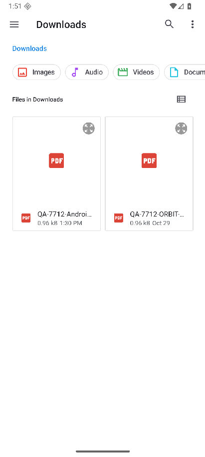
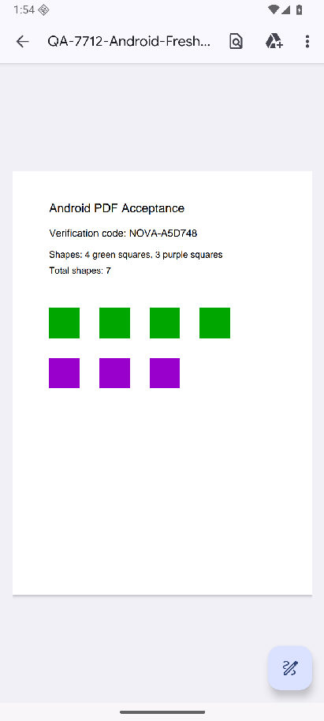
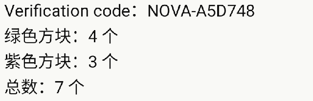

# PR #7712：Android PDF 完整链路验收记录

## 结论与范围

2026-10-30，针对已合并的 [PR #7712](https://github.com/makecindy/cindy/pull/7712)
完成 Android 模拟器 PDF 完整链路验收：系统选择文件、线上群聊发送、打开 PDF、
退出后重进历史、下载字节回读及伙伴内容问答全部通过。

验收负责人转达黄小文确认，本项允许模拟器代替真机。此结论限于下面的 Android
环境与测试提交，不扩展为 iOS、物理设备或后续主干变更均已通过。

## 被测构建

- 源码：`b24232bb01f3f56ea19d460fc0c5df1c8da79f8e`，即 #7712 最终 head。
- 环境：Android API 36 / Google APIs / arm64-v8a 模拟器。
- 安装包：本地调试签名的独立 release APK，内置 `assets/index.android.bundle`，
  原生 OTA 关闭，未启用 mock；停止 Metro 后实际执行验收。
- 安装后整包读回 `verification=confirmed`、`matchesLocal=true`。
- APK SHA256：`e56a2b9f72aa8d5b0e1f0a89e7c1e7529dac5b5bbe395de17cd8d09bba8d2f89`。
- 测试源码工作区当时干净，没有为通过验收修改业务代码；本 PR 只保存验收证据。

## 操作与结果

| 步骤 | 实际操作与可观察结果 | 结果 |
| --- | --- | --- |
| 原生选择 | 既有 QA 群输入框 → `+` → `File` → Android `Downloads`，选择新 PDF，附件返回输入框 | 通过 |
| 线上发送 | 发送附件和不含答案的内容识别请求，群历史收到 PDF 与文本；未把初始 `Queued` 状态计为成功 | 通过 |
| 历史重进 | 返回会话列表后重新进入同群，PDF 附件和提问保留 | 通过 |
| 打开 | 点击群内 PDF，经线上下载后点 `Open`，查看文档文字及彩色方块 | 通过 |
| 字节完整性 | 将浏览器下载副本回读，与原始样本逐字节比较，962 bytes、SHA256 完全一致 | 通过 |
| 伙伴问答 | 仅 @ 一个已恢复模型连接的伙伴，附件实际交付，取得完整最终回复并与样本对照 | 通过 |

## 样本和问答

使用[新生成的受控 PDF](pr-7712-android-pdf/sample.pdf)，避免之前群历史中的旧样本答案干扰。
样本大小为 962 bytes，SHA256：
`55d2bccdae1a5d2eed208c0779a808475e55c607d700dbdd01a484c131be4d2a`。

补测请求标签为 `QA-7712-PDF-RECHECK-1430`，要求读取本条附带 PDF，回答
`Verification code`、各颜色方块数量和总数；请求没有提供预期识别码或数量答案。
宿主确认当前 PDF 附件 `delivery=included`。

2026-10-30 14:09:57（Asia/Shanghai），伙伴实际完成回复，`turnCompleted=true`：

```text
Verification code：NOVA-A5D748
绿色方块：4 个
紫色方块：3 个
总数：7 个
```

上述内容与 PDF 文字及图形完全一致。对应[机器可读回执](pr-7712-android-pdf/receipt.json)
保留测试提交、安装包指纹、样本与下载副本哈希、检查结果和回复完成状态。

## 中断与限制

- 首轮伙伴执行在模型创建前被 `LAZY_CREATE_FAILED` / `REMOTE_AGENT_SHARE_UNAVAILABLE`
  阻塞，未进入 PDF 阅读。经原生伙伴设置换为本机已连接的 OpenAI 来源，保留
  GPT-6.1-Sol / Codex / Medium、Fast 关闭和原备用路线；补测运行时实际读回新来源，
  随后收到以上正确回复。模型配置修复是本机验收环境操作，不属于本 PR 的产品代码变更。
- 另一伙伴的未完成尝试不计为成功；本次问答结论来自已实际完成回复的伙伴。
- Metro 驱动的 debug 包两次在系统选择器返回后重载，待发送草稿丢失。改用同源码、
  内置 JS 的独立 release 包后链路通过；没有据此宣称 debug 重载根因已修复。
- 未补充 iOS、物理设备、多系统版本、网络故障或大文件压力测试。
  APK 为本地测试构建，不在此分发，也不代表正式商店安装包已验收。

## 截图

公开截图仅展示受控文件与结果，不含真实账号、电脑名或私密历史；问答图为从现有成功回复
直接截取的区域，未改写画面文字。问答完成时间见上文，区域截图留存时间为
2026-10-30 14:58:43（Asia/Shanghai），没有为截图重发请求。

### Android 原生选择器



### 线上下载后打开 PDF



### 伙伴内容问答


