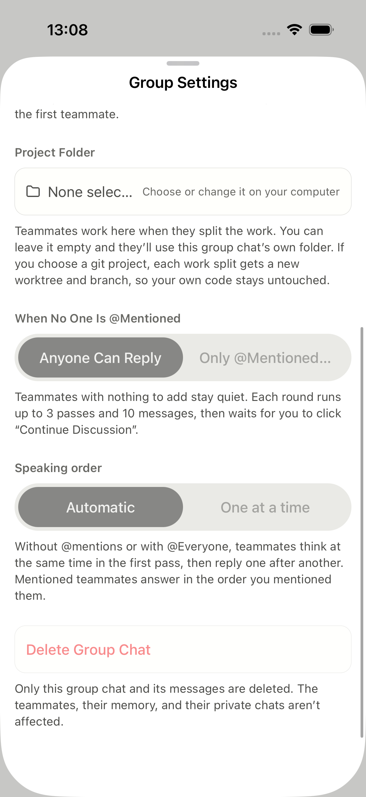
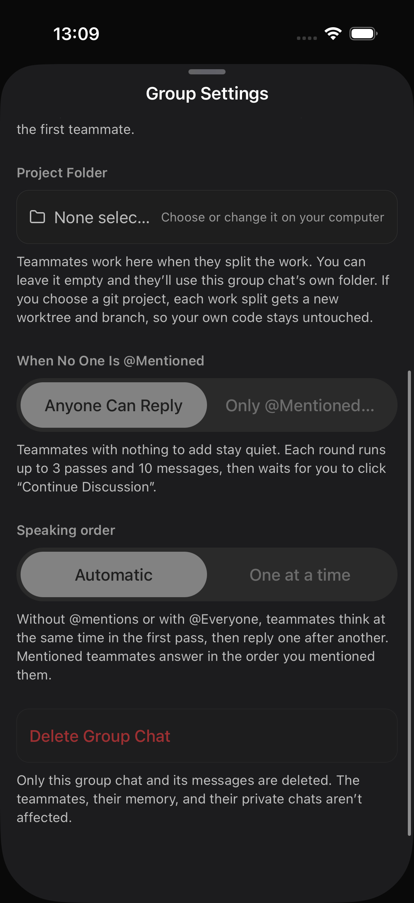
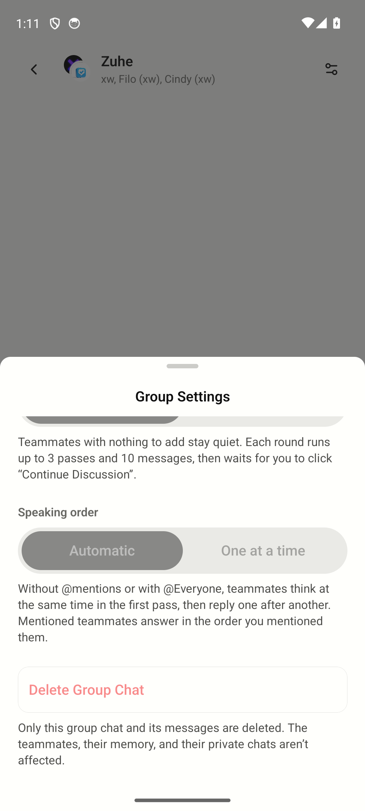
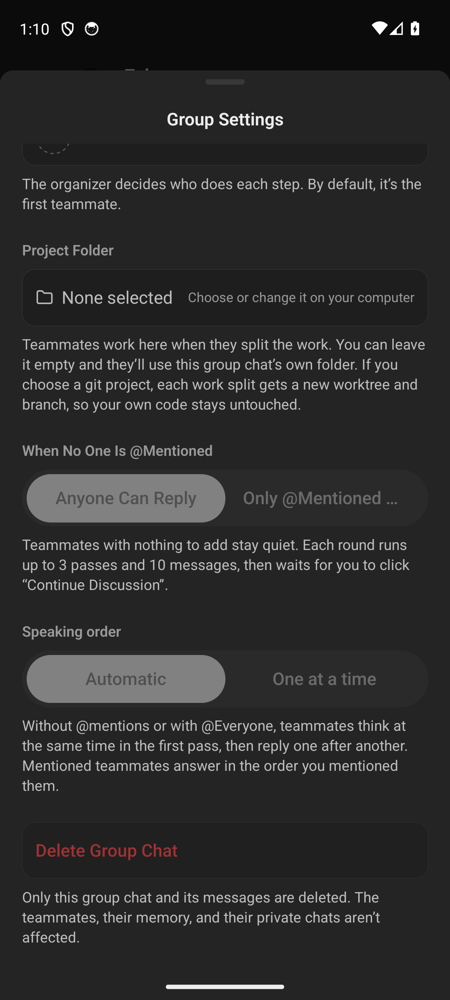

# 群设置滚动验收

2026-10-11，在隔离分支 `fix-ios-group-scroll-validation` 上验证。交付基线为 main `9fb768f197b32ac26b9cd9f1824ef1c16806fec8`，修复参考 [#5295](https://github.com/makecindy/cindy/pull/5295) 的 `06b8cfaa18aaecfcd3379238db68f48fad724364`，对应 [#5288](https://github.com/makecindy/cindy/issues/5288)。保留基线的 nativeList 行为，未改 Android 实现或原生配置。

原生验收在 main `f3c263a36651dd900cc4c4dbd4130d4f77f7af13` 上完成；随后快进到 #5781 的主干修复，仅同步 Desktop 接线测试，移动端实现未变。截图时的 ComposerSheet Git blob 为 `bc716218949a3d592cb9730fab0f983f3d68e0e5`，与提交中的实现相同。加载源码标签为 `fix-ios-group-scroll-validation@f3c263a36+0d43d19fd0`；同名验证 worktree 的 Metro 8081 已重启并核对归属。身份工具返回 native-matched，页面结果另由原生触摸断言与截图确认。

2026-10-12 的评审调整为导入、待办显式保留主干原有 RN 滚动路径及位置保持，群设置继续使用 SwiftUI 滚动。以上截图对应调整前的组件 blob，不作为这次调整后的运行验收；导入长内容到底、待办刷新位置及群设置半档回归仍待原生验证。

| 平台 | 原生环境 | 实际结果 |
| --- | --- | --- |
| iOS | iPhone 17 Pro / iOS 26.5 Simulator；`com.xd.cindy`，开发版本 `0.1.0`，build `2026072301`；installed / expected fingerprint 均为 `db751101a96df9a650b14c9ed73d9204e4978293` | 半屏打开后滑动展开，底部删除入口及完整说明可见；深色关闭重开后再次滚到底。Maestro 浅色 3/3 flows、深色 flow 通过 |
| Android | Pixel 7 配置 / Android 14 API 34 Emulator；installed / built / expected fingerprint 均为 `d422bc5b1105607a56858f8980e283c38665e9f3`；临时 SwiftShader 软件渲染，未改 AVD 配置 | 半屏滚到底，关闭重开、深色及展开后底部均可达。Maestro 断言通过；拍照前关闭开发警告浮层，未改产品代码 |

| iOS Light | iOS Dark |
| --- | --- |
|  |  |

| Android Light | Android Dark |
| --- | --- |
|  |  |

测试群为现有服务端只读群，删除与名称修改控件按产品规则禁用；未删除、重命名或发送消息。截图证明底部可见，不证明删除确认已验收。

名称输入后的点击取消、放弃草稿与返回列表已在本次 review 版本上补测通过；没有提交创建。DOM 回归仅验证原生滚动/内容桥/footer 组合，不代替原生触摸或软键盘验收。

补测共享 footer 的实际调用方：打开账号切换面板，正文滑动前后「添加账号」均可见，并能关闭面板；未点击添加、未切换账号。没有发布含账号信息的截图。

## 未验证

- 真机：两台已配对 iPhone 均 unavailable，ADB 只有 emulator，没有真机截图。
- 原报 iOS 26.0.1、真正的横屏布局、软键盘收起、可编辑群的设置名称提交与删除确认。
- 后续用可连接且已解锁的真机复验上述路径；删除测试只打开确认并取消，保持 Ready，不自动合并。
