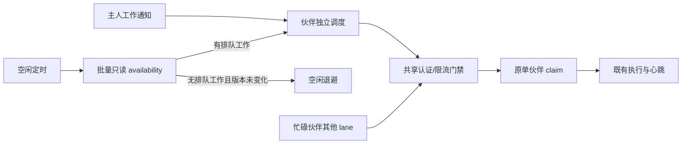

# Chat 工作发现与领取的调度边界

本轮优化针对无任务时的 HTTP/事务成本。批量操作只读队列；实际领取继续沿用主干单伙伴接口。

## 根因与取舍

此前候选方案将多份 60 秒执行租约放进一个 HTTP 响应，收到不确定结果后又建立恢复队列。
聚合响应、串行恢复、忙碌扫描共用全局等待，导致健康伙伴的已领取执行因其它请求排队而过期。
局部错误标志、全局退避和 detached 任务也形成多个授权请求入口；终态回执和队列快照被混用。
这些是调度与协议边界错误，不能靠继续增加 break、重试分支或扩大超时解决。

选用只读批量探测后，探测失败没有未确认租约，能够安全重试或回退。真实 claim 每个请求只取得一个伙伴的结果，
立即进入原执行/心跳流程；本轮不修改其失败语义。单次 claim 的网络不确定结果仍遵守主干租约到期进入 needs_input、
用户显式重试的合同，不新增自动恢复、空回执终结或批量领取 API。

## 状态与所有权

| 状态 | 所有者 | 允许的行为 |
| --- | --- | --- |
| 空闲期限、失败次数、通知版本 | 单个伙伴 | 独立探测/领取；不会阻挡其它伙伴 |
| 只读探测在途 | 探测器 | 最多 4 批、每批 128；新通知可越过它 |
| 领取或忙碌扫描在途 | 单个伙伴 | 互斥，防止同伙伴重复领取/重复扫描 |
| 认证续期等待、失败 401/429 截止时间 | 账号与 endpoint 的共享门禁 | 续期中暂停新工作请求；失败退避只延长，成功不清除其它限流 |
| 已领取执行与心跳 | 既有执行运行时 | 保留原权限、epoch、同 lane 顺序与 15 秒续租 |
| 身份登记重试 | 后台登记器 | 后台独立退避，普通读复用缓存，显式动作按前台流程完成必要登记 |

批量读取不取得执行权，pending=true 也不代表权限允许领取。服务端 claim 必须继续复验所有权、主力设备、成员、
来源可见性、授权版本与队列顺序。只读空状态只对查询时的队列成立；客户端用通知版本保护，过期响应不得清除新提示。
普通 claim 返回 null 也不能代替全队列空证明。

后台身份请求通过显式的 `backgroundIdentity`（请求函数及本地延后分类）注入云端伙伴运行时，覆盖安装归属的读取/CAS、自动到达时的主力确认、
删除登记的后台重试；它与工作发现共用门禁。消息镜像、资料同步、已领取执行和用户明确发起的接管/删除保持原请求通道。
不能按 `/preferences` 路径统一拦截：安装归属确认与资料同步共用该路径，必须在调用职责上区分。

认证屏障由共享令牌刷新过程持有，所有等待请求在该过程完成并释放屏障后重放；不由每个等待请求分别持有。
令牌已经写入本地但刷新尚未完成时，晚到的 401 也等待同一个过程，避免成功续期后相互阻挡或丢失安装确认。

忙碌扫描按请求开始时捕获的提示对象清理，不能删除期间新建的 Map 或同房间的新提示。显式交出/合并所需的
完整资料同步将前台请求通道贯穿登记、主力确认与资料发布；后台轮询仍用受控通道，避免前台动作被本地后台门禁误报离线。

登记调用必须显式声明前台/后台，不能依赖默认参数：定时轮询、通知重同步、缓存预取与自动迁移走后台；
群管理、首个前台读取、伙伴选择、已有任务投递和用户操作的主力重读走前台。前台等待了在途后台登记时，
只对「后台请求尚未获准发出」的本地延后在前台继续，真实服务端错误仍正常返回。运行时也分别注入后台刷新与前台刷新回调。
旧群迁移同样显式区分自动触发与前台等待：前台打开旧群可接续被后台延后的迁移；未发登记请求不缓存成迁移失败，
真实迁移故障仍保留原重试与续传规则。

工作发现与登记解耦，登记失败不暂停其他伙伴；但探测报告 `enabled:false` 的伙伴在重新读到 `/actors` 前
不再从缓存参与探测或领取，避免登记持续失败时每 2 秒重复探测。读取在途期间到达的禁用报告保留到下一次读取。
actor 流 `RESET_REQUIRED` 时先重读伙伴与主力电脑，再从新游标续订和领取。

安装复查的本地延后保留已有确认及其原检查时间，不能把未发请求当作归属被撤销，也不能延长缓存新鲜度；
未知安装仍保持未确认。真实检查失败保留原失败处理；旧检查失败不能清除后来建立的确认。

## 验收不变量

1. availability 前后执行 status/epoch/lease 和操作回执数量不变；越权请求不能得到任何他人信息。
2. 一个慢伙伴、慢探测或长扫描不能延迟另一个伙伴已经返回的单项领取结果。
3. 同一伙伴最多一项领取/扫描；探测与通知竞争不会重复领取或丢掉新提示。
4. 可续期 401 一经观察，暂停所有未发后台工作请求；续期成功沿用原即时重发，失败进入认证退避。429 与最终 401 设置共享截止时间，成功不能清除它。主力登记子请求与认证后的重发均逐请求检查；仍有效的本地登记缓存不因网络门禁失效。
5. 新通知可直接领取，空闲最多 60 秒兜底需完整空队列证明和可靠通知；旧服务器和断线仍用 15 秒上限。
6. 账号切换、暂停、主力电脑变化及 lease/epoch 失效不扩大执行权限；未知网络结果不被解释为成功执行。

保留既有授权、租约、Thread 和主力设备测试；新增真实 PG 只读性测试及独立调度模块的组合场景测试。
旧候选方案的批量租约/恢复专属测试随该未发布功能移除，不将其通过数量当成正确性证据；对应根因通过上述不变量验证。
无新环境变量、Schema 迁移或外部配置；部署仍建议服务端先行。旧服务器缺少探测路由时安全回退单项轮询。
服务端声明 AI 代答（`personalMask:1`）时同样回退单项轮询：探测只读普通与成员加入队列，空结果会让代答与私人汇总
无人领取；在服务端探测覆盖代答队列前不能对它启用。回归见 `chatServer.test.ts` 的代答领取用例。
