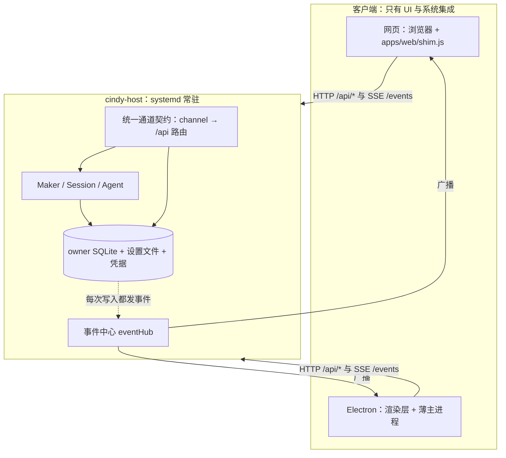

# Debian A1 交接文档：Host 作为唯一 Runtime，Web 与桌面端同步

> 本文取代 2026-11-06 的初版。初版只是"换二进制"的操作清单，没有回答"两端如何保持一致"，
> 且有若干与代码不符的判断，已在「初版文档的纠错」一节逐条列出。

## 1. 目标

Cindy 的智能体核心（Host）在后台常驻，网页端与 Electron 桌面端都只是连接它的客户端：

- **Host 是唯一的 Runtime 与唯一的写者**：Agent 进程、会话、消息、数据库、设置文件、登录态
  与凭据的读写权只在 Host。
- **Web 与 Electron 平级**：打开网页版和打开桌面客户端，看到的账号、任务列表、任务内容、
  设置、模型配置完全一致。
- **两端实时同步**：任一端发消息、停止任务、改名、归档、改外观或布局，另一端无需手动刷新
  即可看到。
- **客户端可随意开关**：关掉网页或桌面，Host 与正在跑的任务不受影响；重新打开能恢复到同一状态。
- **不丢存量**：沿用现有 profile 的数据库、登录态与插件；用户什么都不用重装、重登或重配。

这与 `docs/host/architecture-and-status.md` 的"目标边界"和 issue 136/137 一致，本文只补
"如何在 Debian 这台机器上把它做成"。

## 2. 最终形态



验收时应能做到：

1. 两端登录同一账号，会话列表逐条一致。
2. 在桌面发一条消息，网页端同时看到流式回复；在网页点停止，桌面立即停。
3. 在任一端重命名、置顶、归档任务，另一端在 1 秒内更新。
4. 在任一端改外观、布局、侧栏、快捷键，另一端同步更新。
5. 关掉所有客户端，Host 仍在运行，任务继续；重开后恢复到同一画面。
6. 同一时刻只有 Host 进程持有 profile 的数据库写连接与 Runtime 租约。

## 3. 现状（已读代码核实，2026-11-06）

### 已有

- Host 进程、`/api/*` 路由、SSE `/events`、`/chat`、输入队列、权限确认协议，均已在 Host 内实现。
- Host 已能读写桌面的设置文件（`apps/host/src/profile-settings.mjs`），并由
  `bootValues` 注入网页。
- Desktop 客户端模式：发现 `host-endpoint.json` 后设置 `setMakerClientMode(true)` 与
  `setHostClientMode(true)`，用 `registerHostDelegatedIpc` 代理约 30 个通道，并把 `/events`
  回灌到 `maker:event`（`apps/desktop/src/main/host-delegation.ts`）。
- 单 Runtime 租约：同 profile 的第二个 Host 会报告 `blocked`。

### 为什么两端至今不同步

| # | 根因 | 证据 |
|---|---|---|
| R1 | **两端各有一张通道表，且覆盖不同**。桌面只代理约 30 个通道（`PROXIED_CHANNELS`）；网页 shim 有上百条路由，其中大量返回写死的空值（`maker.listActive`、`localDb.bots.list`、`worktreeListAll`、`deviceLink.*` 等）。两端的数据来源本来就不同。 | `host-delegation.ts`、`apps/web/shim.js` |
| R2 | **客户端模式下桌面主进程跳过全部 `maker:*` 注册**，未代理的通道在桌面端要么报"没有 handler"，要么显式失败，侧栏等界面缺内容。 | `bootstrap-electron.ts` 的 `registerMakerIpcsAfterSplash` 在 `hostClientMode` 时直接 return；`docs/host/electron-client-mode.md`「明确未迁移」 |
| R3 | **写操作不发事件**。`updateSession`、`createMessage`、`createSession` 写库后不向 `eventHub` 发布；设置里只有外观发了 `appearance_changed`，且两端都没有消费它。另一端只能靠下次主动读才能看到变化。 | `apps/host/src/main.ts`；`apps/web/shim.js` 只在本地 `emit` |
| R4 | **设置文件有两个写者**。Host 与桌面主进程都直接写同一批文件（外观、布局、侧栏、快捷键），没有文件监听，也没有通知。 | `profile-settings.mjs` 与桌面 `appearanceSettings` 等模块 |
| R5 | **桌面端 `localDb.ensureReady` 在客户端模式下直接返回失败**，而网页 shim 对同一通道直接返回 `{ready:true}`，两端启动门行为不对称。`local-db:ensure-ready` 不在代理列表里，渲染层 `LocalDbGate` 会调到它。是否真会卡住**尚未实测**（见步骤 S0）。 | `localDb/index.ts` 的 `isHostClientMode()` 早退；`registerAll.ts` 注册了该 handler |
| R6 | **原生模块 ABI 冲突（已有机制，S1 实测通过）**：`electron-rebuild` 会覆盖 hoisted 的根 `better-sqlite3`（Node ABI），让 Host 起不来。仓库已有 `scripts/ensure-deps.mjs`：把 Electron 版产物放进 `node_modules/.xdt-electron-native/…`，随后恢复根目录 Node ABI；`betterSqliteFactory.ts` 在 dev Electron 下自动选用该缓存。 | `docs/host/electron-client-mode.md` 末行（该说法已过时）；`docs/host/evidence/a1-s1-native-abi.md` |
| R7 | **登录态共享刷新有竞争风险**：Host 与桌面读写同一份 keyring 里的 refresh token，两边同时轮换可能让会话失效。 | `apps/host/src/auth/refresh.mjs` |
| R8 | **版本与二进制不一致**：安装版 0.1.109 的 migration 只到 128，dev Host 已到 129；安装版不含客户端模式代码，也不会进入客户端模式，只会自己打开数据库。 | 初版文档背景；`host-delegation.ts` 仅存在于 feat 分支 |

### 当前机器状态

- `cindy-host.service`：disabled，已停。
- `cindy-desktop.service`：enabled，跑安装版 0.1.109，持有 DB。
- `feat/cindy-host` 已推送，最新提交含本文。
- 迁移前备份：`~/.config/CindyGlobal/cindy-cmv9i0xz401c8yg013q3zkqb0.db.bak.2026-11-06T09-21-16-798Z`，
  另有 `...db.hostmigrated-*`。

## 4. 初版文档的纠错

| 初版说法 | 问题 | 改为 |
|---|---|---|
| 第 1 步"构建桌面端二进制，先 `pnpm --filter desktop dev` 试跑" | 没提 R6：dev 桌面与 Host 共用同一 `node_modules`，ABI 互斥，两者起不来 | 先解决原生模块路径隔离（步骤 S1） |
| 第 3 步"桌面以 client 模式启动即可" | 忽略 R2：客户端模式会跳过全部 `maker:*` 注册，未代理通道缺失，界面不完整 | 先补齐通道契约（步骤 S2–S4） |
| "实时双向同步：双方都连同一个 host 事件流后自动成立" | 错。R3：写操作不发事件，设置没有通知路径，"连同一个事件流"不会自动同步任何东西 | 增加"写即发事件"与两端订阅（步骤 S5–S6） |
| "现有改动清单"把 shim 读取设置当作同步 | 那只是两端读同一批文件，不是同步；且 R4 的双写者与 Host 单写者原则矛盾 | 设置写入权收回 Host（步骤 S6） |
| 验证只列了 4 条人工观察 | 缺少 R5/R7 的检查，且无法区分"各读各的"与"真同步" | 见第 7 节验收清单 |
| 未提登录态竞争 | R7 | 步骤 S7 |

初版里**正确**并保留的部分：先统一二进制与 schema 再让两边共用同一 profile；已有数据库备份与
回滚方式；Host 不托管、不被 Desktop 拉起。

## 5. 做法

### 5.1 原则

1. **单一通道契约**：新增一份"渲染层通道 → Host API 路由 + 参数/返回映射"的共享表，网页 shim
   与桌面代理都从它生成，不再各维护一张。
2. **数据归 Host**：凡是 profile 数据（数据库、设置文件、凭据），读写都经 Host；桌面主进程在
   客户端模式下不直接写。
3. **写即发事件**：Host 每个写入 API 在成功后向 `eventHub` 发布一个带类型的变更事件。
4. **未覆盖要诚实**：契约里没有的通道，两端都明确返回"不可用"，不得再由 shim 编造空值冒充可用。
   这样差异会直接变成清单，而不是隐藏的不一致。
5. **纯客户端 Electron 与 Host 用不同的原生模块目录**，不再依赖同一 checkout。

### 5.2 事件契约（新增）

| 事件 type | 触发 | 载荷 | 客户端动作 |
|---|---|---|---|
| `session_changed` | 会话创建/更新/归档/删除/置顶 | `{ sessionId, patch? , status }` | 刷新列表项 |
| `message_created` | 写入消息 | `{ sessionId, messageId }` | 若正在查看则追加 |
| `settings_changed` | 外观/布局/侧栏/快捷键/语音设置写入 | `{ domain, value }` | 更新本地镜像并触发各自的 `onChanged` |
| `project_aliases_changed` | 项目别名写入 | `{}` | 刷新项目分组 |
| `ghosts_changed` | 已有 | 已有 | 已有 |
| `appearance_changed` | 已有，并入 `settings_changed` | — | — |

事件必须带单调递增序号，客户端重连后能用序号补读，避免断线期间丢更新。

## 6. 实施步骤

每一步都要有可复现的验证命令和日志，不以"接口存在"作为完成依据（沿用
`docs/host/feature-parity.md` 的口径）。涉及数据库、凭据、systemd、对外发布等动作，执行前先
向用户确认。

### S0 · 基线实测（只读，不改代码）

- 在独立 profile（`CINDY_HOST_DATA_DIR` 指向临时目录，**不要**用真实 profile）起 Host，再以
  客户端模式起桌面，记录：
  - `local-db:ensure-ready` 的实际结果（R5）。
  - 侧栏、设置、登录等界面缺哪些通道，输出一份"桌面端缺失通道清单"。
  - 网页端同样输出一份"shim 返回写死空值的通道清单"。
- 产出：`docs/host/evidence/a1-baseline.md`，作为 S2 的输入。
- 完成判据：两张清单都有，R5 已得出确定结论。

### S1 · 隔离原生模块（解决 R6）

> **2026-11-06 已完成**：不需要新造机制，`node scripts/ensure-deps.mjs` 已生成 Electron 专用绑定并恢复根目录 Node ABI，两份二进制并存，Host 的 Node 加载验证通过。证据见 `docs/host/evidence/a1-s1-native-abi.md`。下面保留原设计作参考。

- 目标：Host 用 Node ABI 的 `better-sqlite3`，Electron 用 Electron ABI，互不覆盖。
- 做法（任选其一，先试 a）：
  - a. 给 Host 指定独立的原生模块目录（例如独立的 `apps/host` 依赖安装，或 Host 通过环境变量
    指定 `better-sqlite3` 绑定路径）。
  - b. 从桌面 `node_modules` 之外为 Electron 单独做 `electron-rebuild` 输出目录。
- 参考：`docs/dev-rules/environment-setup.md`；动手前读它。
- 完成判据：同一台机器上 Host 与 Electron dev 同时运行，互不报 ABI 错误。

### S2 · 建立统一通道契约

- 新增共享模块（放在 `packages/` 下，符合依赖方向；先读 `docs/dev-rules/architecture-invariants.md`），
  内容为通道表：渲染层通道名、Host 路由、参数映射、返回映射、是否同步通道。
- 把桌面 `PROXIED_CHANNELS` 与 shim `routes` 中**已经走 Host** 的部分迁进该表；
  shim 里写死空值的部分单独标记为 `unsupported`，不再返回假数据。
- 桌面与 shim 都改为从该表生成，删除各自手写的重复映射。
- 单元测试：契约表本身的完整性（无重复通道、路由存在）。按 AGENTS 的测试价值门槛，只测
  可观察的不一致，不为覆盖率加用例。
- 完成判据：两端对同一通道的映射来自同一个文件，且 S0 的两张清单被这张表完整覆盖。

### S3 · 补齐 Host 侧缺失的读通道

- 按 S0 清单，优先补用户首屏必需的：项目别名、最近工作目录、会话标签、侧栏相关查询。
- 每补一条，就同时在契约表里登记，两端自动获得。
- 无法在 Host 实现的（插件沙箱、scheduler、device-link、文件选择对话框等），在契约表中标记
  `unsupported` 并写明原因，两端行为一致（显式失败，界面走既有空态）。
- 完成判据：S0 清单中的"首屏必需"项清零，其余项均有明确状态。

### S4 · 桌面客户端模式修正

- 让客户端模式下的 `local-db:ensure-ready` 不再失败：改为向 Host 确认就绪并返回 `{ready:true}`，
  与网页一致（R5）。保留"桌面不得自己打开数据库"的守卫。
- 客户端模式下，未在契约内的 `maker:*` 通道改为显式 `UNSUPPORTED_CAPABILITY`，不再出现
  "没有 handler"。
- 完成判据：客户端模式桌面无报错进入主界面，侧栏与网页端相同。

### S5 · Host 写即发事件

- 在 Host 的会话创建/更新/删除、消息创建、项目别名、设置写入处统一发布第 5.2 节的事件。
- 事件带递增序号；`/events` 支持从某序号补读，重连不丢。
- 测试：用真实 HTTP 调用写入，断言 `/events` 收到对应事件；断线重连后补读成功。
- 完成判据：用 curl 改一个会话标题，另开的 SSE 连接立即收到 `session_changed`。

### S6 · 两端订阅事件；设置写入权收回 Host

- 网页 shim 与桌面事件桥都消费 `session_changed`、`message_created`、`settings_changed` 等，
  更新本地镜像并触发渲染层已有的 `onChanged` 回调。
- 客户端模式下桌面主进程的设置写入全部转发到 Host（外观、布局、侧栏、快捷键、语音输入），
  不再直接写文件，消除 R4 的双写者。
- 完成判据：
  - 网页改外观，桌面 1 秒内变；反向同样。
  - 网页重命名任务，桌面侧栏 1 秒内变；反向同样。

### S7 · 登录态单写者

- 凭据刷新只由 Host 执行；桌面客户端模式下向 Host 查询 `auth.getState`，不再自己刷新 refresh token（R7）。
- 完成判据：两端同时在线运行超过一个 token 周期，不出现登录失效；日志里只有 Host 做刷新。

### S8 · 版本与 schema 对齐，真实 profile 切换

此步动数据，**必须先向用户确认**。

1. 停 `cindy-desktop.service`，并确认没有其他进程占用数据库。
2. 重新备份真实 profile 的数据库与 `safe-storage`（沿用既有备份命名，不覆盖旧备份）。
3. 用 feat 分支构建的桌面产物替换 `cindy-desktop.service` 里的二进制，并让它以客户端模式启动
   （自动发现 `host-endpoint.json`，或设 `CINDY_HOST_API=http://127.0.0.1:3456`）。
4. `systemctl --user enable --now cindy-host.service`，让 Host 持有 profile 并迁移到 seq 129。
5. 先启动 Host，再启动桌面。
6. 桌面版本号显示改为真实版本，不再是 `0.0.0-host`（读取桌面包版本）。
- 完成判据：第 7 节全部通过。

### S9 · 收尾

- 更新 `docs/host/architecture-and-status.md`、`feature-parity.md`、`electron-client-mode.md`，
  把已达成与仍未达成项如实写回；把"Electron 不参与 Runtime"在真正验收后才标为达成。
- 纯文档改动运行 `pnpm check:dev-docs`；代码改动按风险跑 `pnpm test:unit:related` 与相关
  package 的类型检查。

## 7. 验收清单

| # | 验收项 | 做法 | 通过标准 |
|---|---|---|---|
| 1 | 同一账号、同一列表 | 网页与桌面同时打开 | 账号相同，会话列表逐条一致 |
| 2 | 桌面发送，网页实时可见 | 桌面发消息 | 网页流式出现回复，终态相同 |
| 3 | 网页停止，桌面停止 | 回合中网页点停止 | 桌面 1 秒内停止 |
| 4 | 任务元数据同步 | 任一端重命名、置顶、归档 | 另一端 1 秒内更新，无需刷新 |
| 5 | 设置同步 | 改外观、布局、侧栏、快捷键 | 另一端 1 秒内更新 |
| 6 | 客户端可关 | 关掉两端 | `/health` 仍 `ready`，任务继续；重开后画面一致 |
| 7 | 单写者 | `fuser -v` 看租约与数据库 | 只有 Host 进程持有 |
| 8 | 登录态稳定 | 两端同时运行超过一个 token 周期 | 无登录失效，只有 Host 刷新 |
| 9 | 差异可见 | 查看契约表中 `unsupported` 项 | 两端对这些项行为一致，且在文档里有清单 |
| 10 | 存量不丢 | 对比切换前后 | 任务、消息、插件、登录态均在，用户无需重装或重登 |

## 8. 风险

- **数据库 schema**：Host 会把数据库推到 seq 129，安装版客户端无法再打开（`MIGRATE_FAILED`）。
  S8 之前不得让 Host 触碰真实 profile。
- **凭据**：不得把任何令牌或密钥写入仓库；真实凭据只通过 keyring 与既有 `safe-storage` 文件流转。
- **协议与存量兼容**：契约表改动属于跨端 wire protocol，改前先读
  `docs/dev-rules/protocol-compatibility.md`；插件存量必须照旧可用。
- **并发**：S6 之前桌面主进程仍会写设置文件，不要在两端同时大量改设置做验收。
- **打包**：Electron Forge 打包本机曾出现 V8 堆 OOM 与 `sharp` 原生依赖缺失，属既有问题；
  S1 之前先用独立 profile 验证，不用打包产物。

## 9. 回滚

如果 S8 之后出现数据异常或启动失败：

1. 停止 `cindy-host.service` 与桌面端。
2. 恢复数据库：
   ```bash
   cd ~/.config/CindyGlobal
   cp cindy-cmv9i0xz401c8yg013q3zkqb0.db.bak.2026-11-06T09-21-16-798Z cindy-cmv9i0xz401c8yg013q3zkqb0.db
   rm -f cindy-cmv9i0xz401c8yg013q3zkqb0.db-wal cindy-cmv9i0xz401c8yg013q3zkqb0.db-shm
   ```
3. 把 `cindy-desktop.service` 恢复为原内容（备份：`cindy-desktop.service.bak-20261106-163441`）。
4. `systemctl --user daemon-reload && systemctl --user start cindy-desktop.service`。

S8 里重新做的备份用其自己的文件名；回滚时以**最近一次**备份为准，并先确认它早于 Host 的首次迁移。

## 10. 相关文档

- `docs/host/architecture-and-status.md`：架构、依赖图与总体状态
- `docs/host/electron-client-mode.md`：桌面客户端模式
- `docs/host/feature-parity.md`：功能保留清单
- `docs/host/systemd.md`：systemd 安装说明
- `docs/dev-rules/protocol-compatibility.md`、`docs/dev-rules/environment-setup.md`

## 2026-11-06 修复记录（本次会话）

### 已修复并验证

1. **模型选不了 / 发消息无反应**
   - 根因：`safe-storage` 主密钥在 2026-11-03 12:42 被 keyring 重建，10 月 16 写入的
     `owner_<ownerKey>_provider_key_magpie-debian_{claude-code,codex,pi}.enc` 全部
     `bad decrypt`；`magpie-debian` 被跳过 → 所有会话（`group/deepseek`）在发送时
     `LAZY_CREATE_FAILED`，模型选择器也解析不出模型。
   - 处理：从 `~/.config/magpie/caller-keys.json` 取回有效网关 key（实测
     `http://127.0.0.1:3426/v1/models` 返回 471 个模型，含 `group/deepseek`），
     用当前主密钥重写 5 个 provider key 记录，原文件备份为 `*.bak-2026-11-06T10-23-35-956Z`。
   - 验证：`read custom provider key failed` 0 次；`custom providers merged into active
     catalog { count: 1 }`；`LAZY_CREATE_FAILED` 0 次。

2. **gpg / pass / inua-keyring 的 pinentry 硬失败**
   - 根因：`~/.gnupg/gpg-agent.conf` 指向 `inua-pinentry`，Inua IPC 不可达时报
     `Pinentryがありません`，连锁导致 pass → inua-keyring → safeStorage 不可用。
   - 处理：新增 `~/.local/bin/gpg-pinentry` 选择器（默认 `pinentry-gnome3`，可用
     `INUA_PINENTRY=1` 切回 Inua 对话框），`gpg-agent.conf` 指向它。
   - 验证：gpg 不再报 “Pinentryがありません”，改为等待对话框（超时 124）。

3. **IM 凭据残留**
   - `im_owner_*_telegram-owner-user-id.enc` / `-updates-offset.enc` 同样 `bad decrypt`，
     已移到 `*.stale-20261106-193118`，由应用重建（Telegram offset 归零，可能重放最近更新）。

4. **防止再次把安装版数据库迁移坏**
   - `cindy-host.service` 已 `disable` + `stop`。A1 完成（构建同版本客户端）后再 `enable`。

### 仍未修复（需要单独处理）

- `db-worker worktreeReferences: unsupported task reference schema`：某个 worktree 引用
  的数据形状比安装版新，属数据层面问题，未擅自改库。
- 版本号显示 `0.0.0`：安装包元数据问题，需重新打包。
- `device-link` relay / 远端机器（macbook）离线：外部状态。
- 网页端侧栏 25+ 通道、模型目录、实时同步：属 A1 后续工作。

### 回滚说明修正

早先文档提到的 `cindy-desktop.service.bak-20261106-163441` 并不存在；原 unit 内容已在
本文件「当前状态」一节之外单独记录于 git 历史（commit `3c40a50675` 之前的会话记录）。
恢复方式：按本文件步骤 3 重新写入 unit，或 `git log -p -- apps/host` 查阅对应配置。

## safeStorage 主密钥为什么会变，以及如何不再变（2026-11-06 补）

**“它”是什么**：`safe-storage/*.enc` 的加密主密钥来自 Secret Service 里的一个条目：
`application=Cindy` + `xdg:schema=chrome_libsecret_os_crypt_password_v2`（label
“Chromium Safe Storage”，存在 Inua keyring 里，底层是 pass/GPG）。Chromium 用这个 secret
经 PBKDF2(1 轮, salt “saltysalt”) 派生 AES-128-CBC 密钥。

**为什么会重建**：实测该条目 `created = 2026-11-03 12:42:32`（`application=chrome` 那条同
时间），说明那一刻 keyring 被整体重建（`inua keyring` 初始化/替换/import 或 pass store
重建）。Chromium 找不到旧条目时会**静默生成一个新的随机 secret**，于是 2026-10-16 写入的
密文（`owner_*_provider_key_magpie-debian_*`、Telegram 凭据）全部 `bad decrypt`。

**现在怎么防止**：

1. 已把当前密钥另存为 `~/.local/state/cindy-safe-storage/{Cindy,chrome}.key`（0600）。
2. 新增 `~/.local/bin/cindy-safestorage-guard`：条目缺失时用保存的密钥**恢复**（而不是让
   Chromium 重新生成）；条目存在但与保存值不一致时只告警并把新值另存为 `.drift-*`，
   不覆盖原值。
3. 已接入 `cindy-desktop.service` 的 `ExecStartPre`（先于应用启动）和
   `cindy-desktop-watchdog`（每分钟一次兜底）。
4. 自测通过：临时条目 store → clear → 用保存值恢复，结果完全一致（`match=yes`）。

**注意**：

- 必须通过 `cindy-desktop.service` 启动 Cindy（或先手动跑一次 guard），否则应用可能先于
  guard 生成新密钥。
- 不要执行 `inua keyring replace/import`；若确实要重建 keyring，重建后立刻跑
  `~/.local/bin/cindy-safestorage-guard` 恢复主密钥。
- 保存的 `.key` 是明文（0600）。它和被保护的密文在同一台机器上，安全性依赖文件权限。
