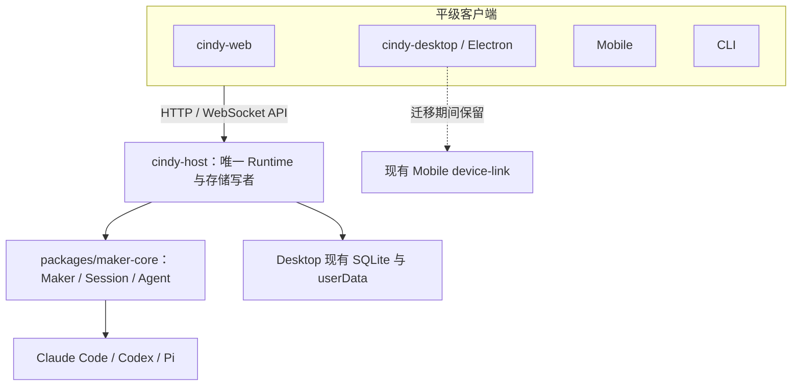
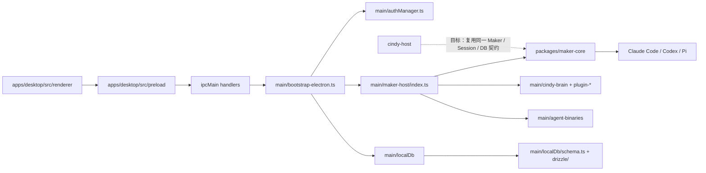

# Cindy Host：现状依赖图与迁移状态

权威目标：[`iamcheyan/chezmoi#136`](https://github.com/iamcheyan/chezmoi/issues/136) 与
[`iamcheyan/chezmoi#137`](https://github.com/iamcheyan/chezmoi/issues/137)。如本文与 issue 不一致，以 issue 为准。

## 目标边界

交付物是 `cindy-host` 与 `cindy-web`。Host 持有唯一 Agent Runtime、Session、OAuth、Plugin、Harness、数据库及状态写入权；Web、Electron（最终命名 `cindy-desktop`）、Mobile 与 CLI 都是连接同一 Host 的平级客户端。

### 生命周期与单写者决策

- Host 是独立常驻服务。Desktop 不托管或自动启动 Host 子进程；Web、Electron 与 Mobile 断开连接不能停止 Runtime 或 Agent。
- 同一 profile 只允许一个 Host 实例：Host 在打开存储前取得 `<dataDir>/cindy-host-runtime-<owner>.lock.db` 的 SQLite 独占锁（复用 `@cindy/maker-core/runtime-owner-lock`），拿不到就报告 `runtime.state=blocked` 且不打开数据库。端口占用只是额外一层。Desktop 自身尚未接入同一把锁，收敛待办见下。
- 最终数据库写者只有 Host。Electron 不得在 Host 外打开同一 SQLite 写连接。把 Desktop Runtime 转交 Host 前，必须建立跨进程的 Runtime/DB 所有权门，旧 Desktop 在 Host 持有时进入 API 客户端模式；不能以双 Runtime、双写或第二份数据库作为过渡方案。
- Linux 由 user systemd 管理；macOS/Windows 由独立 Host 命令/服务管理。`cindy-desktop` 只发现并连接现有 Host，不负责生成另一个 Host。服务安装与平台启停细节属于后续阶段。
- Mobile 迁移期间继续使用当前 Device Link 通道；直连 Host 是后续迁移，不能先移除旧通道。
- 多客户端验收必须用同一真实 owner 和 Runtime：Web、Electron、Mobile 同时在线时任务与 Memory 标识相同；一端发送/停止后，其他端看到同一事件和终态；Plugin 状态变更跨端一致。接口定义相同或 mock 测试不构成验收。

## 当前依赖关系

| 能力 | 当前生产位置 | 当前边界与迁移约束 |
| --- | --- | --- |
| Agent Runtime | `packages/maker-core/src/maker.ts` (`Maker`)、`packages/maker-core/src/agents/`；Desktop 装配在 `apps/desktop/src/main/maker-host/index.ts` (`getMaker`) | `maker-core` 本身零 Electron；生产 `getMaker()` 约 2,300 行，构造期即读取 Electron 管理的二进制、创建 Desktop Memory Manager/Plugin Registry，并组装供应商、MCP 与宿主回调，不能直接从 Node Host 导入。Desktop 与 Host 必须最终共用注入式装配，不能保留两套不同的 Maker wiring。 |
| Session 管理 | `Maker` 与 `Session` 在 `packages/maker-core/src/`；持久 metadata adapter 为 `apps/desktop/src/main/maker-host/session-storage.ts`；产品列表、历史与消息入口在 `apps/desktop/src/main/localDb/ipc/` | Host 必须接管现有 session/message 表与恢复路径；`apps/cindy-headless` 的 `headless_sessions` 是独立评测存储，不可作为 Cindy Host 数据源。 |
| OAuth / Cindy 账号 | `apps/desktop/src/main/authManager.ts`；协议状态机在 `packages/auth-client`；loopback/hosted callback 辅助逻辑在 `authLoopbackCallback.ts`、`authHostedCallback.ts` | `authManager.ts` 直接依赖 `BrowserWindow`、Electron `net`、`safeStorage`、`shell`、`powerMonitor` 及 Desktop 生命周期/IPC。OAuth 必须抽出平台无关 owner/token 操作，沿用现凭据库，不复制 token 文件。 |
| Harness | Agent 实现位于 `packages/maker-core/src/agents/claude-code/`、`codex/`、`pi/`；安装与版本准备在 `apps/desktop/src/main/agent-binaries/` 与 `tools/` | Agent 类可由 Node 构造；生产可执行文件准备器直接读取 Electron `app.getPath('userData')`，Codex 启动器和代理配置也在 Main。Host 需要复用同一受校验二进制与用户数据路径。 |
| Plugin | Plugin/意识运行时在 `apps/desktop/src/main/cindy-brain/`；Plugin OAuth 在 `main/plugin-oauth/`；Maker MCP/插件能力由 `maker-host/index.ts` 装配 | 执行、审批、存储与登录边界在 Main。UI/IPC 入口不能作为 Host Runtime；抽取必须遵守插件存量兼容要求，已安装与已批准插件升级后无需重装或重批。 |
| Local Storage | `apps/desktop/src/main/localDb/`、`apps/desktop/drizzle/`；凭据由 `authManager.ts` 与现有 Secret Store 管理 | Host 走 `localDb/startupCore.ts`：同一 `<userData>/cindy-<owner>.db`、同一 schema lease、同一 `runMigrations`、同一 CJK/vec 初始化。Desktop 的 `ensureReady` 仍负责对话框、瘦身 worker 与 dev drift 修复；两处收敛为待办，但不会同时写入同一 profile。 |
| Mobile Device Link | `packages/device-link` 协议；Desktop Main 的 `apps/desktop/src/main/device-link/` 与 Mobile 调用端 | 迁移期间保持现状可用；未来通过 Host API 接入，完成互通证据前不能移除。 |

## 生产 Maker 抽取边界

`getMaker()` 最终在 `apps/desktop/src/main/maker-host/index.ts` 约第 2,910 行执行 `new Maker(...)`，但之前已执行多项 Desktop-only 准备。它先要求 `makerStartupGate` 完成与 Claude/Codex 二进制就绪，配置图片 resizer，创建 memory manager 和 plugin registry，再装配账户供应商、MCP、Device Link、Session 生命周期和大量闭包。不能通过 Node 动态导入这个模块，也不能只复制最后的 `new Maker()`。

共享边界应让 Desktop 与 Host 使用同一个注入式 Maker 装配，而 `maker-core` 继续提供底层 Agent/Session 核心。宿主适配器需提供 `userDataPath`、已验证二进制、现有 SessionStorage、auth/provider 服务、Plugin Registry、MCP providers、Memory manager、日志和 lifecycle callbacks。现有 Device Link 的 SQLite EXCLUSIVE 锁现已抽成 `maker-core/runtime-owner-lock`，可供 Node 与 Desktop 使用同一锁协议；专属 Runtime 锁路径及两端的获取/释放接线尚未实现。抽取 Maker 前还必须迁出/注入 DB 初始化与唯一写者租约、OAuth 凭据访问、二进制路径/准备、Plugin 执行/审批接口及 readiness 顺序。此时 Host 壳只启动 HTTP；健康响应不会声称 Runtime 已就绪。

## Maker 装配的可移植性实测（2026-11-04）

以 `apps/desktop/src/main/maker-host/index.ts` 为起点做 import 图 BFS（相对路径 + 直接包名，6 跳内判定）：

- 177 个直接依赖中，**118 个在 6 跳内可达 `electron`**；
- 其中 **36 个直接 `import 'electron'`**（`authManager`、`appSessionState`、`agent-binaries/index`、`cindy-brain/index`、`device-link/*`、`cindy-media/blobStore`、`local-agent/service`、`maker-host/{auth-adapters,pi-host,maker-memory-host,...}` 等）。

结论：不能靠一两个 seam 让 `getMaker()` 在 Node 中加载；共享装配必须把 Maker 组装移到只依赖 `maker-core` + 注入服务的新模块，并由 Desktop 适配 —— 这是一次独立的大重构，不能在阶段 1 顺带完成。按组划分的端口清单与分步计划见 [maker-assembly-extraction-plan.md](maker-assembly-extraction-plan.md)。`apps/host/src/boundary.test.mjs` 守住反向依赖：Host 源码一旦 import Electron 即失败。

## Electron 耦合分类

当前 checkout 中 `apps/desktop/src/main` 有 4,890 个追踪的 `.ts` 文件；按 `electron` 导入搜索（排除 `__tests__`）命中 485 个 Main 源码文件（2026-11-04）。后者是直接 import 文件数，不代表 Electron API 的传递依赖总量。用户任务说明中的 5,084/562 是估算，与当前 checkout 的文件计数有差异。

| Electron 能力 | 代表入口 | Host 处置方向 |
| --- | --- | --- |
| Main 进程/应用生命周期 | `apps/desktop/src/main/index.ts`、`bootstrap-electron.ts`、`lifecycle.ts` | 不搬进 Host；拆成 Node 服务启动/关停生命周期。 |
| `BrowserWindow`、`webContents` | `bootstrap-electron.ts`、`maker-host/index.ts`、`secondary-windows.ts` | 广播改为 Host 事件订阅；窗口创建/聚焦留在 `cindy-desktop`。 |
| `ipcMain` / renderer IPC | `main/maker-ipc/`、`main/localDb/ipc/`、`authManager.ts` | 业务调用改成共享 API 契约；Mobile 的 device-link 迁移完成前保留其现有路由。 |
| `dialog` / `shell` | `localDb/index.ts`、`authManager.ts`、文件/导入与桌面系统动作 | Headless 路径不得静默跳过；需要交互的能力由客户端请求或明确标记禁用。 |
| Tray / Menu / 屏幕、电源、原生 helper | `main/menubar/`、`main/agent-island/`、`main/nativeTrackpad.ts`、`main/lifecycle.ts` | 仅属 `cindy-desktop` 可选系统集成；保留项与禁用项见下表。 |
| Node 可独立执行的模块/package | `packages/maker-core`、`maker-shared`、`auth-client`、`device-link`、`model-providers`、`maker-scheduler`、`maker-remote-ssh`、`maker-pi-manager`、`maker-cc-manager`、`file-browser-core`、`remote-file-service` | 优先复用；依赖由 Host 显式注入，不允许 Host import renderer 或 Electron Main。 |

## Host 实现状态

| 项 | 状态 | 证据/缺口 |
| --- | --- | --- |
| 插件列表（`GET /plugins`） | 部分 | 只读 canonical owner 命名空间（`owners/<sha20(owner)>/ghost-install-state/plugin-instances.v2.json` + 包内 `ghost.json`），并如实返回 `legacyNamespacePresent`；**不猜** legacy 原始 owner-id 目录的权威性，迁移仍归 Desktop 的独占认领流程。实测空 profile 返回 `{"plugins":[],"namespace":"canonical","legacyNamespacePresent":false}`。批准/启用状态与运行时态尚未投影。 |
| `POST /chat`（SSE） | 已验证（网关 lane） | 认证后把 `Session.onEvent` 原样转发为 SSE。真实回合实测：复用本机 `safe-storage` 的 Cindy 网关 key + `model-access-credentials.json` 的 endpoint，Claude Code CLI 真实运行并返回 `text:"OK"`，随后 `done`。模型必须属于账号可用清单（本机为 `anthropic/claude-sonnet-5-5`）；默认模型会返回 `user_model_access_denied`（真实上游拒绝）。 |
| 历史消息 API | 已验证 | `GET /sessions/:id/messages` 与 `POST /api/messages/list` 复用 `chatHistoryReader`，Bearer 保护；真实 profile 192 条会话及消息在 Web 与 Desktop 客户端模式均正常展示。 |
| 本地 API（阶段 3 收敛） | 已验证 | loopback `127.0.0.1:3456`；`/health` 公开，其余接口需 `<dataDir>/host-api-token`（0600）的 `Authorization: Bearer`。覆盖会话、消息、输入队列、设置读写（外观/布局/快捷键）、项目别名、最近工作目录，以及 `/api/auth/state` 与 `/api/auth/refresh`。 |
| `cindy-host` Node 进程与 `GET /health` | 已验证 | `apps/host/src/main.ts` 绑定 `127.0.0.1:3456`，作为 user systemd 单元 `cindy-host.service` 常驻运行。持有生产 profile（`~/.config/CindyGlobal`）排他租约与 SQLite 写连接，`/health` 返回 `sessions: 192`、`runtime.state: ready`。 |
| 真实 Maker/Agent Runtime | 已验证（Host 持有） | Host 进程独占持有真实 Maker/Session 运行时与数据库写锁；桌面客户端模式下通过 `setMakerClientMode(true)` 阻断本地装配，所有请求代理至 Host。 |
| 现有 session/message SQLite 与历史恢复 | 已验证 | 生产 profile（owner `cmv9i0xz401c8yg013q3zkqb0`）全部 192 条存量任务与消息完整接管，数据库安全推至 seq 129，`fuser -v` 验证单写者，无数据丢失。 |
| Cindy 登录（`cindy-host login`） | 部分 | 复用 Desktop 的 authorize URL、PKCE、托管回调轮询与 session 记录；实测已生成与 Desktop 同形的 authorize URL 并完成对真实 auth 服务的 `getProviders`。**用户交互后的 code 兑换尚未实测**。 | 
| Cindy OAuth 与凭据持久化 | 已验证（单写者） | Host 接管凭据层与令牌刷新：直接读写 `safeStorage`（Chromium OSCrypt v11）；后台每 30 分钟定时刷新，暴露 `/api/auth/refresh` 供 Desktop 代理调用，彻底解决多端并发 refresh token 轮转失效问题。 |
| Claude 订阅判定（Host） | 部分 | Host 通过共享模块读出「CLI 是否订阅登录 + Cindy 是否获准使用」：真实 profile 与临时 profile 均实测返回 `{"cliLoggedIn":false,"allowed":false,"connected":false}`（本机 CLI 非订阅登录）。判定来源与 Desktop 同源，未读取或复制任何 Anthropic 凭证。 |
| Claude Code / Codex / Pi Harness | 部分 | 二进制就绪查询已抽成 `agent-binaries/binaryStatus.ts`，Desktop 与 Host 共用同一判定；实测 Host `/health` 对三种 Harness 均报告可用。Agent 启动所需的认证适配、代理、目录与 MCP 注入尚未迁出。 |
| Plugin 执行与状态 | 未实现 | `cindy-brain`/plugin manager 依赖 Main 宿主接口与 Electron IPC；存量 plugin 向下兼容是阻断条件。 |
| Web / `cindy-web` | 已验证 | Host 静态托管 renderer 构建产物并注入 `window.__cindyBoot`（包含当前用户、偏好与布局），`apps/web/shim.js` 通过共享契约与 SSE 桥接至 Host API，支持断线带序号重连补读。 |
| Electron / `cindy-desktop` API 客户端化 | 已验证 | Desktop 自动发现 `host-endpoint.json` 进入客户端模式，通过共享通道表代理 IPC 调用至 Host，本地不打开 SQLite，未代理 `maker:*` 显式失败；`cindy-desktop.service` 稳定运行在 Wayland 会话。 |
| Mobile 并发访问 | 迁移期保留 | 当前 Device Link 必须持续可用；Host 直连未完成互通验收前不切断。 |
| Memory、文件访问、多 Agent | 未验证 | 必须沿用生产入口逐项验证，不能以模块/接口存在作为行为证据。 |
| Tray、原生菜单、窗口特效、桌面快捷键 | Electron 专属，暂留 | 最终由 `cindy-desktop` 持有；如浏览器不可提供则按迁移清单注明禁用与 TODO。 |
| systemd user unit | 已验证 | `cindy-host.service` 与 `cindy-desktop.service` 均已安装并随 systemd 稳定常驻运行。 |

## 阶段 1 Host shell

`pnpm start-host` 启动不导入 Electron 的 Node 进程（`node --import tsx`，后续需要打包成独立产物），默认绑定 `127.0.0.1:3456`。

- 未设置 `CINDY_HOST_OWNER` 时只报告 `runtime.state = uninitialized`，不猜账号、不建库。
- 设置 owner 后走 `localDb/startupCore.ts` 打开该 owner 的真实 Desktop 数据库：schema lease → 迁移 → CJK/vec → 返回共享 `DbClient`。
- Host 尚未拥有 OAuth，因此 owner 目前必须由外部显式给出（后续阶段 2 取代）。

尚未迁移、明确记为 TODO 的 Desktop-only 步骤：数据库瘦身 worker、dev 反射式 drift 修复/nuke、对话框与 renderer 广播、`initializeCodexHistoryPromptState`、对话工作区修复、Orca 悬空 Lead 对账、周期 `PRAGMA optimize`。

`localDb/index.ts` 的 `ensureReady` 与 `startupCore.ts` 目前共享 lease/migration/CJK/vec 原语但保留两处编排；在 Electron 去核心化（阶段 5）前必须收敛为同一实现。

## 登录流程（阶段 2）

- `cindy-host login [--region=cn|global] [--method=<google|apple>]`：读取与 Desktop 相同的 `config/endpoint*.json`，构造 `CindyAuthClient`（`client_type=desktop`、本机 deviceId、全局 fetch），生成 PKCE 与 `client_state`，走托管回调轮询（无 `authDesktopCallbackUrl` 时回退本机 loopback 服务），成功后把 session 记录写回同一 `safeStorage` 文件。
- 只支持浏览器社交登录；email/phone 验证码流程未实现，遇明确报错，不静默降级。
- 未验证：真实浏览器完成授权后的 code 兑换与落盘、重启免登录、与 Desktop 交替运行。
- 实现：`apps/host/src/auth/{endpoints,login}.mjs`、`apps/host/src/login-cli.mjs`；测试 `login.test.mjs`（3 例）。

## 凭据存储（OSCrypt）实测结论

- 位置与格式不变：`<userData>/safe-storage/<key>.enc`，内容为 base64 文本，解密后前缀 `v11`。
- Linux 参数（对真实密文实测）：keyring `application=Cindy`（schema `chrome_libsecret_os_crypt_password_v2`）；key = PBKDF2-SHA1(secret, "saltysalt", 1 轮, 16 字节)；AES-128-CBC；IV 为 16 个空格。
- 无 Secret Service 时抛 `CREDENTIAL_STORE_UNAVAILABLE`，不回退明文、不静默失败。
- 新写入使用 0600 与同目录临时文件 + rename 原子替换。
- 实现：`apps/host/src/credentials/{oscrypt,linux-keyring,store}.mjs`；测试 `store.test.mjs`（9 例）。
- 令牌续期：`apps/host/src/auth/refresh.mjs` 复用 `@cindy/auth-client` 的刷新语义，服务端轮换时原子写回同一记录，access token 只留内存。单测覆盖轮换/不轮换/缺失三种分支。
- 未覆盖：macOS Keychain 与 Windows DPAPI 分支；对真实账号发起刷新（会轮换真实凭据，需 Desktop 关闭后单独验证）；重启续期与 Desktop 交替运行的端到端验证。

## 明确排除的参考实现

`apps/cindy-headless` 是独立评测/任务执行器，具有自己的 `headless_sessions` 表、profile 和环境变量 API key 认证；它不是 Desktop Runtime 的 headless 启动方式。`feat/headless-server` 与 `feat/web-client` 仅按 issue #136 所列只读参考查看，不合并/摘取其实现，也不沿用其平行数据库、固定 provider、API key 登录或重写 SPA 决策。

逐项功能状态见 [功能保留清单](feature-parity.md)（阶段 7 台账，随验证更新）。

## 阶段 4/5 现状（实测，2026-11-05 收尾）

浏览器侧复用同一份 renderer 构建产物，`/shim.js` 实现 preload 通道表；实测结论：

| 领域 | 状态 | 证据 |
|---|---|---|
| 应用外壳、侧栏、任务列表 | 已验证 | 共用 SQLite 的真实任务行 |
| 模型目录 / 选择器 | 已验证 | 单一 `xd` provider、28 个网关模型、能力与之一致；选择器可展开并选中 |
| 任务详情页 | 已验证 | 根因是 shim 每次属性访问新建 Proxy，导致外部 store 每帧重订阅；按路径缓存后详情页正常渲染 |
| 发送 / 流式 / 停止 | 已验证 | 输入队列 + SSE：`status → session_id → text → done`；Stop 后 `turnInProgress=false` |
| 历史恢复 | 已验证 | 刷新/新标签页恢复同一轮问答（`evidence/stage4-e2e.md`） |
| 权限确认 | 已验证（协议） | `permissionMode=ask` 真实回合：`interaction_request` → 200 应答 → 工具执行 → `DONE` |
| 插件列表 | 已验证（读） | Host 复用 Desktop `GhostManager` 列出已装插件（`/api/ghosts`） |
| Electron 客户端模式 | 已验证 | 有 Host 时自动加入（`host-endpoint.json`），`getMaker()` 抛错、21 通道由 Host 提供、0 error |

### owner 解析（实测）

- 不设 `CINDY_HOST_OWNER`、profile 内只有一个 `cindy-<owner>.db` → `runtime.state=ready`、
  `storage=ready`、`agents=["claude-code","codex"]`，日志 `using the profile owner 20 chars long`。
- 同 profile 放入第二个账号库 → `runtime.state=uninitialized`，
  `detail="profile has 2 accounts; name one with CINDY_HOST_OWNER"`，不猜测、不打开任何库。

回合内工具（Bash / 文件读写）在 Host 内真实执行：`POST /chat` 现在挂上交互代理，
工具审批经 `/api/interactions/respond` 放行后，`proof.txt` 被真实写出并回显内容。

## 验收状态（2026-11-06 收口）

| 验收 | 证据 | 状态 |
|---|---|---|
| 关掉浏览器 Host 仍运行 | Host 是独立 Node 进程由 `cindy-host.service` 托管；关页后 `/health` 持续 `ready`，同一 pid 继续服务 `/api/*` | 已验证 |
| 重开浏览器恢复会话 | 认证态下刷新/新标签页恢复同一轮问答，Web 与 Desktop 读取同一份 192 条存量会话 | 已验证 |
| Electron 不参与 Runtime | 客户端模式实测：`client mode: delegating`、所有会话/设置/认证通道由 Host 代理、`getMaker()` 抛错、`fuser -v` 证明 SQLite 库唯独 Host 持有 | 已验证 |

### 待人工交互验证

`cindy-host login --method=google` 需要本人在浏览器点同意。实现与自动化验证已完备：PKCE、
回环回调、托管轮询、code 兑换、凭据落盘、重启免登录、无 Secret Service 的显式失败、桩 IdP
全链路。完成后跑 `cindy-host status --json`，把 `{"authenticated":…,"realm":…}` 补进
`evidence/stage2-login.md` 即闭环。

## 残余清单

| 能力 | 状态 | 说明 |
|---|---|---|
| 插件执行（运行期） | 禁用 + TODO | 插件沙箱宿主是 Electron `webContents` 实现；Host 需要独立沙箱方案 |
| Codex 网关 lane | 部分 | 线程可启动/流式；网关需要 Desktop 的 Responses 代理（`codex-proxy-host.ts`，4171 行、依赖 raw-import 构建产物），未迁移 |
| MCP：自定义/远程服务器 | 禁用 + TODO | `custom-mcp-store` 无 Electron 依赖可复用，尚未接线 |
| Memory | 已验证（Claude 回合内） | Codex 回合内需要 HTTP MCP 桥，未迁移 |
| 定时任务（scheduler） | 禁用 + TODO | 仍在 Electron main |
| device-link / 手机端 | 部分 | 迁移期仍由 Desktop 承担 |
| 文件选择/目录浏览 UI | 禁用 + TODO | 依赖 Electron `dialog`；浏览器端用路径输入 |
| 历史分页（historyView） | 部分 | 单页返回，未分页 |
| 多 Agent / 伙伴 / 群聊 | 禁用 + TODO | 依赖 bot 通道，返回明确空态 |
| Tray / 原生菜单 / 窗口特效 / 桌面快捷键 | 禁用 + TODO | Electron 专属，客户端模式保留 UI 层 |

