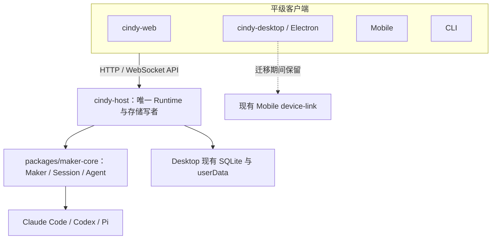
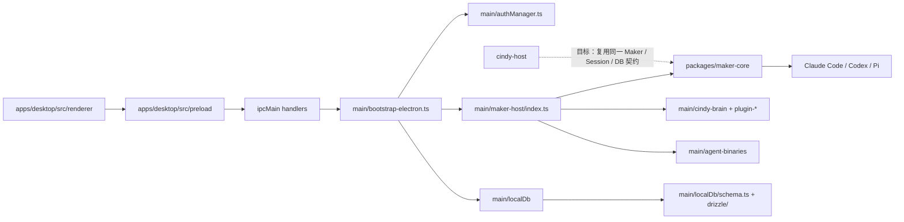

# Cindy Host：现状依赖图与迁移状态

权威目标：[`iamcheyan/chezmoi#136`](https://github.com/iamcheyan/chezmoi/issues/136) 与
[`iamcheyan/chezmoi#137`](https://github.com/iamcheyan/chezmoi/issues/137)。如本文与 issue 不一致，以 issue 为准。

## 目标边界

交付物是 `cindy-host` 与 `cindy-web`。Host 持有唯一 Agent Runtime、Session、OAuth、Plugin、Harness、数据库及状态写入权；Web、Electron（最终命名 `cindy-desktop`）、Mobile 与 CLI 都是连接同一 Host 的平级客户端。

### 生命周期与单写者决策

- Host 是独立常驻服务。Desktop 不托管或自动启动 Host 子进程；Web、Electron 与 Mobile 断开连接不能停止 Runtime 或 Agent。
- 同一 profile 只允许一个 Host 实例：Host 在打开存储前取得 `<dataDir>/cindy-host-runtime-<owner>.lock.db` 的 SQLite 独占锁（复用 `@cindy/maker-core/runtime-owner-lock`），拿不到就报告 `runtime.state=blocked` 且不打开数据库。端口占用只是额外一层。Desktop 自身尚未接入同一把锁，收敛待办见下。
- 最终数据库写者只有 Host。Electron 不得在 Host 外打开同一 SQLite 写连接。把 Desktop Runtime 转交 Host 前，必须建立跨进程的 Runtime/DB 所有权门，旧 Desktop 在 Host 持有时进入 API 客户端模式；不能以双 Runtime、双写或第二份数据库作为过渡方案。
- Linux 由 user systemd 管理；macOS/Windows 由独立 Host 命令/服务管理。`cindy-desktop` 只发现并连接现有 Host，不负责生成另一个 Host。服务安装与平台启停细节属于后续阶段。
- Mobile 迁移期间继续使用当前 Device Link 通道；直连 Host 是后续迁移，不能先移除旧通道。
- 多客户端验收必须用同一真实 owner 和 Runtime：Web、Electron、Mobile 同时在线时任务与 Memory 标识相同；一端发送/停止后，其他端看到同一事件和终态；Plugin 状态变更跨端一致。接口定义相同或 mock 测试不构成验收。

## 当前依赖关系

| 能力 | 当前生产位置 | 当前边界与迁移约束 |
| --- | --- | --- |
| Agent Runtime | `packages/maker-core/src/maker.ts` (`Maker`)、`packages/maker-core/src/agents/`；Desktop 装配在 `apps/desktop/src/main/maker-host/index.ts` (`getMaker`) | `maker-core` 本身零 Electron；生产 `getMaker()` 约 2,300 行，构造期即读取 Electron 管理的二进制、创建 Desktop Memory Manager/Plugin Registry，并组装供应商、MCP 与宿主回调，不能直接从 Node Host 导入。Desktop 与 Host 必须最终共用注入式装配，不能保留两套不同的 Maker wiring。 |
| Session 管理 | `Maker` 与 `Session` 在 `packages/maker-core/src/`；持久 metadata adapter 为 `apps/desktop/src/main/maker-host/session-storage.ts`；产品列表、历史与消息入口在 `apps/desktop/src/main/localDb/ipc/` | Host 必须接管现有 session/message 表与恢复路径；`apps/cindy-headless` 的 `headless_sessions` 是独立评测存储，不可作为 Cindy Host 数据源。 |
| OAuth / Cindy 账号 | `apps/desktop/src/main/authManager.ts`；协议状态机在 `packages/auth-client`；loopback/hosted callback 辅助逻辑在 `authLoopbackCallback.ts`、`authHostedCallback.ts` | `authManager.ts` 直接依赖 `BrowserWindow`、Electron `net`、`safeStorage`、`shell`、`powerMonitor` 及 Desktop 生命周期/IPC。OAuth 必须抽出平台无关 owner/token 操作，沿用现凭据库，不复制 token 文件。 |
| Harness | Agent 实现位于 `packages/maker-core/src/agents/claude-code/`、`codex/`、`pi/`；安装与版本准备在 `apps/desktop/src/main/agent-binaries/` 与 `tools/` | Agent 类可由 Node 构造；生产可执行文件准备器直接读取 Electron `app.getPath('userData')`，Codex 启动器和代理配置也在 Main。Host 需要复用同一受校验二进制与用户数据路径。 |
| Plugin | Plugin/意识运行时在 `apps/desktop/src/main/cindy-brain/`；Plugin OAuth 在 `main/plugin-oauth/`；Maker MCP/插件能力由 `maker-host/index.ts` 装配 | 执行、审批、存储与登录边界在 Main。UI/IPC 入口不能作为 Host Runtime；抽取必须遵守插件存量兼容要求，已安装与已批准插件升级后无需重装或重批。 |
| Local Storage | `apps/desktop/src/main/localDb/`、`apps/desktop/drizzle/`；凭据由 `authManager.ts` 与现有 Secret Store 管理 | Host 走 `localDb/startupCore.ts`：同一 `<userData>/cindy-<owner>.db`、同一 schema lease、同一 `runMigrations`、同一 CJK/vec 初始化。Desktop 的 `ensureReady` 仍负责对话框、瘦身 worker 与 dev drift 修复；两处收敛为待办，但不会同时写入同一 profile。 |
| Mobile Device Link | `packages/device-link` 协议；Desktop Main 的 `apps/desktop/src/main/device-link/` 与 Mobile 调用端 | 迁移期间保持现状可用；未来通过 Host API 接入，完成互通证据前不能移除。 |

## 生产 Maker 抽取边界

`getMaker()` 最终在 `apps/desktop/src/main/maker-host/index.ts` 约第 2,910 行执行 `new Maker(...)`，但之前已执行多项 Desktop-only 准备。它先要求 `makerStartupGate` 完成与 Claude/Codex 二进制就绪，配置图片 resizer，创建 memory manager 和 plugin registry，再装配账户供应商、MCP、Device Link、Session 生命周期和大量闭包。不能通过 Node 动态导入这个模块，也不能只复制最后的 `new Maker()`。

共享边界应让 Desktop 与 Host 使用同一个注入式 Maker 装配，而 `maker-core` 继续提供底层 Agent/Session 核心。宿主适配器需提供 `userDataPath`、已验证二进制、现有 SessionStorage、auth/provider 服务、Plugin Registry、MCP providers、Memory manager、日志和 lifecycle callbacks。现有 Device Link 的 SQLite EXCLUSIVE 锁现已抽成 `maker-core/runtime-owner-lock`，可供 Node 与 Desktop 使用同一锁协议；专属 Runtime 锁路径及两端的获取/释放接线尚未实现。抽取 Maker 前还必须迁出/注入 DB 初始化与唯一写者租约、OAuth 凭据访问、二进制路径/准备、Plugin 执行/审批接口及 readiness 顺序。此时 Host 壳只启动 HTTP；健康响应不会声称 Runtime 已就绪。

## Electron 耦合分类

当前 checkout 中 `apps/desktop/src/main` 有 4,890 个追踪的 `.ts` 文件；按 `electron` 导入搜索（排除 `__tests__`）命中 485 个 Main 源码文件（2026-11-04）。后者是直接 import 文件数，不代表 Electron API 的传递依赖总量。用户任务说明中的 5,084/562 是估算，与当前 checkout 的文件计数有差异。

| Electron 能力 | 代表入口 | Host 处置方向 |
| --- | --- | --- |
| Main 进程/应用生命周期 | `apps/desktop/src/main/index.ts`、`bootstrap-electron.ts`、`lifecycle.ts` | 不搬进 Host；拆成 Node 服务启动/关停生命周期。 |
| `BrowserWindow`、`webContents` | `bootstrap-electron.ts`、`maker-host/index.ts`、`secondary-windows.ts` | 广播改为 Host 事件订阅；窗口创建/聚焦留在 `cindy-desktop`。 |
| `ipcMain` / renderer IPC | `main/maker-ipc/`、`main/localDb/ipc/`、`authManager.ts` | 业务调用改成共享 API 契约；Mobile 的 device-link 迁移完成前保留其现有路由。 |
| `dialog` / `shell` | `localDb/index.ts`、`authManager.ts`、文件/导入与桌面系统动作 | Headless 路径不得静默跳过；需要交互的能力由客户端请求或明确标记禁用。 |
| Tray / Menu / 屏幕、电源、原生 helper | `main/menubar/`、`main/agent-island/`、`main/nativeTrackpad.ts`、`main/lifecycle.ts` | 仅属 `cindy-desktop` 可选系统集成；保留项与禁用项见下表。 |
| Node 可独立执行的模块/package | `packages/maker-core`、`maker-shared`、`auth-client`、`device-link`、`model-providers`、`maker-scheduler`、`maker-remote-ssh`、`maker-pi-manager`、`maker-cc-manager`、`file-browser-core`、`remote-file-service` | 优先复用；依赖由 Host 显式注入，不允许 Host import renderer 或 Electron Main。 |

## Host 实现状态

| 项 | 状态 | 证据/缺口 |
| --- | --- | --- |
| `cindy-host` Node 进程与 `GET /health` | 部分 | `apps/host/src/main.ts` 绑定 `127.0.0.1:3456`；`CINDY_HOST_OWNER` 存在时先取 profile Runtime 租约再打开真实 owner 库。实测：持锁进程存在时第二个 Host 报告 `blocked` 且不碰数据库。 |
| 真实 Maker/Agent Runtime | 未实现 | 当前 `getMaker()` 生产装配仍在 Electron Main；不能把空 Maker、评测 Runner 或 API key adapter 冒充生产 Runtime。需先抽出共享 factory 与单 Runtime 所有权门。 |
| 现有 session/message SQLite 与历史恢复 | 部分 | Host 执行了全部迁移（临时 profile 实测 145 条 migration / 87 张表），并通过 `OwnerSessionStorage` 创建与重读同一条任务；重启 Host 后 `/health` 仍报告 `sessions: 1`。消息写入、Tool 结果、Desktop 同库并发互斥尚未验证。 |
| Cindy OAuth 与凭据持久化 | 未实现 | 当前入口仍被 Electron APIs 包围；后续必须复用原 OAuth 及存储。 |
| Claude Code / Codex / Pi Harness | 部分可独立 | `maker-core` agent 实现无 Electron；生产二进制准备、认证、代理、目录和 MCP 注入尚未迁出。 |
| Plugin 执行与状态 | 未实现 | `cindy-brain`/plugin manager 依赖 Main 宿主接口与 Electron IPC；存量 plugin 向下兼容是阻断条件。 |
| Web / `cindy-web` | 未实现 | 后续接 renderer 现有 UI 与 i18n；不得重写页面/交互。 |
| Electron / `cindy-desktop` API 客户端化 | 未实现 | 当前 Desktop 仍装载 Runtime、OAuth、Plugin 与数据库；完成共享 API 前不得与 Host Runtime 并行。 |
| Mobile 并发访问 | 迁移期保留 | 当前 Device Link 必须持续可用；Host 直连未完成互通验收前不切断。 |
| Memory、文件访问、多 Agent | 未验证 | 必须沿用生产入口逐项验证，不能以模块/接口存在作为行为证据。 |
| Tray、原生菜单、窗口特效、桌面快捷键 | Electron 专属，暂留 | 最终由 `cindy-desktop` 持有；如浏览器不可提供则按迁移清单注明禁用与 TODO。 |

## 阶段 1 Host shell

`pnpm start-host` 启动不导入 Electron 的 Node 进程（`node --import tsx`，后续需要打包成独立产物），默认绑定 `127.0.0.1:3456`。

- 未设置 `CINDY_HOST_OWNER` 时只报告 `runtime.state = uninitialized`，不猜账号、不建库。
- 设置 owner 后走 `localDb/startupCore.ts` 打开该 owner 的真实 Desktop 数据库：schema lease → 迁移 → CJK/vec → 返回共享 `DbClient`。
- Host 尚未拥有 OAuth，因此 owner 目前必须由外部显式给出（后续阶段 2 取代）。

尚未迁移、明确记为 TODO 的 Desktop-only 步骤：数据库瘦身 worker、dev 反射式 drift 修复/nuke、对话框与 renderer 广播、`initializeCodexHistoryPromptState`、对话工作区修复、Orca 悬空 Lead 对账、周期 `PRAGMA optimize`。

`localDb/index.ts` 的 `ensureReady` 与 `startupCore.ts` 目前共享 lease/migration/CJK/vec 原语但保留两处编排；在 Electron 去核心化（阶段 5）前必须收敛为同一实现。

## 明确排除的参考实现

`apps/cindy-headless` 是独立评测/任务执行器，具有自己的 `headless_sessions` 表、profile 和环境变量 API key 认证；它不是 Desktop Runtime 的 headless 启动方式。`feat/headless-server` 与 `feat/web-client` 仅按 issue #136 所列只读参考查看，不合并/摘取其实现，也不沿用其平行数据库、固定 provider、API key 登录或重写 SPA 决策。
