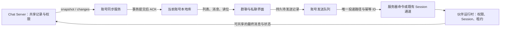

# 伙伴群聊

> **状态**：权威产品规则（authoritative）。本文保留早期本地群的分期说明；当前正式群已接入 Chat Server，手机包含直连和经电脑两条路径（第 8、10 节）。代码核对日期：2026-10-26；具体环境发布情况需单独验证。
> **读取时机**：新增或修改伙伴群聊的数据、发言编排、群专线 Session、分工（负责人、安排、分工 Session、群工作目录）、群聊界面、手机端群聊或相关 IPC／远程资源前。
> 伙伴身份、Profile、主任务与后台任务的通用契约仍以 [`cindy-bots-runtime.md`](cindy-bots-runtime.md) 为准。
> 当前数据链路与后续优化提案见第 11 节；本地表结构见 [多账号数据库架构](../dev-rules/multi-account-database-architecture.md) 第 11 节，私聊衔接见 [云端伙伴](cloud-companions.md) 第 4.1 节。首批分支实现与后续目标在第 11.0 节分开登记，尚未发布；现行产品规则按该节注明的边界衔接。

## 1. 定位与分期

### 服务器群生命周期

群主可以「解散群聊」，普通成员可以「退出群聊」，历史成员可以「从我的列表移除」。
三者独立确认、独立重试：解散不可撤销，停止所有成员的发言、进行中的执行与分工并失效邀请；
退出复用现有成员生命周期（包括带走本人伙伴），最后一个所属账号的群主需先转让或解散；
个人移除只改变本人账号在所有设备的列表，不退出、不删除历史、不影响其他成员或他们的工作。
退出后即使已不能读取群历史，仍可在不可用页面移除本人列表项。

解散仍保留原有权限内的历史；已退出者不会因解散重新取得访问权。归档可恢复，与解散分别呈现，
已解散群不能取消归档。桌面、手机直连和手机经电脑共用角色判断、五语言影响说明及现有破坏性确认。
能力未部署时明确不可用；旧服务器或旧电脑不通过归档／兼容删除冒充解散。服务端合同、部署前置与
兼容细节见 [`protocol-compatibility.md`](../dev-rules/protocol-compatibility.md) 的对应章节。

早期本地群以用户自己的 2–6 位伙伴为典型场景；正式服务器群还支持跨账号的人与伙伴成员。
用户发消息，伙伴们按规则接话。群聊服务真实工作：
一件事可以由几位伙伴讨论，也可以由负责人分好工，从策划、设计到开发一步步做完。

| 阶段 | 范围 | 状态 |
| --- | --- | --- |
| 1 群聊基础 | 本机、同账号伙伴；建群、群里发言、@ 点名、继续讨论、停止、群设置；Desktop | 本文档 |
| 2 分工 | 负责人伙伴出安排、用户点开始后伙伴一步步做；群工作目录（项目文件夹或群自己的文件夹，git 项目共用一个 worktree 与分支）、每步做完停下等继续（可在本机打开自动交接） | 第 7 节 |
| 3 手机端 | 手机查看与发言、分工操作、分工停下时推送 | 第 8 节 |
| Chat Server | 跨账号、跨区域的人与伙伴群聊 | 客户端正式路径已接线并包含旧群迁移；见第 10 节，发布仍需按具体环境验证部署与兼容能力 |

群聊涉及会话生命周期、伙伴运行时与权限，只能由 Core 承载，不做成插件。

## 2. 用户心智

- **群是独立的对象**，不是某位伙伴的主任务，也不是普通任务。它与伙伴私聊在侧栏同一列表，
  保留显式置顶，其余按最新消息排序；群有新消息时向前排列，不另设「群聊」分组，也不进入左侧任务列表。
  群的最近活动取创建时间与最后一条未删除消息时间的较新值，包含话题回复和全群共享的入群事件；
  修改群资料不算活动。空群按创建时间排序，但不增加创建提示消息。
  顶部统一用一个加号提供「新建伙伴」和「新建群聊」两个创建入口，分隔线下另有「输入邀请链接…」作为手动加群的后备；
  不再常驻单独的加群按钮。搜索同时覆盖伙伴与群聊。
- **私聊右上角可以把伙伴带进群**：本机可用伙伴的私聊头部有「添加到群聊」：「发起群聊…」只填写群名称，自动带入当前伙伴，不显示伙伴选择列表；
  创建服务器群后进入新群，自动打开「群聊已创建」邀请弹窗并生成邀请链接。复制在原位反馈，关闭后留在群里；
  链接生成失败只重试邀请，不重复建群。群聊服务不可用时保留输入并提示，不降级为不能邀请人的本地群。
  「添加到已有群聊」只列出你已加入、未归档、该伙伴尚未在内的服务端群，沿用群设置「邀请我的伙伴」的成员邀请，
  权限以服务端为准（已加入成员可带入自己的伙伴），失败如实提示。子菜单先写明「将 某伙伴 添加到」，每行是目标群名；
  添加进行中菜单不能再次打开，成功提示带「打开群聊」，切换账号后旧提示不再导航。原私聊保持不变，私聊记录不会带进群。
  覆盖范围：Desktop 中本机且可用（未暂停、未关闭、未归档）伙伴的主私聊，包括本机 Cindy；
  同一头部也用于渠道会话与只读历史任务，这两处不显示该入口；
  其他电脑上的伙伴私聊（`/bots/remote/…`）仍不显示此快捷入口，可在新建群聊或群设置中选择该伙伴。
  Desktop 目前没有人与人的单聊界面；Mobile 沿用建群与群设置入口。
- **同账号跨设备伙伴可直接加群**：桌面建群与群设置从账号的 Chat Server actor 目录选择，不要求本机存在 Profile，
  也不要求伙伴所在电脑当前在线。禁用 actor 不可选，本机执行的伙伴保留 active 校验；远端主力设备不受本机残留 Profile 状态影响。
  手机直连群设置沿用账号目录；经电脑建群和加成员补入其它主力设备的伙伴，主机重新核对归属，仍拒绝本机隐藏伙伴和未知 ID。
  加群不复制伙伴、不迁移主力设备；实际任务仍由现有主力设备与执行租约机制处理。
- **群未读包括其他人和伙伴的消息**：自己的消息不新增未读。打开群且前台读到末尾才清除；
  停在旧记录处或窗口在后台时，保留新消息的提醒。
- **消息操作复用统一组件**：复制、分享、引用回复、创建话题、表情回应与时间使用现有消息操作栏（`MessageActionBar`
  的紧凑模式），悬停时出现在气泡外侧（别人的消息在右，自己的在左），与气泡顶部齐平；外露引用回复、话题、表情与更多，
  复制、分享与准确时间在更多菜单里。话题保持外露，关闭话题面板后焦点回到打开它的按钮。不另做尺寸与间距不同的群聊
  操作行。话题（Thread）同样支持复制、分享与表情。
  表情回应成功后以服务器为准重读这条消息：它在最新一页就随刷新更新；只在「查看更早」/「加载更早」已打开的
  页上时，重读它所在的那一页（只更新已加载的消息，不改变「还有更早」的判断）。
  「引用回复」留在当前时间线，「创建话题」打开挂在这条消息下的 Thread，两者不能混用（第 10 节「引用回复」）。
  分享复用消息选取和图片导出流程，主群与 Thread 的选区各自独立，导出保留作者和正文，排除操作控件。
- **伙伴在群里还是它自己**：名字、头像、人格、记忆、自有 Skill、模型候选链和工具与平时一致。
- **群聊与私聊各有自己的消息记录**：群里的往来不写进伙伴主任务的时间线，伙伴主任务里的私聊也不会被带进群。
  伙伴在群里记下的长期记忆属于伙伴本身，私聊时同样可用。
- **用户是群的主人**：只有用户的消息开启新一轮；伙伴说话不会自己开启下一轮。

## 3. 数据与所有权

- **正式服务器群的权威记录在 Chat Server**：群、成员、消息、读位、安排和执行分别由服务端实体管理。
  Desktop 经 `withChatServer()` 读取；手机可直连或经电脑读取同一房间。本机目前的短时 snapshot／summary 缓存
  不等于持久消息库，打开群详情仍会读取服务器。
- `bot_groups`（群）、`bot_group_members`（成员与顺序）、`bot_group_messages`（按 `sequence` 排序的时间线）
  是早期本地群结构，现仍保留作旧群迁移来源及本机执行关联；不能据此把正式服务器群理解为本机数据库主导。
  群工作目录、本机自动交接等设备偏好继续按当前账号隔离保存。
- 每位伙伴在每个群里有隐藏的**群专线 Session**：`source = 'bot'`，`bot_session_links.role = 'group'`。
  早期本地群的 `route_key = 'group:<groupId>'`；服务器群还按执行授权隔离，话题另外隔离上下文。
  Session 按需创建，复用伙伴 Profile 与 Bot Home 的规则，并遵守服务器群的权限档；它不替代共享群消息记录。
- **话题是独立对话（2026-10-21，Chris：「话题要真的能把独立事件隔离到独立 session，像 Slack 一样」）**：服务器群里，
  伙伴在某个话题（Thread）里第一次被叫到时，宿主为「这个话题 × 这次授权 × 这位伙伴」另开一条隐藏 Session，
  `role = 'group'`，`route_key = '<群专线 route_key>:thread:<根消息 id>'`；之后这个话题里的消息都进它，主群仍用群专线。
  话题 Session 与群专线同一 Profile、模型链、权限档与工作地点（只聊天的授权共用同一个隔离目录，也同样不带主人记忆、
  私人资料与工具），只有上下文是自己的。老话题不迁移：下次有人在里面发言时新开它的 Session，从服务器读话题内容。
  Session 只是后台对话，不建 worktree 或新目录。
- 群专线 Session 不进入任务列表、伙伴主时间线、历史会话列表、未读和系统通知（分工停下时的手机推送见 8.3）；它随伙伴 Profile 更新推进
  Profile 版本，权限档跟随伙伴主任务。唯一的例外是灵动岛报错卡：群专线失败时灵动岛照常留下这张卡，点击回到它所在的群并
  处置被点的那张卡，规则见 `cindy-bots-runtime.md` 6.2；失败本身仍按 4.4 显示在群时间线里。
- 伙伴被删除时，其成员关系一并移除；群里已有的消息保留发言时的名字快照。
- 早期本地群的删除会删除本机群、成员与群消息，并归档群专线 Session；伙伴本身、记忆与私聊不受影响。
  正式服务器群使用第 1 节的解散、退出和个人列表移除，不能沿用本地删除语义清空共享历史。

### 3.1 附件

群里和普通聊天一样可以带图片、文件、视频；群聊不因为是群就少掉普通聊天已有的输入能力。

- 入口与普通聊天一致：电脑上「+」→「添加文件、图片或视频…」、粘贴、拖入；手机上「+」里的照片、拍照、
  文件（iOS 有最近照片），以及粘贴图片。一条消息最多 20 个附件；有附件时可以不写字。
- 附件属于用户那条消息：早期本地群使用 `bot_group_messages.attachments_json`，正式服务器群使用消息 content 中的 media 块。
  时间线里显示图片缩略图和文件名。
  - 主群时间线、Thread 根消息与 Thread 回复共用同一套附件呈现（`BotGroupMessageAttachments`）：图片点开看图器，
    文件 chip 预览或交系统应用。主群里附件与正文同在一个气泡内、排在正文之后（自己的消息也是一个气泡，不再把图片拆在
    气泡外）；
    Thread 里所有消息（包括自己的）都是左侧头像行，附件同样靠左。附件按发送顺序排列，图片单独一行，相邻的文件
    共用一行 chip；电脑和手机一致。
  - Chat Server 群的附件是消息里的 media 块，按结构显示，**不写进正文**：用户看到的正文只有用户写的字，
    用户自己打出的 `[附件: …]` 文字照原样保留；伙伴收到的群消息文本仍为每个附件带一行 `[附件: 文件名]`。
  - 还没取到这台电脑的附件留在原位置：取件中显示「正在加载」，失败或引用不可读显示「暂时无法加载」，
    之后的读取会重试；不让附件悄悄消失，也不把它补回正文。附件状态变化时，已翻开的较早页面（主群与 Thread）
    里还没到的附件也会重读并更新。失败后的重试发生在下一次读取（群里有新动静、重新打开或切回这个群），且要等
    电脑 30 秒的退避过后；不在后台定时重试，避免反复请求已经不存在的附件。只有附件的消息在侧栏摘要里显示附件名；服务器允许不带文件名（caption）的附件，
    此时用「附件」作为名称，手机经电脑查看时同样可见。手机经电脑查看时，电脑还没取到的附件按发送顺序留在原位置，
    文件名下方显示「加载中」或「暂时无法加载」，点开只说明状态，不提示去电脑打开。
- 交给谁：每位伙伴轮到发言时，拿到它还没看过的所有消息里的附件（包括因太早没放进这一轮文字的消息），
  和普通任务消息的附件一样随这一轮送达；一轮最多带最新的 40 个，更早的告诉伙伴没带上；同一轮后面的发言
  不会重复送。分工时，发起这张安排的消息里的附件交给每一步；步骤进行中补充的话、要求重做的话带的附件也一起
  送到（重做不重复送原来的附件）；这一步没做完时，还没用上的补充和附件留给重试。负责人决定要不要分工时知道
  请求带了哪些附件。
- 存放：
  - 图片进媒体总仓，每次发送各挂一条群的引用（`bot-group-attachment`，refId = 群 id），撤销一次没发出去的
    发送不会动别的消息的引用；删群时在同一事务里释放；各伙伴自己的 Session 另有自己的引用，互不牵连。
  - 一次发送的附件只记在开始时的账号下；准备期间切换账号则整批撤销、不发送。
  - 电脑上选的文件就地使用，和普通聊天一样不复制。
  - 手机传来的非图片文件放在群自己的目录 `bot-groups/<groupId>/attachments/`，删群时随群目录移到废纸篓。
- 手机传来的附件只接受这台手机自己的上传（直传或云端中转），不接受电脑上的路径；取回后删除云端中转副本。
  电脑上的路径不下发给手机。

## 4. 发言编排（宿主确定性执行）

发言顺序、额度、停止与失败处理全部由宿主代码决定，不交给提示词。

### 群广播对象（2026-10-30）

`@所有人` 只点名已加入的真人，不能直接唤醒群伙伴。个人 AI 代答按该真人自己的设置代表本人回答，
不依赖伙伴批量开关。`@所有伙伴` 是独立广播入口，默认关闭，仅群主可改；大群开启前提示可能产生大量自动回复。
开关由 Chat Server 校验，管理员不能修改；关闭后单独点名伙伴仍可用。新旧群默认均关闭。

两种广播可以与单独点名并存；例如 `@所有人 @Cindy` 只额外唤醒明确点名的 Cindy。
显式广播优先于引用/话题的隐式伙伴接收人，`@所有人` 在伙伴的话题下也不自动叫醒原作者。
只有本人一个真人时仍是定向真人广播，不退回没有点名的普通消息。不改普通无点名消息的接话设置。

新服务端声明 `groupMentionAudiences: 1`，存储并展开真人/伙伴广播；旧服务端仅支持客户端的真人展开，
没有其他真人时保留本人的 actor 作为不会触发伙伴的接收人。旧服务端不显示伙伴批量入口，也不能修改开关。
旧版客户端没有发送对象标记，仍须升级客户端才能修正其 `@所有人` 行为。

### 4.0 服务器群：一次只有一位伙伴说话（2026-10-21）

Chat Server 声明 `capabilities.groupSingleSpeaker: 1` 时，服务器群按下面的规则执行，取代 4.1–4.2 的
回答者选择、同时想与自动续圈（4.1–4.3 仍描述本地旧群与未声明该能力的服务器）。规则由服务端派发与
宿主代码执行，不靠提示词约束；Chris 2026-10-21 定稿（去掉负责人，原型见设计资产 `group-coordination`）。

- **一次只有一位伙伴说话**。@ 一位伙伴，只有它回答；@ 多位伙伴或已开启的 @所有伙伴，按 @ 的先后排队；
  **没有 @ 人时按群设置决定是否回答**：`all`（默认，「大家都可以接话」）让所有能回答的伙伴排成一个队列
  （按成员列表顺序）；`mentioned`（「只有被 @ 的回答」）不唤醒伙伴、不新建或替换队列。群里只有一位伙伴能回答时不排队，
  它直接回答。伙伴的回复不叫醒任何伙伴，也不能替自己往队列里加人。
- **两种编排（2026-10-23 修正，Chris：「整个原本的分工交接全没了」「重新做好编排…服务器最好不用改」）**：
  - **讨论**（队列卡，`talk`）：上面那条规则，大家对同一个问题依次说看法。
  - **分工**（安排卡，`work`，第 7 节）：几位伙伴接力把一件事做完，每做完一步停下等「继续」，在项目文件夹里干活。
    只由「+」→「安排分工」发起，见 7.0。10-21 去掉的分工入口、负责人与项目文件夹在服务器群里恢复。
- **讨论的队列卡**：卡上一步一位伙伴、一次模型调用，宿主按顺序依次派发，
  不另调模型来排顺序。**前 5 位依次自动回答，第 6 位起每位等用户点「继续」**；用户觉得够了就点停止、「结束」或不再继续。
  轮到的伙伴没什么可补充时回复 `NO_REPLY`，群里不显示，但这一步照样算说完。
- 每位伙伴的回复都是独立消息；安排卡单独一条，只表达顺序与进度，不并入谁的回复。
- 群设置保留独立的「没有 @ 人的时候」，控制是否响应无 @ 消息，与排队顺序无关（2026-10-23 修正）；
  「负责人」「项目文件夹」随「安排分工」一起保留（第 7 节）。不再有「发言方式」，群头像行不再标「负责人」，
  也不再自动第 2、3 圈；继续由卡上的「继续」完成。
- 队列停着等「继续」时又发了符合回复条件的新消息，就是新问题：旧队列结束，按新消息另排。卡片进行中（讨论有伙伴正在答，
  或分工在做、停着等继续）时，发起人或管理员不 @ 人说的话仅在 `all` 时交给当前这一步：讨论里作为补充交给正在答的伙伴，
  分工里是补充或让刚做完的伙伴返工（7.4）；`mentioned` 时它们是普通消息、保持安静。@ 了人则按 @ 依次普通回复、
  `all` 且没 @ 人只由第一位伙伴回答，不另开队列。话题里的消息不排队列：点名多位依次回答，`all` 且没有接收人只由第一位伙伴回答，
  `mentioned` 且没有接收人保持安静。
  这里的「没有 @」指没有定向接收人的普通消息；保留第 10 节已有的定向回复例外：引用回复伙伴，或在伙伴消息下回复话题时，
  宿主会把仍在群里的原作者加入接收人，所以无需再手动 @，`mentioned` 下也会回答。回复人类根消息的话题不增加伙伴接收人。
- 主群里的普通回复只带最近 12 条主群消息、每条截至 600 字（更早的标为已省略），群专线自带此前的轮次；
  当前请求本身完整送达。
- **停止只停自己的**：普通成员点停止，停掉自己发起的请求与安排、以及自己的伙伴在替别人做的事；
  别人发起、别人的伙伴在做的继续进行。群主或管理员在还有别人的工作时，停止会多出「全部停止」。
  没权限停的那一项继续跳过，其余可停止项仍继续处理；已经停止的部分保留。
  没有可停止项、存在因发起人缺失而无法判断停止权限的项，或服务端拒绝后重读仍不能确认已结束或正在停止时，
  返回相应原因，不报告停止成功。具体实现与回归见
  [`chatServer.ts`](../../apps/desktop/src/main/maker-ipc/chatServer.ts) 与
  [`chatServer.test.ts`](../../apps/desktop/src/main/maker-ipc/__tests__/chatServer.test.ts)（#8045）。

### 4.1 一轮从哪里开始

- 用户发一条消息开启一轮。
- **谁回答**：消息里 @ 了伙伴，只有被 @ 的伙伴回答；@所有人不直接唤醒伙伴；支持广播开关的服务器群中，已开启的 @所有伙伴让全部合资格伙伴回答；没有 @ 时按群设置：
  - `all`（默认，「大家都可以接话」）：全部成员依次获得发言机会；
  - `mentioned`（「只有被 @ 的回答」）：没有伙伴回答。
- **顺序**：@ 了具体伙伴时按 @ 的先后；其余情况按成员顺序。同一轮第二圈起，起点依次后移一位，避免总是同一位先说。
- **同时还是轮流**（群设置「发言方式」）：
  - `auto`（默认，「自动」）：没有 @ 具体伙伴（含已开启的 @所有伙伴）且回答者不少于 2 位时，是同一个问题各答各的，
    第一圈所有回答者**同时**想，谁先想好谁先发，彼此看不到本圈的回答；第二圈起轮流，每位都能看到之前所有人的话。
    @ 了具体伙伴表示用户指定了先后，始终轮流。
  - `sequential`（「始终轮流」）：每次只有一位伙伴发言，后说的能看到前面的回答。
  - 伙伴不能自己决定等待或抢先；是否并行只由宿主按上面的规则决定。需要分工与依赖的工作由第二阶段的群管理员
    伙伴出计划处理。

### 4.2 额度

- 每位伙伴每圈最多发 1 条；同时想的一圈里，晚到的回复在额度用完后丢弃。
- 一轮最多 3 圈、10 条伙伴消息。只有 1 位回答者时只跑 1 圈。
- 整圈没有任何伙伴发言，本轮提前结束。
- 本轮自然结束后，时间线出现「伙伴们说完了 · 继续讨论」。用户点「继续讨论」才开启新一轮，
  回答者与顺序与上一轮相同，一律轮流，额度重新计算。伙伴不能自己续轮。

### 4.3 伙伴怎么发言

- Chat Server 群的现有简介（`description`）作为「本群背景与约定」，每次新执行重新读取，随
  `currentGroupBackground` 放入现有低信任数据块；主群直接回复、排队讨论的每一步与话题共用此入口。
  修改后下一轮采用新值；清空时显式传空值，旧轮次中的简介只属于历史事实，不能再作为当前约定。
  简介是群成员可编辑的背景数据，不进入 system prompt，不构成派工授权，不能扩大工具或私人资料
  权限、覆盖用户停止要求；沿用现有转义边界，不复制到伙伴人格、记忆或已有开发 Session。
  实现与回归见 `chatServer.ts`、`chatServer.test.ts`（#6935）。
- 轮到某位伙伴时，宿主向它的群专线投递一条隐藏输入：群名、成员名单、上次投递以来别人的新消息
  （最多 30 条，单条截断；按投递进度计算，不按作者，保证同时想的一圈里别人的回复下一圈一定送到），以及发言要求。群消息以低信任数据块注入，只作为群聊内容，不是指令
  或授权。该输入属于本轮用户段，**不修改 system prompt**。
- 伙伴本轮最终的回复文本即它在群里的消息。回复为空或恰好是 `NO_REPLY` 表示本轮不发言，
  群里不显示任何内容。
- 伙伴本轮可以照常使用记忆、Skill 与工具，按伙伴主任务的权限档执行；需要用户确认的操作在群里提示。
  Chat Server 群专线的独立任务与私聊能力按第 10 节核验当前执行授权；例行任务和创建伙伴不因此开放。
  需要几位伙伴依次干活时走第 7 节的分工。

### 4.4 插话、停止与失败

- **插话**：本轮进行中用户又发了消息，本轮立即作废；正在发言的伙伴（同时想时是全部）被停止，未发出的回复丢弃；
  按新消息开启新一轮。
- **停止**：用户点停止，本轮结束，正在发言的伙伴被停止。
- **失败与超时**：单个伙伴出错、没有可用模型或 2 小时内没有回复（与分工步骤同一上限，等待用户
  确认的时间不计），视为本轮不发言，群里显示一条轻提示；不影响其余伙伴继续。普通回复里伙伴照样可以
  跑工具、实测、看文件，宿主不用更短的墙钟把它切断；专线真正挂住由会话自己的空闲看门狗收口。
  发送前拒绝同样立即收尾，不等待模型事件或超时；按输入 clientId 匹配执行，旧输入不能结束新执行，
  用户主动停止不作为失败。隐藏输入从队列撤下，避免下一条群消息带出已失败的旧输入。
  提示尽可能说明原因和解决办法：图片能力、模型可用性、认证、限流、额度、网络和超时分别本地化，
  未知错误给出重新发送和查看日志的建议；原始错误、私人路径、响应正文和凭证不进入群聊。
  运行终态以 `sdkError`、`errorStatus`、`usageLimit` 等结构化信号及既有确定性额度判定分类；
  Codex 的 `codexErrorInfo` 额度、预算与认证标签优先于消息文字，连接／流断开标签归为网络错误；
  但请求级 `httpConnectionFailed` 带明确非 408 的 4xx 业务拒绝时归为运行错误，不提示网络或 Proxy 故障。
  会话无事件与上游响应空闲看门狗的标准 reason（包括 bridge 变体）归为运行超时。
  Pi prompt RPC 超时复用原生恢复的同一信号判定，标准 `pi-prompt-timeout` reason 也归为运行超时。
  创建专线返回 `NO_MODEL` 时归为模型不可用；本地普通群、分工与服务器执行复用同一分类，提示配置可用模型。
  上游容量不足复用 SDK 的过载判定（包括标准 `upstream-overload` reason、Codex `serverOverloaded` 与 Anthropic 529）。
  Codex `responseTooManyFailedAttempts` 已耗尽采样重试时，仍能从结构化状态码或上游过载标记识别的错误保留过载原因，保持终态且不再叠加重投。
  群聊归为独立的 `UPSTREAM_OVERLOADED`：说明模型服务暂时繁忙，建议稍后重新发送或选择其他可用模型；不增加群聊重投。
  本地成员和分工步骤的计时器超时同样带上 `RUNTIME_TIMEOUT`，保留等待用户批准时暂停计时的规则。
  普通回复与分工步骤的 2 小时上限都只累计实际运行时间；等待结束后用剩余时长继续，
  多个确认重叠时直到全部结束才恢复，不重置完整预算。确认包含既有权限、提问、计划审阅与插件设置等待，
  插件设置完成后的卡片展示宽限期不算等待。会话自身的空闲看门狗和主动停止仍可收尾。
  回归见 `maker-ipc/__tests__/botGroupChatService.test.ts`。
  明确的额度耗尽优先于泛化 429，明确的暂时限流不会因 `usageLimit` 标记误报为额度耗尽。
  直接发送拒绝也在执行端分类本地 `message`，跨群仍只提交白名单错误类别。
  远程任务名额不足在创建专线与发送失败时保留本地诊断并分类：`DEVICE_LIMIT` / `TOTAL_LIMIT`
  分别投影为 `REMOTE_DEVICE_LIMIT` / `REMOTE_TOTAL_LIMIT`，双端提示释放闲置任务或由远程电脑主人提高上限；
  不自动清理连接或调整上限，未带具体限额标记的 `REMOTE_AGENT_BUSY` 沿用未知错误回退。
  Chat Server 是执行状态的唯一事实来源：消息页只包含真实历史，另通过
  `/execution-failures?sourceIds=<已加载消息 ID>` 读取当前读者可见、源消息未删除的完整失败状态
  （执行 ID、epoch、源消息 ID、伙伴、计划和白名单错误类别）。每次最多查询 100 个源 ID，
  Desktop 与 Mobile 复用 shared 去重分批规则，覆盖所有已加载消息，不拉取未加载的全群失败历史；
  不受普通执行列表最近 100 条限制。推送刷新、分页和 Thread 都包括已加载的旧消息 ID；
  新页与推送并发时，保留较新的状态并为新增源重新读取，防止旧响应恢复过期错误。
  Desktop 主群、Thread 和 Mobile 合并真实消息页后，使用 shared 的同一投影函数把失败提示放在
  已加载源消息旁；提示不写入分页缓存、不参与模型上下文，不覆盖消息、预览或未读位置。
  已加载旧消息即使不在刷新页内，重试、完成、更换 epoch、删除源消息或撤销历史可见性后也按
  当前状态重新生成提示；旧消息首次发生失败也无需重新翻页。线程根与回复用同一规则，不增加回复条数。
  错误提交沿同一 operationId 和不可变终态重试，不重跑伙伴；主动停止不产生失败提示。
  手机设备互联由宿主把当前状态投影成兼容的消息视图，旧手机无需理解新状态字段；手机直连群页
  读取相同 `/execution-failures` 状态并复用 shared 投影。旧服务没有该路由时，仅 404 回退到既有
  `/executions`，错误展示限于旧服务提供的最近执行范围；认证、权限或网络错误继续进入正常读取恢复。
  手机显示同一份本地化原因与恢复建议，并说明模型或设置需在伙伴所属电脑上调整。
  本地失败通知升级为服务器历史时，错误类别存入既有历史卡片的可选结构化字段，不上传标记正文；
  Desktop 与 Mobile 仅在服务器盖章的 import／系统通知历史中恢复类别，也兼容此前已迁移的标记，
  不把普通用户发送的同名卡片或标记当成错误提示，标记不进入历史预览或模型正文。
  新服务器返回安全的 `failure_code`；旧服务器仍接受既有 `detail` 字符串，新客户端在当前执行端
  缓存具体原因；服务器把新类别归为 `RUNTIME_ERROR` 时也保留同一执行 ID 与 epoch 的本地具体原因，
  服务器返回其他明确类别时以服务器为准。其他设备或重启后的具体原因依赖服务器白名单支持，
  未支持时降级为通用失败提示。实现与回归见
  `maker-ipc/botGroupRuntimeFailure.ts`、`maker-ipc/__tests__/chatServer.test.ts`。
  手机回归见 `botGroupRemote.test.ts`、`chatServerClient.test.ts`、`BotGroupChatScreen.test.tsx`。
- 应用退出或重启会结束进行中的一轮；重启后不自动续跑。

## 5. 界面

- 手机群聊正文复用任务内的原生文本选择组件；长按显示系统选区和手柄，支持局部复制，不能退化成只能整段 Copy 的菜单。iOS 格式化正文与点名使用同一 UITextView 文本树，Android 沿用系统 TextView 选择。消息操作栏的复制按钮保留。

- 桌面和手机群聊正文将伙伴的组件回答显示为可读内容；无法转换的内容保留原文。

- 群聊行与伙伴私聊混排在侧栏「伙伴」段（置顶上方，与任务列表共用一个侧栏，见
  [cindy-bots-runtime.md](cindy-bots-runtime.md#导航未读与系统角标)）；段头加号提供新建伙伴与新建群聊。群行显示成员组合头像、群名与最近一条消息：
  两人斜向叠放；三人及以上围绕同一圆心等角度重叠，按群成员顺序取前五人，整体呈圆形聚拢。
  叠放顺序以最前层为第一位：第一位成员完整显示，后续成员依次向后叠放；双人同样遵循此顺序。
  头像随展示人数适度缩小，沿用与侧栏背景同色的描边区分前后层次。
  展开列表与收起头像行使用相同规则，头像区域和行高不随人数增加。
  有伙伴正在发言时显示运行中标记。未读角标是真实条数：宿主随摘要给出最近（至多 99 条）别人发来的消息时间
  （`incomingMessageTimes`），与本机读位比较；旧宿主没有这份列表时只显示 1。伙伴发的安排卡与回复同样算来信：
  本机群的 `lastReplyAt` 取两者里最新的一条，首次种读位时不会把最新的安排卡留成未读。
- 群聊页（2026-10-20 与伙伴私聊统一为气泡，设计稿见伙伴对话面板 r3.4）：顶部为成员头像、群名与群名下一行；这一行平时只写人数
  （「9 位成员」，人与伙伴一起算，不逐个列名、不标负责人；完整名单在悬停提示、读屏标签与群设置里，2026-10-26 用户要求「不能列满」），
  有人在做事时换成此刻谁在做什么（「X 正在做第 2 步」「X 正在说…」「X 正在安排…」）；手机顶栏同样只写人数。右侧为群设置入口。时间线：自己的消息靠右，沿用用户
  气泡，正文、引用与附件同在这一个气泡里；伙伴与别人的消息靠左，28px 头像 + 名字 + 时刻，下面是卡片底、细边框的气泡（不加阴影，DESIGN.md §6），引用、
  正文、任务卡、分工表、附件与贴回的话题回复都在气泡里，任务卡与分工表是气泡内的浅色内嵌区；正文与任务正文同一字号
  （15/1.6）。气泡宽度由内容决定，上限 720px 并始终给外侧操作栏留出位置。同一作者五分钟内的连续消息合并——后续行不再
  带头像和名字，时刻只在悬停时出现在左侧槽位；每个自然日一行居中的日期（今天 / 昨天 / 短日期），不吸顶；消息操作栏
  悬停时出现在气泡外侧，键盘聚焦与触屏时常显；@ 点名在所有消息里用主题链接色（`--msg-link`，不加底色；它不是链接，不受 DESIGN.md「聊天正文不使用 `--msg-link`」约束，2026-10-20 裁决），指针停在点名上约 0.25 秒弹出该成员的信息卡（头像、名字、谁的伙伴或群内角色、暂停／不可用状态），指针可移入卡片；`@所有人`、`@所有伙伴` 不弹卡；表情回应贴在气泡外上角（别人的在右上、自己的在
  左上），≤3 人时显示头像；话题入口是气泡下方与气泡左缘对齐的一行（回复者头像、N 条回复、最后回复时间）；轮次结束、
  分工结束与系统提示是居中的一行小字。多人群里别人带来的伙伴显示「伙伴名 (主人昵称)」，人类成员名字旁带「某某的主人」。
- 进行中：每条执行在时间线里占一个轻量过程入口，标题显示伙伴与「已处理 + 耗时」；等待、排队、停止状态优先，箭头紧邻文字。
  默认展开；展开后只有一条细引导线和一级缩进，阶段文字按顺序连续保留，不重复消息气泡与操作栏。
  缺少活动数据时写「正在处理」，不猜成「正在思考」；等待、排队、停止中分别显示，确认卡始终在折叠外可操作。
  分工保留「第 k/n 步」与该步内容，停止权限沿用原规则。
- 结束后：最终答复单独保留。新版答复携带可选过程关联信息，显示「用时 + 耗时」入口；默认收起，用户主动检查过的展开状态保留。
  主群与话题回复共用过程记录组件。只读取自己伙伴原执行电脑上的本轮阶段文字和工具记录，私密回复、思考和原始工具结果不发送到群里；
  连续思考与工具按阶段合并为客户端摘要，详情按需展开；阶段文字保持原顺序，摘要不新增模型请求或提示词。
  运行中保留打开原任务的入口，不能回退到伙伴私聊。其他成员不因这个入口获得私有任务访问权。
  旧答复没有关联信息时保持原样；电脑离线或读取失败时保留重试，不把别轮内容填进来。
  手机沿用同一展示和访问边界，直连 Chat Server 时通过自己伙伴的主力电脑读取。停止自己的请求、安排及自己伙伴工作的权限不变；
  执行电脑终止后提交已有 cancel 回执，失败重试回执而不重跑模型。
  Desktop 等待确认的过程立即显示；耗时只取真实执行或活动的开始时间，缺失时显示通用处理状态，不拿打开页面或修改分工的时间补算。
  本机等待交互但群里没有对应确认卡时，保留进入这条原任务的入口处理；远端不可读时不显示错误任务入口，也不获得其他成员的私有任务读取权。
- 输入框支持 @ 伙伴，候选第一项为「所有人」；支持附件（见 3.1）。服务器群的话题回复用同一个输入框的话题模式，@ 候选也是
  同一套（`useBotGroupMentionPicker`）：候选、筛选、键盘与鼠标选择、Esc 收起和同名伙伴按选中身份区分都与主群一致；候选与点名
  解析都不含当前用户自己（与手机一致）。草稿随群持久（切走再回来文字还在，群被删除时丢弃）。
  发送是乐观的：按下发送自己的消息立刻出现（发送中略淡），宿主回包后原地换成正式那条。主群复用第 10 节的发件箱，失败时只放回空输入框，否则保留失败消息供重试或编辑；话题失败撤掉本地副本并恢复草稿。
- 不跳、不卡：宿主对同一群的变更通知合并成一次（150ms 窗口）、Renderer 同一时刻只读一次并把最新页**并入**屏幕上已有的消息
  （被挤出最新页的旧消息留着）、内容没变的消息沿用原对象不重绘；发送用实时订阅担保的最近快照（30 秒内），侧栏摘要按群的
  变更头复用；自动分工判断整体不超过 8 秒（单候选 5 秒），超时按「不要」处理，不让第一条回复等它。
- 新建服务器群聊：群名称必填，伙伴可不选，最多选择 6 位；旧本地群仍沿用其人数校验。
- 群设置：群名称、成员（添加与移出、设为负责人）、项目文件夹、「没有 @ 人的时候」回复方式、「发言方式」（自动／始终轮流）、删除群聊（二次确认）。
  本地群与服务器群的这几项用同一套文案；服务器群的组织方式见下条。
- 服务器群的群设置（2026-10-30 用户定稿，Desktop 与手机同一结构，只整理界面，不改权限与协议）：
  顶部是群身份（组合头像、群名、「N 位成员 · 你是群主／管理员」）和唯一的「邀请」入口，下面「群设置 | 成员」两个标签。
  「邀请」是下拉菜单两项：「邀请朋友」打开现有邀请链接（只有群主和管理员可用，其他人看到置灰并写明原因）；
  「邀请伙伴」列出账号里还没进群的伙伴，点一下以自己身份加入（所有成员都可以）。Desktop 在同一菜单里换成可搜索、
  限高、虚拟滚动的列表；手机是一页可搜索的列表。群聊顶栏的邀请图标对所有成员显示，打开同一个菜单。
  「群设置」标签依次是群介绍（群主和管理员可编辑；成员只读，空的时候不显示）、我在本群（本群资料、AI 代答）、
  我的伙伴（只列已在群里的，进入「伙伴在本群」三选一）、群管理入口（只有群主和管理员）、从我的列表移除、退出群聊。
  群级默认都在「群管理」：伙伴怎么接话（非单人发言服务器另有发言方式）、分工（负责人、项目文件夹、自动交接）、
  归档／取消归档、解散（只有群主）。群主不能直接退出：Desktop 灰着显示并写「先把群主转让给别人，才能退出」，
  手机按「点不了的入口不摆出来」只在「从我的列表移除」下写这句。「成员」标签是搜索加名单，行尾「⋯」只给能操作的人：
  自己的伙伴是「在本群的权限」，群主／管理员是设／取消管理员、转让群主（只对真人）、移出。
  编辑群资料、本群资料、伙伴在本群都是同一抽屉／面板里的下一页，返回仍在原标签。声明 `groupSingleSpeaker` 的服务器群没有「发言方式」（一次只有一位伙伴说话），其余照常（Desktop 与手机一致）。
- 话题面板与主时间线同一套消息样式（合并、悬停操作、@ 高亮、引用块、附件），同一个输入框。电脑话题模式的「+」提供
  「添加文件、图片或视频…」，也支持粘贴图片或文件；可只发附件，限制与主群一致。不提供安排分工与引用回复。
  文字和附件草稿按群与话题分别保存，发送失败保留；发送键是「发送回复」，失败原因写在输入框上方。
  正文、附件（含标注）和点名目标不变时重试沿用同一个 clientId；发送结果不明确时复用已上传的内容，不重新读取原文件。
  本次运行期间关闭重开话题也保留发送身份：发送中禁用重发，失败后沿用原附件和标注生成图重试。
  待发送的标注生成图参与草稿图片保护，成功、编辑或丢弃草稿后解除；删除群或失去访问时一并丢弃主群及其话题草稿。
  成功回执只清理与此次发送快照一致的附件，关闭重开话题后的新标注保留。「同时发到群聊」沿用现有先回复、再贴回的流程。
  话题内不预留侧边操作栏的空白：共用的消息操作栏常显在气泡底部，正文使用可用列宽；宽表格在自身容器内横向滚动，
  文件 chip 不超出气泡、长文件名省略。群聊与私聊同由 `ThreadPanel.css` 约束（回归：`scripts/fixtures/thread-panels`）。
- 视觉遵循 [`DESIGN.md`](../design-rules/DESIGN.md)；Light 与 Dark 同时实现。
- 成员卡优先使用消息中的点名身份；服务器消息缺少身份时，只对群成员中唯一匹配的名字显示卡片，重名和广播标签不猜测。表情角标换行时，悬停操作栏仍以实际气泡顶边为基准定位。

## 6. 本地旧群的限制（服务器群见第 10 节）

- 仅同账号伙伴；群和伙伴都在同一台电脑上，不支持跨电脑、跨账号的群。手机端见第 8 节。
- 只属于单个任务的设置（模型、权限模式、计划模式、目标、协同、额外目录）不出现在群输入框：群没有单一任务，
  这些由各伙伴自己的设置决定；群的项目文件夹在群设置里。
- 输入框的 @ 只用于点名伙伴，暂不支持像普通聊天那样 @ 文件、目录、任务或浏览器标签。
- 进行中的一轮只保存在内存，重启后结束；分工的安排与每步状态持久保存（见 7.6）。

## 7. 分工（第二阶段）

> 服务器群声明 `groupSingleSpeaker` 时（4.0），安排卡既承载讨论（`talk`）也承载分工（`work`），下面 7.0 优先于
> 7.1–7.4 的对应条款。

### 7.0 服务器群的安排卡（2026-10-21，分工部分 2026-10-23 修正）

讨论的队列卡（`talk`）：

- 服务器自己排的卡是队列：每一步写「说说看法」，状态为「正在说 / 说完了」。
- **前 5 位自动接续，第 6 位起每位等「继续」**，没有开关。「下一步 · 继续 / 结束」只给发起人、群主或
  管理员看。
- **卡片自动折叠**：超过 4 位时只露当前这一位前后共 3 行，卡底「共 N 位」展开全部、「收起」折回。
- 排队时群名下写「某某 正在说…」；有人正在说时输入框提示话会带给他，停着等继续时输入框是普通提示，
  不暗示「让上一位改改」。
- 每一步跑在这张卡自己的 Session 里，上下文只有原问题、前面各位的回答、以及这一步期间你补的话，
  不带主群历史；不准备项目文件夹或 worktree，不收集产物文件。前面的回答只有上一位的给到 2000 字（与分工
  交接同一上限），更早的每条截至 600 字并标为已省略，长队列不再把每位的回答整段重发一遍。
- 队列有伙伴正在答时，`all` 模式下发起人或管理员不 @ 人说的话并入这一步；队列停着等继续时，符合回复条件的新消息另起队列（4.0）。
- 队列卡作为独立一条显示在请求下面，不挂任何伙伴名义；每位伙伴的回答是各自独立的消息。

分工的安排卡（`work`，2026-10-23 恢复；10-21 起新版服务器群里开不了新的分工，用户实际依赖它让角色伙伴接力干活）：

- 输入框「+」→「安排分工」重新可用，触发由宿主代码决定，**只看分工标签，不看话怎么说**；不加标签的话照 4.0 讨论。
- **写好了步骤就照写的建卡并直接开始**，不调辅助模型：每个 @ 后面写这位伙伴做什么，后一位从新的一行或标点之后开始
  （「登录页：@A 出方案，然后 @B 按方案实现；@C 测一遍」）。第一个 @ 前的话是共同背景；「然后、接着、最后、再」这类
  引出下一步的连接词不算进任何一步（最后一步照原话保留）；同一位伙伴相邻的几步合成一步；最多 6 步，每步任务最多 200 字（服务端上限）。
  @ 夹在句子里（「@A 和 @B 一起做」）、某个 @ 后面没写活、@所有人或 @所有伙伴、重名分不清、点到不能派活的伙伴，或文字里有认不出的 @
  （点选后伙伴改了名）时，不当作写好的步骤。
  解析在 `@cindy/maker-shared/botGroupMentions` 的 `splitBotGroupRelaySteps`。
- **没写成步骤就交给负责人**出安排卡（「开始 / 不用了」），沿用 7.2 手动分工的流程与每候选 20 秒的预算；开始前
  不 @ 人说话仍是修改意见（7.3；回复模式为「只有被 @ 的回答」时不算，照 4.0 不叫任何人）。安排不出来、或负责人认为不用分工时，这条请求立即按 4.0 回答（点名的依次答，
  否则第一位伙伴答），不让它干等服务端两分钟后再排队。
- 发出前宿主让消息先挂起，服务端不会先拿它去排讨论队列；建卡后挂起解除。你自己的讨论队列停着等「继续」时，先把它结束
  再建分工卡；还有别人的卡或正在进行的卡时拒绝（`PLAN_OPEN`），与旧版一致。
- 负责人还在出安排卡时，这台电脑（含经它的手机）拒绝再发新消息（`PLAN_OPEN`），等卡出来再说：该服务端无法撤销挂起，
  新消息顶掉这次安排会让原请求两分钟后被排成讨论队列。已知遗留：安排中途点停止或操作别的卡仍会留下挂起，需服务端
  恢复 `cancel-planning` 后才能根治。
- 执行、返工、换人、重试、停止与工作目录沿用 7.3–7.5：每一步在这位伙伴自己的分工 Session 里做，保留它自己的技能、
  记忆、工具与模型；做完一步停下等「继续」；等继续时不 @ 人说话就是让刚做完的伙伴返工（输入框写「想让 X 改改，直接说…」；「只有被 @ 的回答」的群里不适用，见 4.0）。
- 负责人与项目文件夹回到群设置；负责人只在请求没写步骤时排分工，群头像行仍不标「负责人」。

用户心智：照常说话。事情需要几位伙伴一起做时，负责人先回一个安排，用户点「开始」；伙伴一位接一位做，
每做完一步停下来，用户点「继续」交给下一位。界面上统一叫「分工」，不叫「协同」「协作」「接力」——
「协同」是 Orca 多 Agent 协同的功能名（角色 Lead / Worker），「协作」用于共享任务。

### 7.1 负责人

- 每个群有一位负责人：群设置里指定的成员；未指定、或指定的伙伴已移出或不可用时，由成员顺序里第一位可用的伙伴担任。
- 负责人负责出安排与改安排，也可以给自己派一步。英文不译作 Lead（Orca 已占用）。

### 7.2 什么时候出安排

判断由宿主代码固定执行，不交给伙伴自己决定是否调用某个能力（那样同一句话时出时不出）。

- **自动**：用户发的新消息没有 @ 具体伙伴（已开启的「@所有伙伴」也算没有指定，面向真人的「@所有人」不触发），且群里没有未结束的安排时，
  宿主**每次**都用辅助模型做一次判断：
  「要不要分工」只能回答要或不要，要时同时给出步骤。回答必须是结构化 JSON，宿主校验格式、步骤数（1–6）
  和每一步的伙伴都是群里可用成员；不合格换下一个候选模型，全部失败或超时按「不要」处理。
  这次判断挡在每条未点名消息的回复前面，所以整体不超过 8 秒：第一个候选最多 5 秒，剩下的留给备用候选，预算用完不再派发；
  手动「安排分工」与修改安排仍按每候选 20 秒。
  - 判断标准写死在请求里：要做出成果，而且需要两位以上成员各自的本事才分工；闲聊、提问、一个伙伴就能做完的不分工。
  - 要：群里出现负责人名义的安排卡，本条消息不再普通接话。
  - 「只有被 @ 的回答」的群里，未定向普通消息不进入自动分工判断、修改或继续安排，也不显示伙伴工作状态；手动安排、明确 @、引用回复与话题回复仍按对应定向请求处理。
  - 不要：按第 4 节规则接话。
  - 判断进行中，群里显示负责人正在看这件事；判断期间用户再发消息或停止，本次判断作废。
- **手动**：输入框「+」里的「安排分工」。选中后输入框上方出现「分工」标签，这条消息一定交给负责人出安排，
  不再判断要不要；出不来（包括选中的伙伴在判断期间都已不可用、保存失败）时群里提示，用户可重试。修改待开始的安排同样如此。
- @ 了具体伙伴的消息不做判断，按第 4 节只让被 @ 的伙伴回答。
- 辅助模型使用 Cindy 的辅助模型链（与标题、提示词推荐相同的候选与禁用设置），不走伙伴的对话 Session。
  群消息与成员简介以低信任数据块传入。

### 7.3 安排卡

- 一步一行：谁做、做什么。最多 6 步；同一位伙伴可以做多步，但相邻的几步由宿主合成一步（每一步都要停下等「继续」，
  同一位伙伴连着做没有停的意义）。
- 「开始」「不用了」。开始前点某一步可以换成其他可用成员，或删掉这一步（至少留一步）。卡底一行小字写「每做完一步会停下来，
  等你点「继续」」（本机打开了自动交接时写「做完一步会自动交给下一位」），可换人时右侧写「点某一步可以换人」。
  在这台电脑发起的服务器群分工，卡底左侧改为开关「做完一步自动交给下一位」，开始前、进行中都能拨（见 7.4 自动交接）。进行中的那一步写走动的已做时长，做完的步骤写完成时刻；
  每一步的交接消息在作者名字旁带「第 k 步」小标。
- 开始前用户不 @ 任何伙伴直接说话，视为修改意见：负责人按意见改出新的安排卡，旧卡标为已作废。
- 一个群同一时间最多一张未结束的安排（待开始、进行中、等继续）；自动判断只在没有未结束安排时进行。

### 7.4 一步一步做

- 点「开始」后按顺序执行，同一时间只有一位伙伴在做。
- 每一步由那位伙伴自己的**分工 Session** 完成：隐藏的伙伴 Session（`role = 'group'`，
  `route_key = group:<groupId>:plan:<planId>`），与主任务共享 Profile、Home、记忆、Skill、模型候选链与权限档；
  同一安排里同一位伙伴的多步共用一条分工 Session。它不进入任务列表、伙伴主时间线、历史列表、未读和系统通知。
- 宿主向分工 Session 投递一条隐藏输入（本轮用户段，不改 system prompt）：用户的原始要求、全部步骤与当前是第几步、
  前面各步的交接、近期群消息（低信任数据块）、工作目录（git 时含分支名）与交付要求。
- 这一步的最终回复即它在群里的交接消息；这一步里在工作目录中新建或修改的文件（git 按工作区变更加本步新提交里的文件，
  非 git 按修改时间，最多列 20 个）附在消息下，点开用系统默认方式打开，只允许打开该安排工作目录内的文件。
- 之后群里普通接话时，交接消息连同这些文件的实际路径一起交给伙伴：文件在安排的工作目录里，不在伙伴自己的 Home。
- 做完停下：时间线出现「下一步：谁 做什么 · 继续」；最后一步做完出现「N 步都做完了」，安排结束。
- 自动交接（服务器群，可选，默认关）：群设置「分工交接」与安排卡底的开关是同一个设置，开着时**在这台电脑发起的**分工
  做完一步就由这台电脑像点「继续」一样交给下一位，不出现「继续」那一行。设置只存在本机（与项目文件夹相同，不同步到别的
  电脑或手机），别人发起的分工不受影响；同一账号在另一台电脑发起的分工也不受影响（本机记下在这里建的卡，最近 50 张）。
  读取安排期间关掉开关，这次交接取消。手机经电脑看到的安排卡按电脑的开关写「做完一步会自动交给下一位」，开关只能在电脑上改。这一步没做完（等「重试」）、分工已停止或最后一步做完时照常停下；等继续时打开
  开关立即交给下一位。交接以安排的版本号为准，别人先点了「继续」或改了安排，这次自动交接放弃，不会让一步做两次。
  这台电脑离线时不会自动交接，分工停在「继续」，有权限的人仍可手动继续；电脑重新连上、打开群之前就已做完的一步也会
  接着交出去。只在一次一位伙伴的服务器群（`groupSingleSpeaker`）提供这个开关，旧服务器分不清分工与讨论队列。
- 等「继续」时用户不 @ 任何伙伴直接说话 = 让刚做完的伙伴按意见返工，返工完成后再出现「继续」。
- 正在做时用户不 @ 任何伙伴直接说话，这些话在本步当前回合结束后交给同一位伙伴继续做，全部处理完才算本步做完。
- 停止：输入框的停止结束整个分工，已完成的结果保留，群里提示已停止。
- 失败与超时：伙伴出错、没有可用模型或 2 小时内没有做完（等待用户确认的时间不计），本步标为没做完，
  时间线出现「谁 没做完 · 重试」；用户也可以停止。
- 做完一步停下时，还没做或没做完的步骤仍可在安排卡上换人（例如伙伴被移出后换人再重试）；删步骤只在开始前。
- 本步收尾（整理文件、保存交接）期间用户补充的话同样交给这位伙伴：收尾前到达的并入本步，保存交接后才到达的自动变成一次返工。
- 分工 Session 待确认的权限与提问在群里显示，与群专线相同。

### 7.5 在哪干活

- 群设置「项目文件夹」可选，必须是本机已存在的目录（与新建任务选择项目的校验相同）。
- 没选时使用这个群自己的文件夹（当前账号 Cindy 数据目录下 `bot-groups/<groupId>/files`），在第一次开始安排时创建；
  删除群聊时移到系统废纸篓，不直接永久删除。
- 选的是 git 项目时，每次开始一张安排，宿主新建一个 worktree（`.cindy-worktrees/<name>`，分支 `cindy/<name>`，
  与新任务使用 worktree 相同的来源规则），这张安排的所有步骤依次在里面做，不改用户当前的 checkout；安排结束后保留 worktree
  与分支，由用户决定合并或删除。
- 不是 git 项目时直接在该文件夹里做。无法确认是否是 git 项目（探测出错、超时，或目录链上有 `.git` 却建不了 worktree）时
  本步失败，**绝不**退回在用户当前 checkout 里直接改。
- 分工 Session 的工作目录由宿主按安排记录确定：每次启动或恢复时核对安排仍存在、目录仍可用，否则本步失败，
  **不回退到伙伴 Home**。群专线与伙伴主任务的工作目录仍固定为 Home `workspace/`。

### 7.6 数据与生命周期

- 早期本地群的安排与步骤保存在 `bot_group_plans`、`bot_group_plan_steps`，负责人和项目文件夹保存在 `bot_groups`；
  安排卡与交接消息属于 `bot_group_messages`。正式服务器群的共享安排、执行和卡片以 Chat Server 为准，
  项目文件夹、worktree、分工 Session 关联等本机执行信息另按账号隔离保存，见第 10 节。
- 应用退出或重启时进行中的一步结束，安排停在该步「没做完 · 重试」，不自动续跑。
- 早期本地群删除时删除安排与步骤数据，归档群专线与分工 Session；worktree 与分支保留。
  正式服务器群遵守第 1 节的生命周期，解散停止执行但保留权限内的历史。
- 移出成员：它未开始的步骤在轮到时提示伙伴不可用并停下，用户可重试（换人后）或停止；伙伴本身不受影响。

## 8. 手机端（第三阶段）

服务器群的列表、历史和消息同步由 Chat Server 负责，不以建群电脑在线为条件；伙伴执行仍依赖其运行电脑。
以下 8.1–8.3 描述电脑 Remote Resource 兼容路径；手机直连接入见 8.4。

### 8.1 接入方式

- 群聊经设备互联的 Remote Resource 协议接入（collection `bot-groups`，资源类型 `bot-group`），不新增专用 IPC
  channel、推送事件或 allowlist 条目；列表、详情与动作复用 `maker:remote-resources:*`，任何变化都用
  `maker:remote-resources:changed` 让手机重读该群和列表。
- 声明 `bot-group-chat` 原语的手机拿到完整的群视图（与电脑同一份契约）；旧手机只拿到可读的 Markdown 摘要。
  电脑上的路径不离开电脑：项目文件夹只给文件夹名，安排的工作目录不下发。
- 手机可以：新建群、发言（@、@所有人、@所有伙伴、「+」安排分工）、停止、继续讨论、开始／不用了／继续／重试／结束分工、
  开始前换人或删步骤、停下时给没做完的步骤换人、改群名／回复方式／发言方式／负责人、增删成员、删除群。
  **不能**选择或更换项目文件夹，也不能切换分工的自动交接（两者都是电脑本机的设置，只能在电脑上改）。
- 只有全部成员都是手机可见的伙伴（未隐藏、未归档）时，群才出现在手机上；所有动作都重新核对。
- 旧电脑没有该 collection 时，手机不显示群聊入口。

### 8.2 界面

- 伙伴页把群聊和伙伴混排在同一个列表里，按最近活动排序：群用成员组合头像、群名、最近状态（与电脑侧栏相同的分工
  状态）、运行中标记，行样式与伙伴行一致。右上角「+」菜单可新建伙伴或新建群聊。
- 手机新建群聊不设伙伴人数下限；保留群名必填，打开时自动聚焦群名并唤起键盘，空白群名提交时用红色字段提示。关闭和创建固定在顶部工具栏，伙伴列表随内容滚动，不按最多可选人数截断候选。表单不显示顶部介绍与电脑说明，保留离线、加载失败和提交失败反馈；旧电脑拒绝创建时展示其错误。
- 群列表与聊天顶部的组合头像复用第 5 节的顺序与布局：两人斜向叠放，三人以上圆形聚拢，最多取群成员前五位，
  第一位在最前层完整显示，其余依次向后。同色描边随 Light / Dark 变化；保持列表 44pt、收起 48pt、顶部 32pt 区域；列表与收起入口沿用统一右下角实心状态点，顶部原有运行呈现不变。
  实现与回归见 `apps/mobile/src/session/BotGroupAvatars.tsx`、`apps/mobile/src/__tests__/BotGroupAvatars.test.tsx`。
- 本地群的群设置里点成员行打开该成员的菜单（设为负责人、移出群聊）；群至少保留两人，移出在只剩两人时不可用。
  服务器群按上面「服务器群的群设置」的同一结构（2026-10-30）；经电脑打开的服务器群只显示电脑支持的项
  （群资料、接话方式、负责人、带伙伴进群、移出、归档），本群资料、伙伴权限、转让和邀请链接只在直连时提供。
- 群聊页与电脑一致：多作者时间线、安排卡、交接消息与文件名、「下一步 · 继续」「没做完 · 重试」、
  「N 步都做完了」、正在发言／安排／做的伙伴、待确认操作内嵌；输入框支持 @、附件（见 3.1）与「+」安排分工。
- 电脑不支持群附件时（旧版本，`supportsAttachments` 缺省），手机不显示附件入口。
- 伙伴正文中的 Markdown 表格保留表头与单元格，逐列统一宽度；短表铺满正文可用宽度，宽表在表格内横向滚动，长内容在所属单元格内换行。
  列宽复用普通任务的 `messageTableLayout.ts`，实现与回归见 `BotGroupMessageText.tsx`、`BotGroupMarkdownText.test.tsx`。
- 分工产出的文件在电脑上：手机只显示文件名，不在手机上打开。消息附件里的图片经已有远程媒体读取显示缩略图，
  文件只显示名字。
- 视觉遵循 Mobile 设计规范：按钮用手机端现有的紧凑按钮（视觉轻、触控够），Light / Dark 同时实现。

### 8.3 分工停下时推送到手机

- 分工的一步做完（等继续）、没做完（等重试）或全部做完时，电脑向手机发一条推送：标题为群名，正文说明谁做完了
  哪一步、要做什么。桌面不弹系统通知（桌面侧栏已显示状态）。
- 推送沿用现有 notify 帧（类别 `session-needs-reply`），深链为 `/companions/groups/<groupId>?deviceId=<电脑>`，
  同一台电脑同一个群的推送在系统层合并。不认识该深链的旧手机点开只进入 App。
- 聊天里的普通接话不推送。
- 只推送手机能看到的群：与群列表同一条规则（全部成员都是手机可见的伙伴），隐藏了成员的群不推送。

### 8.4 手机直连 Chat Server

#### 手机粘贴邀请（2026-10-27）

已登录手机在首页伙伴段加号选择「加入群聊」，无需电脑或已有伙伴；首次加载与空列表保留
紧凑入口，搜索时不显示加号，不为无匹配结果占据空白段。手动与外链共用 `ChatInviteSheet`，
输入页点「继续」只读取邀请，明确点「接受并加入」才接受；已是成员时保留群身份信息，
显示「你已在这个群聊中」，点「打开群聊」才关闭面板并进入群，不再调用接受接口。取消丢弃本次输入，切换账号
只保留目标并重新预览，旧账号结果不得导航。接受期间阻止重复点击和关闭；结果不确定时重试
同一 `operationId`，不能把网络失败视为尚未加入。成功在面板关闭后打开无电脑参数的群路由，
返回沿既有首页名册刷新。暖启动从其他页接受邀请时，也只在加入成功且面板关闭后，将群放在首页之上；
保留已有首页实例，返回按钮与系统返回／手势均回到首页。取消邀请不改变原页面与导航栈。

手机外部邀请与首页手动入口由同一个常驻 Host 承接，只保留当前内存目标；登录暂隐不取消目标，
取消则清除，不持久化邀请口令。同一链接去重，另一链接只提示，不替换正在确认的邀请、不排队；
需要处理另一邀请时回原链接再打开。未安装时沿公开页下载安装后回原链接，不新增安装归因；
认证 Universal Link 不作为群邀请 Universal Link 已支持的证据。

群邀请支持复制完整链接后打开手机 Cindy（2026-10-29）：启动及登录就绪、或回到前台时，
读取文字剪贴板并只识别格式完整的群邀请链接，复用上述预览与确认流程，不自动接受邀请。
iOS 可能要求系统粘贴授权，拒绝后保留手动粘贴入口；使用已有剪贴板变化计数，
本进程内同一内容不重复读取或请求授权。已关闭的同一邀请不因前后台切换重复弹出，
需要再次打开时使用手动入口或点击原链接；不落盘剪贴板内容、邀请口令或去重摘要。
真实退后台、账号切换及已发生的手动/外链邀请操作使旧读取结果失效；系统权限弹框的
短暂 inactive 不视作退后台，回到 active 后才展示。无效链接、普通文字、图片不打开邀请。
共享任务邀请仍沿用其独立产品规则，不恢复共享任务的自动识别。

邀请预览按用户批准的 V9（2026-10-28）显示居中 88pt 群成员头像集合、22/28 群名、13/18
真实人数及邀请人。客户端读取可选 `memberAvatars?: Array<{avatar:string|null,initial:string}>`，
最多五个 joined 成员的摘要，按 Actor ID 顺序；只使用已通过邀请授权的预览响应，不请求成员名单。
摘要中的图片、预设头像、emoji 沿既有头像组件解析；空图/坏图保留对应首字槽位，不挪动集合；
摘要缺失/为空回退服务端群头像或默认群标识，不能借用邀请人的个人头像。`memberCount` 是
独立的 joined 人与伙伴总数，不由最多五个头像推算；缺失显示人数暂不可用，不伪造。服务端
没有群自身头像存储时仍返回旧字段 `avatar:null`，摘要是群身份集合而非群自身照片。
旧服务端可缺省上述元数据，旧客户端可忽略新增字段；真实摘要/人数展示需两端均支持，
生产部署与真实连接须另行核验。有效期仅在真实有限期旧链接显示日期，不显示永久/未知占位。
iOS 使用现有 Expo 原生 BottomSheet 基座：内容高度紧凑档、输入单档防止键盘升起自动扩成大空白，
大字/横屏可滚动；Cindy 50pt 胶囊包裹原生单行 TextInput，保留系统编辑、清除、选择和粘贴。
加入中关闭与修改链接保位且禁用，进度文字保持对比度；未知结果仍可退出或修改链接、同请求重试。
Android 保留现有键盘避让和接受期间禁止关闭的面板，无原生配置变更。
回归入口：`useChatInvite.test.tsx`、`chatServerClient.test.ts`、`HomeTeammatesSection.test.tsx`。

- 伙伴列表使用当前账号所属 realm 的端点清单 `chatApiBaseUrl` 与既有 Bearer/401 续期；
  从 `/v1/conversations` 分页列出 `joined` 群，不注册伙伴或执行器，不触发本地旧群迁移。
  成员、历史范围及附件访问由服务器当前成员权限决定，不要求成员有本地伙伴 Profile。
  手机阅读与发言使用自身登录账号的 human actor，不借用电脑 token；群管理可使用同账号拥有的管理 actor（见下文）。HTTP 与 WS 共用当前 realm 的受信清单地址。
  正式包由启动端点闸门解析 CDN 清单，网络故障沿用本区已校验缓存/随包清单；非法清单阻断并可重试。
  旧清单缺少群聊地址时显示本地化配置错误，重试重新读取同区受信清单，恢复后重新订阅；不把缺配置视为空群列表。
  `check:endpoints` 对两份生产正本检查群聊地址非空 HTTPS，并阻止直连代码硬编码生产地址。
- 手机列表以服务器群 ID 去重，优先直连；电脑声明的 `bot-groups` 继续提供本地旧群和旧入口兼容。旧缓存无法区分服务器群与本地群，
  因此兼容群行须有电脑当前连接代次的成功列群回包，断线缓存不能作为成员权限依据。
  直连群的已同步列表按账号与 realm 保存显示副本（摘要、时间、未读序号及成员头像身份），冷启动先读本地，后台再刷新；
  暂时读取失败保留已知显示内容，成功空列表、归档、个人移除或撤权会更新副本。保留已识别服务器 ID，避免旧电脑副本将已移除群带回。
  无缓存记录或本地读取失败不结束首次加载；已缓存的空列表可直接显示。显示副本沿用 256 × 1024 字符预算，超限先只保留群列表可见的前五位头像，再淘汰较旧行；在线内存列表不裁剪。极端元数据超限才回收较旧标记，不能整份静默放弃写盘。
  显示副本不授予成员权限；打开群和发送仍执行实时授权。退出账号沿用远程资源缓存清理。
  直连列表和电脑 `bot-groups` 列表均排除已归档群；直连仍保留其服务器 ID 用于去重，防止旧电脑回包重新带回同一群。
  列群后取得的较新快照已归档时也不显示该行。过滤只影响列表，既有历史访问和群管理权限保持不变；个人移除仍走账号的 list-state。
  回归见 `chatServerMobileEntry.test.tsx`、`BotGroupChatScreen.test.tsx` 与 `botGroupRemoteResourceProvider.test.ts`。
  无电脑参数的群路由直连，带电脑参数的既有推送/创建路由仍走原资源协议。
- 列表在前台订阅账号成员事件，每 30 秒核对群 head，仅重读变化群的快照；打开群后订阅该群事件，
  用字符串游标 ack，断线/前后台切换重连并重读授权快照。离开页面或切换账号即停止订阅。
  群详情分页读取主时间线；通知使已展示的历史窗口重新核权读取，撤权清空页面，恢复成员权限后重新建立订阅。
  实时订阅断线仅触发重连与定时核对，HTTP 可用时仍可发言；HTTP 读写失败进入读取恢复，发送被撤权拒绝时立即清空群页。
  列表从当前账号投影其他成员消息的未读序号，用字符串序号精确比较本地已读镜像与服务器 `read_seq`，不以时间戳代替序号；前台可见尾部确认只推进已显示消息的已读位置，读取列表不向服务器提交已读。
- 直连页支持已有群的列表、成员查看、主时间线与旧历史、文字及 @ 发言；
  `@所有人` 在发送前读取当前授权成员，只展开已加入且非本人的真人 actor，避免使用旧页面快照漏掉新成员。
  私有附件点击时重新授权，图片走已有看图器，其他文件打开短期签名 HTTPS URL，不转交账号 token。
  列表失败与空列表分开呈现，服务器故障使用服务器文案，不误报电脑离线。
- 直连页的群设置直接使用当前账号的 Chat Server 连接，不发现电脑、不打开 device-link，也不探测伙伴执行端。
  打开时读取群快照及账号身份，群主／管理员可修改群名、简介、回复方式、负责人和成员角色；
  服务器未声明 `groupSingleSpeaker` 时保留发言方式。所有写入仍由服务器按实时群角色核权，
  同账号拥有的群主／管理员 actor 可沿用 Desktop 的 `X-Chat-Actor` 管理路径；不能借用其他账号身份。
  成员候选来自账号云端伙伴列表，不以电脑在线状态筛选；添加／移出／角色修改逐个提交，
  不整批覆盖成员。简介编辑后显示明确的保存／取消操作，草稿或保存进行中阻止直接关闭；
  失败保留草稿，取消才放弃。群资料保存携带编辑时的 `expectedRevision`，冲突保留输入并重读最新设置；
  网络结果不确定时仅由用户重试，复用同一操作回执 ID，避免重复执行。
  账号、群或设置页生命周期变化后，旧请求不能恢复授权或影响新页面；写后重新读取，
  读取失败保留已确认保存的结果但暂停继续编辑，提供服务器读取重试。
  群主和管理员可归档、取消归档服务器群（与 Desktop 一致），离群／解散／个人移除保持既有直连路径；电脑离线不影响人际聊天与群管理。
  直连时还可改本群昵称与本群头像、伙伴在本群的权限（以自己身份写入）、转让群主与生成邀请链接（以自己控制的群主／管理员写入），
  接口与 Desktop 相同。本群头像在手机上选图裁成正方形、缩到 512 存成 JPEG，经账号的公共资源预签名上传后写回群里，
  缩略图用完即删，原图不动。
  项目文件夹属于执行电脑，直连云端设置不展示虚假的空目录，也不为读取它连接电脑；原电脑入口保留目录展示。
  仅实际请求伙伴回答或执行时，执行服务检查相关伙伴的可用性，失败只影响该次执行。
- 直连页复用手机现有相册、拍照、文件、最近照片与粘贴图片输入，支持只发附件和文字加附件。
  预处理后按既有 Chat Server `media` → 签名 PUT → `complete` 接口直传，消息只提交媒体 ID，
  不要求电脑在线。PUT 不携带账号 token，签名地址不写入草稿或消息；单件沿用服务器 100 MiB 上限。
  上传失败保留托盘重试，消息发送失败保留已上传附件及原发送标识；移除/退页取消在途上传，
  不将服务器媒体交给电脑中转对象回收接口，不改变服务器媒体生命周期或新增删除接口。
  账号/群聊换代后不接收旧结果；服务器撤权沿用群页清空行为。附件阅读仍沿用点击时核权的既有展示。
- 直连页暂不提供新建群、分工编排/审批、Thread 与表情操作；
  卡片保留服务器可读 fallback。原电脑兼容入口保留既有操作，不能把两条入口的能力混为一谈。
  同账号另一台 Desktop 已经通过自身 Chat Server 适配器访问群，不应依赖远程伙伴列表再聚合一遍。
- 本次仅改 Mobile JS，无原生 fingerprint 或服务端 schema 变更。客户端代码接通不代表服务器部署与真机验收；
  发布需确认当前 realm 的 Chat Server 可达、既有账号 token 可鉴权，再从手机伙伴列表验收电脑离线场景。

## 10. Chat Server 多账号群的授权补充（2026-10-03）

**任务完成消息的来源位置（2026-10-30）**：伙伴私聊发起回原私聊，群聊外层发起回原群聊外层，话题发起回原话题。专用任务入口与普通新建任务入口共用这个规则；来源在创建时冻结，执行设备、后续管理入口、跟进者和重试不能改写。后续继续同一任务仍保留原来源。原位置不可投递时结果留在任务中并显示交付失败，禁止回退私聊。

普通回复中明确展示的当前任务生成图片作为群附件交付，其他有权限的成员可以查看和下载；图片交付失败不降级为丢图的纯文字成功回复。
有文件访问授权的伙伴普通回复（含讨论队列）中，明确链接的当前任务工作目录内 PDF 等文件作为群附件交付；交付失败明确报错，不把本机路径当作成功交付，也不自动收集目录内其他文件。
文件交付在读取、上传和封存前复验群成员、伙伴归属、授权版本及执行租约；工具调用结束时的授权不能替代交付时的授权。明确撤权则停止交付，临时校验失败保留同一执行结果重试，不重新运行 Agent。
Markdown 图片与 `cindy-ui` 的图片节点遵守同一规则；修改或删除图片节点后，只交付最终保留的图片，同一张图不重复交付。
群正文保留媒体的说明、替代文字与图注，不展示内部媒体地址；没有说明时保留类型占位，不凭媒体地址宣称附件已送达。
公开 HTTP(S) 媒体来源保留网页链接，避免未走附件交付的图片、视频或音频丢失访问入口；说明文字仍按字面显示，不因来源是公网链接而扩大本机媒体读取权限。

Chris 已明确扩展到多人各带伙伴，并选择「主人按群预先授权」。正式群聊统一使用 Chat Server；已有本地群及消息自动迁移，不保留并行本地群入口。Agent 工作目录与私人资料仍留在执行端，外部成员的访问继续受下述授权边界约束。服务端群历史与 Agent 本机/云端执行分离，人和伙伴共用成员、群角色和消息合同，国内与国际账号可以互邀。

正式适配器同时接通继续讨论、负责人、项目文件夹和交互式分工。计划、步骤、批注和执行状态由服务器保存；开始、继续、重试、更换伙伴、移除步骤及停止沿用同一执行租约与主人授权。旧安排导入后可继续操作，原运行中的步骤转为等待明确重试，不自动重放工具。项目目录及 worktree 路径只保存在对应账号的执行电脑上；步骤产物通过私有附件交接。仅聊天的分工专线同样隔离主人上下文、工作目录和工具权限。第 1–9 节中的本地表描述仅保留为迁移源/计算缓存的历史实现说明，群消息的最终存储要求以本节为准。代码接线不等于部署完成：部署仓登记、两区 CDN 清单和生产双账号/设备验收仍为发布前置。

群主/管理员负责群资料与成员；伙伴主人负责该伙伴在本群的非主人使用授权，两者不可互相代替。默认只用公开身份和群内内容交流；主人可允许本群成员使用该伙伴已有工具与私人资料，也可设为仅主人使用。开放前告知结果对全群可见、原有审批有效、已完成外部操作不能撤销。

伙伴具体工具的配置统一在「伙伴设置 → 能力」：逐项展示现有内置工具、MCP 与技能，显示用途与开关；列表不能截在独立小滚动区中。群设置直接展示伙伴的群授权，并提供「工具与授权设置」入口到该伙伴能力页。群成员的使用授权、伙伴所选工具与操作审批是三个不同概念，不能用审批模式页代替工具配置；本次单项选择指现有工具集／MCP／Skill，不宣称实现了插件内部逐动作权限。

群权限必须约束实际上下文和工具执行，不能只靠提示词。群专线按授权种类与版本隔离；未获私人授权的专线不加载主人记忆、私人 Profile/Home 和已学 Skill，并使用引擎工具禁用门禁。撤回、离群、移除和执行租约失效后停止执行，拒绝旧结果。主人离群时其伙伴也退出，重新加入不继承旧授权。

群专线的 `role=group` 是来源身份，不等于只读历史任务，也不单独构成授权。读取自己的 Profile、能力与 Skill 目录时，必须核对活跃执行、伙伴归属、成员状态、授权版本及执行租约；只聊天的专线仍不可读取私人资料。群主身份不能替代伙伴主人身份。

2026-10-20：群里主人 @ 自己伙伴发起的请求，经现有 `authorizeGroupTool(sessionId, botId, 'owner-action')`
向 Chat Server 实时核验后，按主人输入处理。自主跟进行动门不再额外弹确认卡，沿用普通任务权限流程；
这同时适用于 helper 与 Orca 写操作、工作台继续及任务互发。访客 `chat` / `tools`、其他伙伴转入、定时跟进
不获得同样放行；授权失效或 `GROUP_AUTHORIZATION_UNAVAILABLE` 均不算主人输入。

只有伙伴主人发起且当前授权有效的执行，才能从群里启动独立开发任务或发送私聊。独立任务保留群内调用身份与来源范围，沿用普通任务的权限档、审批、隔离目录和工作目录注册。**从群里启动的任务住在这个群里**：父任务就是发起它的群专线，不再改挂或新建私聊。**在话题里启动的任务住在这个话题里**（2026-10-21）：父任务是那个话题的 Session，下面这些卡片与结果消息都带上 `threadRootId` 发进同一个话题，主群看不到；这类任务也只能在这个话题里查询或控制（「同一授权专线」按话题 Session 计）。任务一建立，伙伴就以自己的身份在群里发一条带任务卡（`cindy.task` 卡片块，带 fallback 文字；fallback 由发送端按本机界面语言生成，卡片数据本身不含语言；群里每位成员都读得到卡片数据，所以卡片只带任务标题，不带伙伴写下的完整任务目标）的消息；群通道暂时不可用时，这条「进行中」卡在任务仍在进行期间按退避持续重试，应用重启后由启动恢复再发一次（按幂等 ID 去重，不会重复出现），任务已结束就不再补发；主人续接已结束的任务时，新一轮同样发一张「进行中」卡（幂等 ID 带轮次，首轮沿用原 ID），群里不再停在上一轮的终态；子任务要确认时再发一条「等你确认」的卡（权限请求只说需要批准，不带工具名和参数；提问带问题原文），主人从卡片打开任务作答；任务结束后结果正文、终态卡与交付文件作为伙伴的群消息回到群里。终态卡与主人实时任务卡同一口径：超时任务显示「已超时」，不是「失败了」。交付文件逐个上传，本机发不出去的文件（空文件、超过 100 MB）和服务端明确拒绝的文件跳过并记日志，其余照常送达；只有临时故障才整条稍后重试。超过一条消息 20 个附件上限的文件，与超长正文一样，在同一幂等 ID 家族的后续消息里继续发，不截断。这些消息在任何执行之外以伙伴 actor 发出，不唤醒群专线，也不唤醒私聊；工具返回 `completion_destination=group`，伙伴只需告诉群里开了什么；从本机旧式群（没有服务器房间）启动时同样返回 `completion_destination=group`，不改发私聊。群的消息通道明确拒绝（伙伴已不在群、群已归档、本机旧式群）时，保留任务结果，并在该任务中显示未能送达原对话；临时故障按原群与原话题重试，不能静默改发私聊。主人的桌面与手机看到的是实时任务卡（桌面在伙伴的主力电脑上读本机委派行，主人在自己的其他电脑上打开群时看快照；手机按该伙伴的主力电脑读，不论群是经哪台电脑打开还是直接从 Chat Server 进入；主力电脑未知时，经电脑打开的群读那台电脑，直接进入的群退回快照），其他成员看到卡片发出时的标题与状态。已识别的任务卡不在正文重复显示 fallback；纯任务卡消息的侧栏预览与引用摘要使用任务标题，有正文时优先正文。非主人获得的群工具授权不包含此独立任务能力。群内只能查询或控制由同一授权专线创建的独立任务；主人仍可从私聊管理已启动的任务。群执行结束不会取消已经正式启动的独立任务，后续群内操作必须重新验证当前执行。主人在桌面或手机上从群里的实时任务卡点「停止任务」是主人自己的操作，不是群工具调用：只要求这张卡所在的专线能看到该任务，不要求发起它的群执行仍在进行。

非主人群工具授权仅允许读取伙伴自身资料、已选能力和自己的技能；应用级能力目录与默认模型查询仍须当前主人执行授权。

`send_to_user` 由宿主定位当前伙伴主人与该伙伴的私聊，写入有来源标记的伙伴消息（桌面与手机显示宿主盖章的群名及群 ID，分享图片与共享访客不泄露来源），不唤醒模型、不接受任意账号或收件人参数；重复提交同一标识只返回原消息凭据，不宣称已读。`send_to_agent` 从群发起时仅允许同设备同账号的其他伙伴，在投递元数据及模型信封中保留群专线来源，回信沿用发起伙伴与主人的私聊，不自动投回原群；不能用发送给自己代替给主人私聊。普通任务和伙伴原有私聊发送规则不变。新调用在撤权、换账号、旧执行结束或重启后均须重新取得当前执行授权，不能凭持久化专线记录复活旧权限。

每次启动或恢复专线时，服务端分工从本机 `sessions.working_dir` 读取创建专线时登记的目录，目录不可用就失败，不依赖旧 `bot_group_plans` 行或回退伙伴 Home。仅聊天授权先于分工目录解析，始终使用与创建期相同的账号／伙伴／授权专线隔离目录和 `dialogue` 类型；即使旧本地计划存在同名 ID，也不能取得其项目目录。创建事务到启动期的回归见 `botGroupLaneTx.test.ts`，旧本地计划目录校验见 `botWorkspaceRuntimePlan.test.ts`。

群主只能由真人担任，转让对象必须是仍在群内的真人；伙伴与集成身份不能通过建群、转让或修改角色取得群主身份。伙伴加入群的前提是其真人主人已在群内且未禁用；真人退出、被移除或封禁时，其已入群及待接受邀请的伙伴一起退出，撤销授权并停止群内执行。伙伴不能在主人缺席时独自接受邀请或重新入群。伙伴仍可担任管理员。存量伙伴群主保留由主人代为转让给真人的交接路径，不自动改写历史群主；最后群主须先交接给真人或解散后才能退出。Desktop 转让按钮只对真人显示，Main 在发送前再检查最新成员快照，服务端在同一群锁内最终校验。回归见 `ChatGroupSettings.test.tsx`、`chatServer.test.ts` 与服务端群成员集成测试。

个人账号资料、群内昵称、群角色与伙伴归属是四个不同字段，禁止互相覆盖。群内昵称只由本人/伙伴主人修改；个人头像与名字走既有账号服务，Chat Server 只保存受认证的显示投影。群成员可另设本群头像，仅覆盖当前群内的显示；未设置或恢复默认时使用最新账号头像，账号资料与其他群不受影响。Desktop 群设置只提供群内昵称与头像，不打开账号资料编辑器；裁剪复用现有编辑器，保存复用群昵称接口的可选头像字段，未传的昵称或头像保持不变。服务端通过 `groupMemberAvatar: 1` 声明支持，旧服务端不展示换头像入口；手机直连群同样可在「我在本群的资料」更换或恢复本群头像（2026-10-30），成员头像以本群头像优先显示。实现与回归见 `ChatGroupSettings.tsx`、`ProfileEditDialog.avatarCrop.test.tsx` 和 `chatServer.test.ts`。

发送主群消息或 Thread 回复时，显式点名的每个目标都必须仍是已加入成员。任一目标失效时拒绝发送并保留原输入，不把非空点名列表过滤为空，也不只发送给混合列表里的有效目标。输入框从候选中选过的目标在成员列表刷新后仍保留为本条草稿的点名意图，由发送入口校验；不把离群目标重新放回成员或候选列表。选择记录绑定到正文中的具体点名，编辑时随未改动的点名移动，删除或覆盖该点名时清除，不被另一个同名点名继承。删除正文里的点名后，草稿恢复普通消息规则。伙伴名字与「所有人」的叫法（含 Thread 的 all／everyone）相同时，从候选选中的仍只点名该伙伴；只有选「所有人」一项或手打该叫法才点名所有人。校验后到消息提交之间的成员变化仍由服务端按原始点名与最新授权处理；Thread 回复会由宿主将仍在群中的根消息伙伴作者加入接收人，并与显式点名去重；根消息中的文字和名字不产生额外接收人。回归见 `chatServer.test.ts`、`BotGroupChatView.test.tsx` 与 `ChatServerControls.test.tsx`。

同一草稿的点名目标 ID、顺序或所有人标记变化，即使显示名字与正文没变，也必须使用新的 `clientId`。只有正文、点名目标、分工标记和附件均不变时，失败重试才复用原发送尝试。

Desktop 主群输入框发送即乐观显示：点发送后消息立即接在时间线末尾，输入框与托盘马上空出，可以接着发下一条；同一个群的提交按发出顺序逐条交给 main。待发送状态沿用淡色气泡，慢于 0.6 秒的「发送中…」只作读屏提示，不在气泡下新增可见状态行；发送确认前后不因该提示改变消息行高或滚动位置。失败时仍显示错误及编辑／重试入口。回执的 `messageId` 是替换依据：时间线读到该消息即换成真实消息，回执之后开始的重读没读到也视为已进历史；推送重读先于回执到达时，只对正在提交的那一条按「基线之后、未被回执认领、正文与附件数一致的自己的消息」做显示去重，最终仍以 `messageId` 为准。附件按输入生成临时列表；带手绘标注的图片入队即烧录，完成后气泡改用烧录后的本地预览，提交与重试复用同一份烧录结果，放回输入框的仍是带笔迹的原件；入队烧录失败即这条消息失败，轮到它时不自动再烧，用户「重试」或编辑后重新发送才重新烧录。真实消息到达而服务器副本尚未可用（无 url / path，或旧版尚未列出）时，在同一 `messageId` 内配对：数量一致按发送顺序；副本按下载完成先后逐个列出、数量不一致时，只有名字（烧录后的名字）在这条消息里唯一的附件按名字配对，重名的附件分不出谁是谁，继续显示各自的本地预览、对应副本暂不单独显示，直到数量一致再按顺序替换；不退成缺失、不重复、同名文件不互换。离开输入框、尚未确认的图片（含标注原图与烧录副本）登记进存储清理的保护清单直到条目释放，已确认消息的本地预览不登记（发送时 main 已在群的 `bot-group-attachment` 引用下固定）；本地预览按已加载的全部时间线（含更早的页）结算，不设条数上限，消息被删除（含在其他设备上删除）即撤下其本地预览；尚未进入消息的暂存文件按归属回收：还没开始提交的条目（排队中、已失败）归发件箱，群被删除（包括不在当前页、从列表消失且读取确认 `NOT_FOUND` 的群；读取不确定时在 5 秒、30 秒、2 分钟后各重试一次，群回到列表或读到仍存在即停止）时立即回收；已开始提交的条目归它的那次请求——烧录期间被丢弃的不再发出并回收，已交给 main 的等 main 答复，成功（已进入消息）不回收，失败或调用异常才回收（main 在答复前读完本地文件，失败时不留引用暂存路径的本地记录）。切换账号时发件箱同样发出回收，但 main 只删当前账号暂存目录里的副本，renderer 看到切换时 main 已在新账号（或边界）下，所以前一账号的暂存副本留在它自己的目录里，不在发件箱范围内。发送失败绝不自动重发：输入框为空（无文字、附件、分工标签）时把正文、点名、标签与附件原样放回并提示原因，再发沿用原 `clientId`；输入框已有新内容时消息留在时间线上显示「没发出去」（待发与失败的消息都排在按下发送时时间线已有的消息之后，之后到达的消息排在它下面，不会被挤到末尾；比它先发出、已出现在时间线上的自己的消息始终排在它上面），可「重试」（同一 `clientId`）或在输入框清空后「编辑」放回；main 拒绝的是消息内容本身时（引用原消息或点名对象已不可用、字段或附件无效：`QUOTE_UNAVAILABLE` / `MENTION_UNAVAILABLE` / `INVALID_PARAMS` / `INVALID_ATTACHMENT` / `ATTACHMENT_TOO_LARGE`），原样重发只会再次失败，只提供「编辑」；失败时输入框不在（切到别的群、分享模式），回到该群时同样放回空输入框并提示原因。「引用回复」随消息进入发件箱：待发气泡上方显示同一个引用块，引用是发送输入的一部分（换引用即换 `clientId`）；失败放回时引用只随它自己的正文放回（期间已另选引用的以新选为准），原消息不可用（`QUOTE_UNAVAILABLE`）时只放回正文。发件箱原样保存并发出完整发送输入（附件入队即开始烧录标注，提交时序列化），首发与重试不挑字段；除 `clientId` 外的全部字段与附件共同决定能否复用原 `clientId`，新增发送字段无需改动发件箱。发件箱只在 renderer 内存中保留，切群后仍按群隔离（以 main 返回的群 ID 为准，从旧的本地路由打开已迁移到 Chat Server 的群时同样），切换到另一个账号时清空（同账号的 generation 修复、认证边界短暂的 null 不清空）、删群丢弃，不持久化。Thread 回复同样立即显示本地副本，但不进入主群发件箱；手机端仍是等待回执后显示。实现见 `renderer/features/bots/botGroupOutbox.ts`，回归见 `botGroupOutbox.test.ts` 与 `BotGroupChatView.test.tsx`。

完成全部显式目标校验后，最终点名列表继续沿用排除当前用户自己的既有规则；主群、Thread 与手机直连均一致，不因显式列表或所有人标记改变。

手机直连入口同样在发送前读取已加入成员、校验全部显式目标，再展开所有人。点名失效沿用本地化提示和草稿恢复，不把群页标为离线；重选当前成员后可以立即继续发送。回归见 `chatServerMobileEntry.test.tsx` 与 `BotGroupChatScreen.test.tsx`。

多人群里的伙伴统一显示为 `伙伴名 (主人昵称)`，例如 `Cindy (Chris)`，便于区分不同人带来的同名伙伴。消息、Thread、成员列表、侧栏摘要与 @ 候选使用同一显示名；后缀仅用于展示，身份、授权和 @ 路由仍依据唯一 ID。已有短名 @ 继续可用，选取完整名字时只点名对应伙伴。
主人名称按 `ownerActorId` 关联当前群已加入的人类成员，复用其有效群名称（含群昵称），缺失或空白时回退到伙伴原有的 `ownerName`；均不可用时不加后缀。私聊继续使用原账号主人名，不解析群昵称。Desktop 与手机直连共用 `maker-shared/botGroupPresentation.ts` 的解析规则，手机经电脑读取沿用 Desktop 投影。昵称刷新沿既有成员资料读取与页面刷新规则生效，不重写历史消息、全局资料或归属字段。回归见 `chatServer.test.ts` 与 `chatServerClient.test.ts`。

Desktop 主群与 Thread 的表情回应徽标参考 Telegram：某个表情的回应者不超过 3 人时，徽标直接显示他们的头像
（替代数字，不需要悬停）；超过 3 人时显示数字。头像按 Actor ID 从群成员投影取，同名伙伴各用自己的头像；
已离群成员或没有成员记录的回应者只显示名字首字母或「?」，不借用别人的头像、不编造名字。显示头像时，徽标的读屏
名称列出这几位回应者（自己为「你」，离群成员标注不在群中，无记录的只计数）；超过 3 人时与视觉一致只读出人数，
不额外读取名单。只有接近可视区域的徽标才读取回应者，打开长历史不会逐个徽标发请求。名单按 Actor ID 去重，由主进程读取
Chat Server 既有的回应者接口直到最后一页（离群成员保留回应，总数可超过群人数上限）并按群成员投影命名；
读取只读，不触发伙伴资料同步等任何写入。加载期间按人数预留头像位，不撑动消息；读取失败或名单与人数暂不一致时
如实显示数字。回应数、自己的状态或这条消息的实时回应事件（含人数不变、只换了人的情况）变化时重新读取；
回应版本按消息记在群详情上，已加载的更早消息页与话题里的徽标也会据此重新读取回应者，别的消息被回应不会让它重新读取；
旧页消息自身的回应数与「我是否回应」不随实时事件重新拉取（沿用群聊既有的分页刷新规则，本功能不改变），
读到的名单与旧页人数对不上时如实显示数字；
单个群记版本的消息超过 500 条时，改为整群加一次版本并清空记录，避免长时间打开时无限增长；
实时连接断开期间，只换人不换数的变化要到重连回放后才更新，无法回放而重置时，整个群的回应都按已变化重新读取；
同一账号下群聊连接被重建时同样按整群已变化处理，不会因版本从头计数而沿用旧头像。回应者是否在群、叫什么，
始终按最新的群成员资料双向投影：改昵称、离群或重新加入都会立即更新，离群后沿用读取时的名字并标注不在群中。点击仍是添加/取消回应。回归见 `ChatReactionButton.test.tsx`
与 `chatServer.test.ts`；手机端暂不显示回应。

当前本地验收与正式切源边界见 [Chat Server 本地联调](../dev-rules/chat-server-local-test.md)。

### 群归档与找回（2026-10-14，Issue #6039）

- 群主或管理员可从 Desktop 群行右键菜单或群设置归档群；确认框明确归档会对全群停止新消息与伙伴执行，保留群历史。
- 侧栏伙伴段只显示未归档群（展开的行列表与收起的头像行都不含），不放常驻归档入口。归档群经侧栏总搜索找回：按群名或成员名搜索时，结果包含已归档群并标明归档状态，可直接打开历史；伙伴段为空、只剩归档群时总搜索照样可用。有管理权限的成员可从伙伴段群行菜单归档，并在打开的历史群的群设置里取消归档，恢复伙伴段中的群行与群内使用。
- 当前选中的群归档成功后，右侧回到未选中聊天的空态，居中显示「选择伙伴或群聊，开始对话」，群设置同时关闭；归档其他群不切换当前页面。取消、失败或等待期间已切到其他聊天时保留当前选择。通过搜索主动打开已归档群可继续查看历史，取消归档也不退出历史页。
- 只剩当前群主一个成员时，群设置提供归档引导，不再提供要求转让给不存在成员的退出操作。已有多人群的退出与群主转让规则不变。
- 归档沿用服务器已有的全群停用语义，不删除群消息或任何群专线 Session。群列表镜像仍保留归档群，隐藏只发生在默认侧栏的展示层。
- 归档不提供永久删除，也不增加「新消息自动取消归档」行为；个人列表移除使用上述独立生命周期操作。归档期间服务器拒绝新消息；取消归档后才恢复。已解散群不可取消归档，侧栏菜单与群设置均不提供恢复入口。

实现见 Desktop 的 BotsSidebar、ChatGroupSettings、BotsFeatureLayout；回归见对应群侧栏、群设置与 `botsFeatureLayout.archive.test.tsx` 测试。

### Thread 内唤醒伙伴的上下文

伙伴要回答的是服务端执行指定的那条源消息，不是「群里最新的一条」。执行端先按源消息 ID 读到当前请求，
再按它在不在 Thread 里选 Session（第 3 节：话题 Session 或群专线），所以选 Session 之前必须读到源消息；
源消息是系统消息时直接拒绝，不建任何 Session。
源消息在 Thread 里时，再按 ID 单独读取根消息，并在执行上下文序号内读取该 Thread 的回复（最多 100 条，
更早的标为已省略）。这样即使原帖早于普通历史窗口，也照样会送到。送给伙伴的结构化数据只有
`currentRequest`（当前请求与所在位置）和 `thread`（根消息与本 Thread 回复），外加群名、成员与最新群简介（第 4.3 节）；
**主群消息和其他 Thread 的消息、附件都不送**（2026-10-21 起取消原先的 `mainGroupBackground`，保证话题上下文干净简短）。
根消息不可见时如实标为不可用，不让伙伴去猜内容。
主群请求读混合历史，但只把主群消息交给伙伴，**Thread 回复与 Thread 里的附件不进群专线**；贴回主群的话题回复是主群消息，照常可见。

当前请求和本 Thread 的附件占用每轮 40 个附件的额度，而且每轮都重新尝试送达，不受附件水位限制：
水位只记录某一轮执行成功，不能证明文件当时真的送到了。每个文件逐个标明投递状态：本轮已带上、
未能送达（额度或下载失败）；主群请求里早于水位、本轮没有重送的文件标为「未重送」，不声称之前已送达。
已知限制：服务器的附件水位按伙伴、授权与分工步骤计，不分主群与话题；话题 Session 成功一轮也会推进水位，
早于它、与当前请求无关的主群旧附件之后不再自动带给群专线（当前请求自己的附件不受影响）。
回复由服务端写回源消息所在的同一 Thread；单独 @ 一位伙伴、@所有人、@所有伙伴和不 @ 的规则仍由服务端
决定。话题 Session 只装这个话题，每轮说明「这段对话只属于这个话题」；群专线说明较早的轮次可能来自启用话题 Session 之前的话题。
以上内容仍以低信任数据块放在本轮用户段，不进入 system prompt。
同一位伙伴可以同时在不同对话里干活（2026-10-21）：主群、每个话题、每张安排各算一个对话，各自一个 Session，
互不等待；同一个对话里仍一次一轮，后到的请求排在前一轮之后，按服务端顺序执行。伙伴空闲时照旧认领最早排队的活；
正在某个对话里干活时，宿主只按执行 ID 认领它在其他对话里排队的活：候选来自实时的「排队」通知，另外每 10 秒
重读一次它正在干活的群，补上漏收的通知。别的群里早于它开始干活前就已排队、又没有收到通知的活，等它空闲后再按顺序认领。
同一伙伴的多个对话同时写同一个工作目录时，与同一项目里同时开两个任务相同，不另加锁。
引用回复（`replyToId`）是另一层关系，不等同于 Thread 根消息。回归见 `chatServerThreadContext.test.ts`。

### 引用回复与创建话题（2026-10-13）

Dash 提出：群聊需要有别于原「回复」的引用回复，原来的「回复」改叫「创建话题」。

- **两个入口，两种结果**。「创建话题」就是原来打开 Thread 的按钮：没人回复时叫「创建话题」，
  有回复后叫「查看话题 · N 条回复」，面板标题「话题」；话题里的输入框、「发送回复」等单条发言
  文案不变。「引用回复」在当前主时间线发一条新消息，带被引用者与原消息摘要，不创建、不进入 Thread。
- **输入框**：选「引用回复」后输入框上方出现一行紧凑的「引用 某某」与一行摘要，光标进入输入框。
  × 或 Esc 只取消引用、不清正文；发送失败时引用与正文一起放回，原消息已删除或不可见时只放回正文
  并提示。引用本身不是一条消息：没有正文也没有附件时不能发送。草稿随群，切群不带走。
- **已发消息**：正文上方显示引用块（作者 + 最多一行摘要，超长省略；原消息只有附件时显示附件名），电脑与手机一致。原消息在
  已加载的主时间线里时一律以原消息为准，点击居中并高亮原消息、焦点移过去；不在已加载范围时向前
  最多翻 5 页寻找，找不到就提示「原消息不在可查看的记录里」，绝不跳到别的消息。推送刷新只重读最新一页，
  所以每次推送刷新后，被引用、只在更早已加载页上的原消息会先标为未核实（引用块暂按快照显示），再重读
  所在的已加载页（每个原消息至多一次读取，只更新已加载的消息，不拉取未打开的历史）；核实后按最新内容显示，
  已删除即撤掉摘要，读取失败保持快照。话题面板里根消息的引用用同一份已核实的消息。点击引用时同样先重读那一页，读取失败不跳转。较新的读取会作废较早仍在途的读取。原消息已删除时
  只显示作者和「原消息已删除」，不再展示快照、不可点击。只匹配同一群的主时间线，不解析到 Thread。
- **点名与伙伴**：引用回复伙伴的消息，或在伙伴消息下发送话题回复时，宿主将该消息的伙伴作者加入点名，
  与手动 @ 去重合并；无需用户再输入 @。只有当前仍在群里的伙伴会被加入，引用人类消息不增加点名，
  引用正文里的名字不参与点名。引用回复已点名伙伴时，不走未点名消息的自动分工判定。伙伴在群消息
  数据块里看到该消息的 `quote`（当前请求、话题根与回复、主群背景都带；原消息在本次读到的任一消息里时取原消息，否则取快照；已删除只给 `deleted`），
  与其它群消息一样是低信任数据，引用内文不能增加接收人或授予权限。带引用的消息交给负责人判断
  分工时，判定输入同样带上该引用；生成的安排在服务器长度允许时把引用行附在请求后，供各步骤理解「这个」指什么。
- **持久化**：服务器的 `replyToId` 只允许指向同一 Thread 内的消息（主时间线用它会被
  `REPLY_THREAD_MISMATCH` 拒绝），所以主时间线的引用存为消息内容里的版本化卡片
  `cindy.quote`（revision 1，见 `packages/maker-shared/src/botGroupQuote.ts`），与 `cindy.plan`
  等同一扩展机制，由 Chat Server 保存、同步。界面只交原消息 ID，摘要由实际发送端（电脑或直连手机）
  在发送时按当前账号的权限从服务器读取同群原消息生成：别的群、权限外、其它 Thread、系统事件或已删除的消息一律拒绝
  （`QUOTE_UNAVAILABLE`）。卡片读取时逐字段校验，不合规的块不算引用、按普通文本显示其 fallback。
- **范围**：电脑端主时间线可发起与跳转；电脑话题面板暂不提供引用回复。手机经电脑与直连两条路径
  均可发起引用回复并定位原消息；直连话题通知打开对应话题，回复保持在该话题内。原消息不再可读时保留
  输入内容并提示失败，不把引用静默丢掉后发送。
- **旧端**：不认识卡片的旧电脑和旧手机直连显示 fallback（`> 作者: 摘要`）后接正文；经电脑查看的旧手机
  只显示正文、没有引用块。回归见 `botGroupQuote.test.ts`、`chatServer.test.ts`（引用回复）、
  `BotGroupChatView.test.tsx`（引用回复）、`chatServerClient.test.ts` 与 `BotGroupChatScreen.test.tsx`。

### 真实成员加入事件

新版执行端声明 `memberJoinedVersion: 1` 协议能力后，可领取服务端派发的真实人类入群任务；
这是同一入群欢迎功能的客户端配套，不是欢迎开关。只有执行响应中的严格 `execution.trigger`
（`type=member.joined`、`messageId`、`actorId`、`displayName`）与单独读取的持久入群记录一致，
才能启动伙伴：记录必须是 `origin=system`、`cindy.membership` revision 1，来源 ID、序号、
人类作者和名称快照也须匹配。用户复制卡片、未知或损坏的 trigger、群历史与同步回放都不能成为新入群触发。

事件作为独立上下文送入既有群专线，不修改全局 system prompt，也不伪造 @。
伙伴按当前授权上下文中已有的欢迎指令决定是否回应；没有适用要求时输出既有 `NO_REPLY` 或空回复，
宿主通过不带 `content` 的 `complete` 静默结束。欢迎回复不会要求下一圈，欢迎执行也不能作为
「继续讨论」的来源。不新增设置、固定欢迎词、私人历史扫描或任意新鲜期。

事件仍沿 `requester=新人`、群授权版本与执行租约核验权限：仅聊天的专线继续不加载私人
SOUL、记忆、`system_prompt.md` 或工具；有授权的专线沿原规则加载伙伴上下文。
已配置在私人资料里的欢迎指令不会借入群事件进入仅聊天专线。切账号、撤权、离群、停止与重试
沿原 owner fence、租约和同一不可变完成凭据执行；事件唯一性与成员加入轮次由服务端负责。

兼容与发布顺序：客户端系统提示 #5585 已合并；服务端入群记录依赖
[server #836](https://github.com/xindong/cindy-server/pull/836) 的 migration 007，
欢迎服务端扩展使用 migration 009（同时依赖既有 006），不依赖邀请长期链接 migration 008。
建议先发布本客户端能力适配，再部署 #836 与欢迎服务端扩展；只有双方已部署才提供欢迎执行。
旧执行端不声明能力，服务端不向它派发入群任务，普通消息和计划继续可领取。
新客户端遇到旧服务端严格拒绝新增字段（HTTP 400 `INVALID_INPUT`）时，按原 claim 字段继续普通聊天；
重连后重新尝试能力协商。未知执行 kind/payload 直接拒绝运行，不降成普通用户请求。
服务端先行时旧端仍可阅读入群记录，欢迎需新版执行端；回滚客户端只停止领取欢迎，不删除群历史或偏好。
手机与远控端仍通过既有群消息链路阅读结果，无新增 UI、IPC 或原生改动。

客户端回归见 `maker-ipc/__tests__/chatServer.test.ts`：可信源、损坏与伪造、系统历史、
静默完成、丢回执重试、取消、旧服务器降级与无续轮。合成协议测试不能替代真实模型、安装版或线上入群验收。

### Desktop 群聊认证恢复

Desktop 群聊只对 `TOKEN_EXPIRED`、`INVALID_TOKEN`、`AUTH_REQUIRED` 的 401 尝试一次
续期后重发，并发失败共用同一次续期；已有更新 token 时直接重发。持续 401 即使续期
成功也至少等待 60 秒再尝试刷新，不能让两秒任务轮询反复轮换 Auth token。后台轮询
在 401/429 后等待至少 60 秒，429 遵守更长的 `Retry-After`；服务暂时不可用时逐步
退避到最多 60 秒，成功后恢复正常轮询。换账号后使用独立的恢复状态，旧请求不重发。
已完成回复遇到可恢复的 401（含无法解析的上游响应）或 429 时保留待提交结果，遵守
至少 60 秒及服务器更长的等待，使用同一 `operationId` 和结果内容重试，不重跑伙伴。
准备结果以及认证/限流等待期间继续按既有心跳续租，由服务器检查当前授权与租约；
心跳明确拒绝时立即释放旧执行，不能占住伙伴直到等待结束。普通网络丢失响应仍使用
原提交回执重试，不插入心跳。租约确实过期时接受最终拒绝，不更换执行身份来提交旧结果。
账号不可用、权限撤回或执行租约失效等明确拒绝仍停止提交，换账号后不重发旧结果。
回归见 `main/maker-ipc/__tests__/chatServer.test.ts`。

### Desktop 群邀请深链续接

群邀请在 Global / 中国大陆构建生成已有公开页的 HTTPS 链接，开发构建与本机回环端点保留
`cindy://chat-invite/<token>`；两种形式均由主进程校验并暂存目标。
登录、账号选择与本地数据库就绪后，在主窗口打开邀请弹窗并**自动读取邀请**（不显示粘贴框），
展示群名与邀请人；点击链接不自动加入，仍须点「接受并加入」。读取中可随时关闭；接受进行中不可关闭。
重复打开同一待处理邀请只保留一份，不覆盖正在确认的另一邀请。账号切换仅保留邀请目标，
新账号重新预览，旧账号的异步结果不得导航或清除待处理邀请。
同一账号数据代次在读取中更新时，作废旧结果并按当前代次重新读取，不停留在读取中。
读取结果：已是成员时直接打开该群并关闭弹窗，不调用接受接口；服务端判定无效、已用、过期或撤销时
说明原因，只留「关闭」；账号无权、未登录或服务暂不可用时说明原因并提供「重新读取邀请」。
口令残缺或被改动的链接（如聊天软件截断）不带任何链接内容地回报为「邀请链接不完整或格式不对」，
不访问服务端、不进入日志。邀请只在本次应用运行的内存中保留，
不写路由、日志或持久存储，关闭弹窗或成功处理后清除。
侧栏不常驻加群按钮；链接在发送方应用里不可点击时，从伙伴列表加号菜单的「输入邀请链接…」粘贴，
预览与确认规则相同。该后备在 HTTPS 邀请落地页上线后再评估是否保留。
「输入邀请链接…」也接受公开页链接 `https://…/chat-invite/join#<token>`，只取口令，交给当前账号的 Chat Server；
规则与页面一致，见 [跨端协议兼容 · 群聊邀请公开链接](../dev-rules/protocol-compatibility.md)。
「复制邀请链接」直接复制创建接口返回的上述链接，不手工拼接第二份。公开页按构建 app 提示
唤起对应应用，当前账号决定后续服务地址。此次只切换已核验的两个生产区域，开发公网部署
仍未验证；Mobile 入口和登录续接见下方手机群邀请合同。
实现见 `main/deepLink.ts`、`renderer/features/bots/ChatInviteHost.tsx`、`ChatInviteDialog.tsx`；
回归见 `ChatInviteHost.test.tsx`、`deepLink.test.ts`，离线浏览器转交（含残缺链接）见
`chatInviteBrowserHandoff.test.tsx`，原生系统唤起仍需相应平台验收。

### Desktop 群邀请链接的有效期与撤销

群内手动邀请和建群后的邀请复用 `ChatInviteDialog`：打开即生成链接，不再先点「生成邀请链接」。
两者共用当前用户头像、带不透明底色与虚线描边的「＋」空位、邀请朋友说明和原位复制反馈；
只有建群后的标题写「群聊已创建」。手动邀请的「撤销此链接」与「关闭」「复制邀请链接」同放底部操作行。
离开新建群时清空自动邀请状态，返回该群不重复弹窗或请求链接。

邀请按服务端真实响应判断规则：只有 `expiresAt=null` 且 `reusable=true` 才视为长期有效、
可供多人重复使用；发送方不展示常规有效期说明。旧服务端返回的到期时间及省略的 `reusable` 仍按单次链接显示实际到期时间；
不把缺失字段当作永久链接。到期后停止复制和接受，已加入成员仍可打开群聊。

「撤销此链接」需确认，只作废弹窗中当前这一条链接，不影响同群其他链接或已加入成员。
主进程重新核对当前账号拥有的已加入群主／管理员 Actor，服务端仍为最终权限权威；撤销 token
只放在请求正文中。仅 HTTP 200 与 `{revoked:true}` 表示成功，失败保留原链接与错误。
成功后旧链接不可再复制，生成新链接使用新的操作标识，失败重试保持该操作标识。
未声明新合同或不支持撤销的服务端禁用撤销入口并提示，不以本地状态模拟撤销。

新客户端可先发布并兼容旧服务端；长期链接与撤销需完成新版服务端及其 nullable migration 的部署。
旧客户端的邀请弹窗不读取到期字段，因此可消费新响应但不显示准确的新规则，也无撤销入口；
旧服务端将新版 null 链接视为不可用，服务端滚动期间不能宣称长期链接已完整可用。
回归见 `chatServerInvitations.test.ts`、`ChatInviteDialog.test.tsx`；手机邀请入口与预览见 8.4。

### Thread 预览与贴回主群

界面文案把主时间线称作「群聊」（「聊天」是 Chat 条目禁用译法），下文「主聊天」与「主群」同义。

Desktop 主聊天在根消息下方提示话题里的最新回复，并能把话题回复贴回主聊天。

Desktop 群聊与话题之间的分隔线支持左右拖拽和方向键调宽；未调整时保留原有默认宽度。
调宽仅改变两栏宽度，在本群页面内切换或关闭重开话题时保留；窄窗按可用空间限制宽度，
不切换布局，不改变消息、输入框、滚动条、tab 与既有话题入口。

- **最近回复预览**：有回复的根消息下方显示一行与气泡对齐的话题入口：最近回复者头像（去重，最多 3 个）、回复数和最后回复时间（2026-10-20 起，
  取代原先可见的最新 2 条回复卡片）。整行是打开话题的按钮，键盘可达；最新 2 条回复的作者和单行摘要作为该按钮的无障碍描述读出，不再可见展示。
  头像从已读取窗口按服务端作者身份去重后取最近 3 位，与两条摘要分别投影；同一人连续回复不会挤掉窗口内其他回复者，不为凑满头像额外翻历史。
  工具栏回复按钮不再重复显示数字。摘要中长文字截成单行；只有附件的回复显示「图片／文件 · 文件名」；已删除的回复不进入预览，与回复数口径一致。
  预览先用房间快照里已有的最新 100 条消息（含所有话题回复），活跃话题不额外请求；只有最新回复早于这个窗口的话题，才按根消息读一页不超过 6 条，
  遇到已删除回复占位时向前再读，最多 4 页。这些读取在后台进行，不拖住群页面：先显示数量，读完后刷新一次。
  结果缓存到回复数变化，或其中某条被编辑、删除为止。读取失败时先只显示数量，然后按 30 秒、1、2、4、8 分钟自动重试，
  最多 5 次，之后等下一条推送或重新打开群聊；同一群里多条读取失败各自按自己的到期时间重试，共用一个定时器、到点后接着排下一个；
  编辑或删除推送会清除该群旧的失败退避并立即重读，其他群的重试期限不变；切换账号或退出时取消。
- **话题未读与提示（2026-10-21，Chris 确认 r4 原型）**：未读来自服务器按「人 × 群 × 话题」记的已读位置
  （快照的 `reads`，`thread_key` 为根消息 ID），多台电脑同步；服务器不提供已读状态时（旧服务器）一律不显示未读，不把所有话题都标成未读。
  - **话题入口**：根消息下那一行里，别人在已读位置之后发的回复（不含自己、系统消息和已删除的）显示为蓝色未读圆点 +「N 条新回复」，
    取代「最后回复时间」；其中有人 @ 了你时再加「@你」。只统计房间快照最新 100 条里的回复。从没打开过的话题从头算。
  - **群聊里的话题提示**：输入框上方、聊天列右侧浮一个按钮，只在「有人在话题里 @ 了你、且还没看」或「你关注的话题来了没看的新回复」时出现。
    只有一个这样的话题时点一下直接打开；多个时弹出本群话题列表：上面「有新回复」是进提示的话题，下面「其他话题」是其余有回复的话题，最多 50 个。
    点 × 先收起，直到出现比收起时更新的未读回复才再出现（按回复序号判断，删除或滑出窗口的回复不会让它重新出现）。已经开在旁边的话题不进提示。不做跨群的全局话题面板（Chris：「到不同频道去看」）。
  - **已读**：话题面板打开、且停在最新回复处时，把已读位置推进到读到的最新回复；往上翻看时新到的回复保持未读，
    滚回底部才记为已读。只前进不后退，翻更早的页不算已读。另一台电脑读过，服务器推送 `read.changed`，这里刷新后未读随之清掉；
    「查看更早」打开的旧页复用本地覆盖，编辑／删除按增量修正，表情／回复数按需重读受影响页；话题入口的未读随最新话题列表更新。
  - **关注开关**：话题面板右上角「关注」，默认关；打开后显示「已关注」，这个话题的新回复会进群聊右下角的提示。
    在话题里回复、被 @ 都不会自动关注（Chris：「以免回了一个就关注了，一直通知」），服务端同时去掉了自动关注并清空历史自动关注
    （cindy-server#1003）。关注状态存在服务器（`POST /conversations/:id/read` 的 `following`，重述原已读位置，不改变已读），
    多台电脑一致；服务器不保存已读状态时不显示开关。系统通知沿用关注与静音状态，见下节。
  - **面板里的「新回复」分隔线**：打开时记下原来的已读位置，在它之后第一条别人的回复前画一条带蓝点的「新回复」分隔线；
    新回复就是从第一条开始时不画。分隔线在面板开着期间不随已读移动。
- **同时发到主聊天**：话题输入框有「同时发到群聊」，默认不选、每次发送后恢复默认、切换话题不继承。先发话题回复，成功后再贴回主聊天；
  贴回临时失败时回复保留在话题里，显示「重新发到群聊」，重试只重做贴回这一步，不重发回复。服务端确认来源不可贴回（`SHARE_UNAVAILABLE`）时移除该重试项并显示原因。多条临时失败一起列出，
  按群和话题保存在本次运行中，切换话题再回来仍可重试；切换账号时清空，不把一个账号的待重试项交给另一个账号。回复失败时重试沿用原 `clientId`，回复送达前不会贴回。
- **贴回已有回复**：话题里每条回复（包括别人和伙伴的）在「更多」菜单里有「贴回群聊」。已贴过的回复显示「已贴到群聊」，点了回到主聊天里那条；
  自己贴过的，菜单变为「在群聊中查看」。贴回接口返回的消息 ID 会保留下来；那条贴回在主群更早的记录里、还没加载时，会提示往上加载。
  主群未加载到的历史贴回，需要服务端提供按回复查询的索引才能显示状态；在此之前，重复贴回仍由服务端幂等去重。
- **持久化引用**：贴回是由分享者在主聊天发的一条新消息，内容只有一个 `cindy.thread-share` 卡片（revision 1），`data` 仅含 `messageId` 与
  `threadRootId`。只有内容恰好是这一个有效卡片时才识别为贴回；混有文字、媒体或其他卡片时整条按普通消息处理，界面与伙伴上下文都保留正文。
  客户端渲染时按 ID 读取服务器上这条回复的当前版本，原作者、正文和附件都来自服务器，卡片里的文字只是旧客户端的回退显示，
  不能借卡片冒充原作者。来源在后台读取，读取中显示「正在读取原回复…」。目标已删除、读者无权查看（服务器返回 404/403）、
  或 ID 与所属话题不一致时，显示「原回复已删除，或你无权查看」。新版客户端在任何状态下都不显示卡片的回退文字，复制也不会带出这段文字；
  贴回消息自己成为话题根时，话题面板里用同一个引用块展示，附件也一起显示。原回复留在话题里不移动；
  原回复被编辑后显示新内容并标「已编辑」。界面区分分享者与原作者：分享者是消息作者，引用块内是原作者；自己发回自己的回复显示「回复了话题，也发到了群聊」。
  引用块里的「查看话题」打开原话题并定位、高亮那条回复（必要时向前读最多 5 页）。
- **去重**：每个人对每条回复只有一个固定的 `operationId`（`thread-share:<回复 ID>`），重试和重复点击都由服务端操作幂等返回同一条消息；
  原回复改过后再贴，服务端返回 `OPERATION_CONFLICT`，显示为「已经贴过」，不再发第二条。不同的人分别贴同一条回复是各自的分享。
- **不重复唤起伙伴**：贴回消息的 `mentions` 只含分享者本人。服务端定向消息从不放宽到其他人，所以不会启动伙伴回合，引用里的 @ 也不会再点名任何人；
  新回复本身的 @ 按原规则只在话题里生效一次。「继续讨论」不会把贴回消息当作新请求。伙伴读到群历史时，贴回消息带 `sharedReplyId`，并被说明为引用、不是新请求。
  普通回复、话题背景与分工判断共用的模型文本投影不带贴回卡片的 fallback，只保留引用标识；原回复如在所读历史中，仍按原消息独立提供。
- **更早页面上的贴回**：「查看更早的消息」加载出的贴回卡片会跟着原回复变化。每次刷新时，客户端把已显示的全部旧卡片引用
  交给主进程，按同一套缓存、失效和权限判定重新解析；原回复被编辑后显示新内容，删除或失去查看权限后显示无法查看，不需要点击或重新打开群聊。
  来源和附件完成推送都核对全部已加载引用，不按数量或 loading 状态截断；缺失来源继续由既有后台读取并发限制处理。
  旧页跨刷新到达时，过期引用先改为「正在读取原回复…」，同一组过期引用在同一代次只追加一次核对；不循环刷新未完成来源。
  旧页面的正文、删除、表情和回复数由 §11.0 的持久投影及增量刷新修复；分享来源仍按本节授权与版本规则处理。
- **侧栏**：群的最新一条是贴回时，侧栏只显示「谁贴回了一条话题回复」，不引用卡片里的文字，也不为此读取原回复。
- **兼容与边界**：只新增可选字段 `threadPreview`、`threadShare` 与 Desktop 专用 IPC `maker:chat-server:shareToMain`，不进入设备互联白名单。
  旧客户端与尚未升级的手机把贴回消息显示为卡片的回退文字「↪ 原作者: 摘要」，不随原回复编辑或删除更新；
  手机直连话题适配见下述补充；经电脑不具备话题路由、关注及贴回能力，不得静默转直连。电脑经 Remote Resource 只额外带上 `threadShare`（附件不含本机路径），
  手机侧栏仍按「谁贴回了一条话题回复」显示。
- **服务端缺口**：Chat Server 目前没有“不启动执行”的发帖字段，`deferExecution` 只是推迟 2 分钟。本功能依赖“定向消息不放宽”的现有不变量；
  建议服务端补一等字段（如 `share: { messageId }`：校验来源可见，`queueRound` 跳过，列表直接带回来源），以及在消息列表里直接返回每个根消息的最新回复，
  减少客户端的回退读取。

### 手机直连话题补充（2026-10-28，已确认设计）

- 主群用真实 `replyCount`、最多3位去重回复者、最近回复时间／未读和点名摘要作入口；无回复消息从「…」创建话题，与「回复」分开。手机群消息不挂长按操作菜单，气泡下保留「复制」「回复」「…」，有话题摘要时两者并存；附件点击仍直接预览。消息下方依次为话题摘要和操作栏；话题回复的「已贴到群聊」状态紧随消息、位于操作栏上方。自己消息统一沿右边缘对齐，伙伴／他人消息沿正文左边缘对齐；图标跟随同一边线，保留 44pt 点击区，组内紧凑、消息之间留出层次，不按短气泡单独测量页脚偏移。手机顶栏不加群人头占位；根消息与回复用轻量分隔线分组，正文不缩小。附件置于正文上方。
- 上滑到旧回复边缘自动读下一页，保留可见回复的消息 ID 与相对偏移；失败才显示重试，不能以新增尾部内容的高度推算旧页锚点。通知与页内入口共用话题路由，返回保留原电脑身份或直连主群位置。
- 关注只修改服务器 `following`，重述原十进制读位；旧服务器无 reads 时不展示关注和未读。根缺失只有明确的根 lookup `404/MESSAGE_NOT_FOUND` 可局部降级；群撤权仍清理整群及各话题历史。
- 手机「同时发到群聊」沿既有耐久发件箱增加可选后段信息：先持久保存真实回复回执 ID，再保存固定 `thread-share:<replyId>` 请求体，随后发送并保存发群回执。结果未知不开始后段，后段失败只重试后段，不阻塞后续普通回复；离页和新版重启恢复同一记录、请求体和操作 ID。
- 后段 `unavailable` 是终态，保留原因供关闭，不继续自动重试。真实群撤权永久停止旧记录，重新入群不自动复活。后段完成还要在已持久历史中看到本人贴回引用才回收记录；回执缺 ID 只显示不可定位的已贴回标记，不伪造跳转。账号与 realm 隔离沿既有 ledger 和清理规则。
- 旧记录没有后段字段时行为不变；**降级到不支持后段的旧版，不能保证未完成的同时发群意图继续**。这不是新版重启恢复保证，也不新增版本门或发布排空前置。
- 复制、准确时间及图片分享复用既有消息菜单、导出与系统分享。图片分享的选择交互直接复用 session 的 `ShareMessageCheckbox`、`ShareSelectAllButton`、`ShareSelectionBar` 与 `shareSelectionStore`：整行短按或圆形勾选、顶部全选／恢复原选择，选择时隐藏普通消息操作，交接系统分享时退出选择，只有打开失败才恢复勾选。只导出选中且当前可见的内容，图片按媒体 ID 重新鉴权；切账号、来源变更或关闭会取消本次导出。此处不新增群消息编辑／删除、播放器、附件上传或远程话题协议。

实现：`maker-ipc/chatServerThreads.ts`、`chatServer.ts`（`decorateThreads`、`shareToMain`）、`renderer/features/bots/BotGroupThreadViews.tsx`、
`ChatThreadPanel.tsx`。回归：`chatServerThreads.test.ts`、`chatServer.test.ts`（thread previews and main-chat shares）、
`BotGroupChatView.test.tsx`（thread previews and posting to the main chat）、`maker-shared` 的 `botGroupThreadShare.test.ts`。

### 收到消息后的注意、定位与回应

- 桌面运行时由 Chat Server 实时事件触发提醒：灵动岛开启且原生窗口已就绪时由岛面承接群消息，关闭、启动／重启未就绪或原生发布失败时回退系统通知，
  同一条消息不同时发两份横幅；手机由 Chat Server 直接发 APNs／FCM，不依赖电脑在线。
  桌面完全退出后没有常驻接收进程，不承诺继续弹窗。伙伴私聊的任务回复继续复用原有任务通知链。
- **灵动岛群消息**：一个群一张两行卡，第一行群名及可选「@你」，第二行发送者与摘要；话题回复标明话题，头像复用侧栏前五位成员的聚拢顺序。
  未读 @ 优先于普通群消息，等待回答／审批和报错优先于群消息；展开操作时保持既有非阻塞卡的顺序。连续消息原位更新，
  同一群 30 秒内不反复展开、不延长已展示卡的停留时间；普通提醒后新到的 @ 可以提前提醒，群消息不播放任务完成音。
  自动提示收起后，未读卡仍保留在展开列表。点击沿用群／消息／话题深链，不清空读位、不提供任务归档或已读滑动动作。
  服务端读位推进后，已读的 @ 消退；若还有其他符合提醒规则的未读消息，原卡显示它，否则移除。
  静音、隐藏、归档、离群和撤权同步收起；已订阅群取消静音或关注变化时重新计算未读，不要求先打开群列表。
  启动／重连用本次连接的第一份群快照序号作静默基线，只恢复未读，不重弹旧消息。
  群专线的成功回复由群消息提醒承接，不再同时留下任务完成提醒；接受的群输入标记先于身份／头像读取判定，极快回复也不重复提示。
  运行、审批和报错仍按原任务状态展示。
  实现与回归：`chatMessageNotifications.ts`、`chatServer.ts` 及对应测试，`agent-island/{state,service}.ts`、`deviceSessions.test.ts`。
- 主时间线未读来自服务器精确序号，只计别人发来的可见消息；列表同时显示 @。最新快照窗口最多 100 条，
  计数为该窗口中的未读数。系统事件、已删除、导入与自己的消息不提醒。话题只提醒点名或主动关注的回复。
- 只有前台实际读到底部才推进读位；阅读历史时保留位置，显示新消息按钮。按钮返回最新消息；打开通知
  按群与消息 ID 定位，话题消息进入对应话题。定位最多补读 5 页，找不到明确提示，不跳到相邻消息冒充成功。
- 通知标题保留群名，正文为实际发送者名称和去除 Markdown／引用卡元数据的摘要。头像取当前成员头像／
  原身份头像；iOS 使用 Communication Notifications，Android 使用 MessagingStyle Person。
  桌面通过 Electron 原生 icon 提供头像，其显示受操作系统控制（macOS 横幅可能仍只用 App 图标）。
- 静音、隐藏／归档、离群和服务端已读状态在发送时重新核对。手机可关闭内容预览；权限拒绝保持不可用提示。
  云推送延迟短暂合并读位，Android 云推送与本机后台通道按账号／消息 ID 去重。不同设备尚未读过的消息
  仍可能各自收到通知；服务端读位抑制后续发送，不声称撤回已送达其它设备的系统通知。
- Android 可另行开启可见的后台连接，持续通知提供停止按钮；不依赖 Google 服务。它受系统休眠、厂商限制、
  用户强行停止和网络影响，不是强杀后保活。凭证仅在内存，由现有登录模块刷新；未授权通知时不启动。
- 原生接线与服务端部署、FCM 项目配置和真机送达是独立交付项，构建通过不能代替收到通知的实测。

## 11. 聊天本地数据与同步优化（2026-10-26）

> 状态：首批降耗与消息投影已合并主干；本节描述实现边界，部署版本需单独核验。后续 inbox、显式私聊镜像修订仍是设计目标，不能将整节视为全部上线。
> SGP 观测、服务器实际表结构与降耗计划维护在服务端仓现有 [Chat Server 合同](https://github.com/xindong/cindy-server/blob/main/docs/chat-server.md)，不在客户端重复维护完整运维记录。

实现核对入口：[chatServer.ts](../../apps/desktop/src/main/maker-ipc/chatServer.ts)、[BotGroupChatView.tsx](../../apps/desktop/src/renderer/features/bots/BotGroupChatView.tsx)、[手机 Chat 客户端](../../apps/mobile/src/chat/chatServerClient.ts)。原有文档中的本地群分期不能替代当前代码事实。

### 11.0 本轮实现与边界

- 服务端 `userPrincipal` 已改为已有身份只读，首次创建用 `INSERT ... DO NOTHING`，并发冲突后另一次 SELECT；每次仍校验 disabled 与 actingAs 归属。
- Desktop actor 刷新兜底从 5 秒调整为 60 秒，Auth profile 刷新从 60 秒调整为 300 秒。本机伙伴变化信号、云端 `actor.changed` 仍可主动失效；强制刷新失败保留失效标记，按既有错误退避重试，不能受最近成功登记的 60 秒节流阻挡。
- 空闲伙伴按设备只读探测是否有任务（每批最多 128 个，探测并发最多 4）；真正领取继续使用单伙伴接口。主人 work.available 通知合并 250ms 后直接唤醒目标伙伴，探测不阻塞通知；不同伙伴的已返回结果互不等待。仅完整空队列证明且 WebSocket 在线、支持工作通知时退避至多 60 秒，其余为 15 秒，另加最多 1 秒抖动及调度误差。旧探测不能覆盖新提示；401/429 立即设置共享请求门禁，普通失败按伙伴退避。身份登记独立重试，当前运行时重连从 actor 游标续读。15 秒续租、执行租约失效及显式重试规则不变。设计见 [工作轮询设计](../dev-rules/chat-work-polling.md)。
- 共用 [chatHistory.ts](../../packages/maker-shared/src/chatHistory.ts)：首次 snapshot，缺页才取 messages，重启／重连按已提交 cursor 读 changes。已加载旧消息按 revision 更新／保留删除 tombstone；最新页变化后保留旧范围覆盖，分页边界移动不导致所有旧页重新下载。最新页直接合并已授权的新增消息，无需重新下载。变化正文不带的表情聚合／话题回复数按消息 ID 去重，通过现有列表接口的单条窗口刷新；同一页有多条变化时合并为一次页读取，旧缓存的失效页仍先按原路径修复。
- Desktop 在账号 SQLite 的 `chat_cache_rooms`、`chat_cache_messages` 中保存投影（追加 migration `0133`）；worker 事务同时提交消息、覆盖范围、snapshot、generation 与 cursor，并用 version + generation 防止并行实例回写旧状态（包括清除重建后的版本号重复）。WebSocket 按序处理，落盘完成后 ACK。
- Mobile 复用现有私有文件缓存能力，在 `cache/chat-history-v1/` 中按账号／realm／endpoint／已验证 human actor／房间生成哈希文件名；每房间消息、页覆盖、游标原子替换，跨挂载 CAS。聊天正文不占用 AsyncStorage，避免多房间累计挤满偏好／草稿的共享库；不新增原生依赖或冷更输入。切账号及退出先失效旧实例、等待在途写入后清理文件，清理失败在下一次登录前重试。元数据失效标记必须在刷新成功落盘后消费，CAS 冲突重试不能丢弃，刷新期间到达的新标记也必须保留。活动群的通知先完成增量补齐再 ACK；列表的跨设备已读通知单独失效相应房间读位，重连、actor 游标重置及手动刷新重新校准个人元数据。
- `RESET_REQUIRED`、游标超前或成员变化会重建整房间覆盖；界面通过 `historyRevision` 丢弃旧页。翻页、引用原文及附件补读也检查代次：发现重置立即清空旧窗口、作废在途读取并重载最新页，不能再次用展示缓存恢复失效窗口。旧代次迟到回包不能混入新窗口。同代次翻页的 `messageUpdates` 同步修正已显示消息，若已有更晚的刷新结果则保留该结果，并补读新加载范围。明确撤权清除投影，普通网络失败保留磁盘数据。增量投影恢复仍需在线校验；主干的独立展示缓存可先显示已保存内容，得知重置或撤权后立即废弃，离线副本不代表最新授权。已校验热缓存最多复用 30 秒，显式刷新／重连立即补 changes；组装详情期间遇到投影代次变化必须重读，不能把旧正文标成新代次。
- Desktop 本地已读、话题已读及关注写入共用失效入口，普通已读成功回执直接按服务器读位合并到缓存，迟到 HTTP 回执不覆盖较新的关注／静音事件；actor 批次按房间一次落盘，缺字段或关注／静音等偏好写入保留完整元数据校准。不依赖 WebSocket 回声，重连仍重新校准。
- Desktop 当前账号已确认的群类型可供后续话题回复／贴回复用，断线走 HTTP 时也无需为了不可变的房间类型重新下载完整 snapshot；来源复用同账号、当前连接代次 30 秒内已校验的消息缓存；失效、过期或缺失时重新读取，真正发送仍由服务端实时鉴权。点击贴回立即在主群显示明确标为发送中的临时副本，成功回执结束发送状态，失败移除副本并保留话题的独立重试；正式消息按服务端 ID／已解析来源与本人身份合并并保留行标识，不把临时 ID 送入历史查询。话题回复收到成功回执即结束发送状态，同时贴回单独继续；贴回失败沿用独立重试，不重发话题回复。回执到达但历史回声尚未到达时，临时消息保留稳定行标识且不开放服务端消息操作。已授权新主群消息可随既有推送直接投影到同代次界面，完整执行／安排／已读刷新在后续核对；断线时贴回后的单条消息授权读取提供同一路径。旧成功读取不能擦掉较新的推送，权限拒绝仍立即清空。
- Desktop 单条增量提前显示时保留上一份完整最新页的覆盖上界；后续完整页若跨过该边界仍按既有缺口规则重置窗口，使「查看更早」能够补回中间消息。单条消息的序号不证明中间历史已完整读取。
- 贴回来源复用还需当前连接代次完成校验且仍在 30 秒有效期；WebSocket `ready` 本身不证明历史已同步，重连／失效清除有效期，校准前改走单条来源授权读取，来源不可见时不发送 fallback 正文。
- Desktop 群详情返回 `messageUpdates` 修正已展示旧页，更新同样经过话题预览／贴回来源解析，不能把已删除来源的卡片退回旧 fallback；私聊云端转录和手机私聊同样复用持久消息与游标。手机私聊刷新后丢弃过期分页响应，但请求结束仍清除同一房间的加载状态，刷新失败后可以继续翻页。canonical Session、执行授权与接管恢复不读取这份 UI 缓存。Desktop 私聊首次仍按现有消息时间排序合同读取有界历史，后续复用页并补增量。

本轮本地验证：Desktop 聊天／私聊／SQLite／时间线定向测试 492 项、Mobile 聊天与私聊 95 项、共享同步核心 10 项通过；migration 回放 15 项通过。新增持久层与同步测试文件单独运行均低于 5 秒。Desktop Light/Dark 的 56 个 UI 检查变体通过，并检查总览图；未做手机真机、跨设备实网或生产容量验收。服务端全量测试及成员队列扫描上限修复对照见服务端合同。

当前仍会读取执行／安排／失败状态，侧栏也保留旧接口；并未实现零 HTTP 切群、账号 inbox、草稿迁移、actor scope 持久游标或显式修改本机历史后反向修订服务器镜像。缓存最多覆盖每房间 500 页，超限优先淘汰最早的消息范围并保留本次返回页，不能按插入顺序淘汰而让一次新消息触发整段历史重拉；超长积压超过 20 个 changes 批次时重建投影。后续目标与取舍见以下各节。

### 11.1 目标与业务边界

建议统一为「服务器保存已确认的共享聊天记录 → 当前账号的本地数据库保存可恢复投影 → 界面订阅本地变化」。群聊和伙伴私聊共用消息、成员、未读、同步、发送队列模型；伙伴运行时仍独立管理 Session、工具、权限、主力电脑和执行租约。

SGP 采样改变了优化顺序：当前请求主要是伙伴领取工作、身份与伙伴列表刷新，不能只优化打开群时的历史读取。先处理鉴权的无变化写入和高频轮询，再推进聊天本地投影；两项工作可分别交付。

| 业务场景 | 目标行为 |
| --- | --- |
| 切回已读过的群或私聊 | 立即显示当前账号的本地记录；同步健康且没有缺口时，不因切换重拉完整详情 |
| 首次打开、翻到未下载的历史 | 有界分页取数、落库、显示；不预下载所有群的全部消息 |
| 新消息、编辑、删除、表情变化 | 增量合并到对应记录，包括已翻开的旧页面；不会重新触发伙伴执行 |
| 断线或重启 | 从已持久化游标补齐；不能把内存收到通知当作同步完成 |
| 账号切换 | 数据库、内存、请求、订阅、发送队列一起切换；迟到结果不能进入新账号 |
| 群成员被移出、权限收紧 | 根据明确权限事件收窄本地可见数据；网络故障不等于权限被撤销 |
| 伙伴主力电脑在线／离线／接管 | 房间和聊天记录身份稳定，执行地点可以变；保留现有本机与 device-link 能力 |
| 本机尚未上云的伙伴 | 保留本机使用能力；使用本地稳定标识，注册成功后建立映射，不能新建第二份记录 |

「聊天记录」只包含当前用户有权看到的内容。工具参数、私有推理、权限确认、后台执行上下文，不因统一聊天数据层而变成群成员可读的数据。

### 11.2 当前读取与缓存

正式群通过 `withChatServer()` 接入服务器；旧 `bot_groups` 等表仍用于旧群迁移和本机执行关联，不是正式服务器群消息的权威存储。新增 Chat 投影只缓存已下载范围，不冒充完整历史或执行数据库。

`BotGroupChatView` 在 groupId 变化时加载详情；生产 `getGroup → detail` 通过持久投影读取 snapshot 与主时间线，30 秒内可复用已校验状态，过期／重连／本地写入后补 changes。管理、发送授权准备和执行上下文继续走现有权威读取。约 60 秒 summary 缓存仍供侧栏使用。旧页通过可选 `messageUpdates` 和 `historyRevision` 接收修正与重建信号。

话题与主时间线共用服务器 `chat_message`：`conversation_id` 指向群，主消息的 `thread_root_id` 为空，话题回复指向同群根消息；编辑版本、删除标记与房间变更游标共用。话题的运行时 Session 负责伙伴上下文，不是另一套聊天消息库，也不需要独立同步游标。

Desktop `chatServer.thread → threadDetail` 复用同一房间的 snapshot／成员、根消息和 `threadRootId + before + limit` 分页覆盖；Mobile 直连的 `load` 同样从该投影读取话题根消息。根消息可能已不在最新页，因而在房间状态中增加可选 `lookups`／`staleLookups` ID 索引（最多 100 个独立读取），正文仍只存在 `messages` 中。它们随既有事务与游标一起保存，不新增表或 migration，不改变服务端 API。新消息只失效匹配主时间线／话题筛选的最新页；新回复、删除、表情变更同时失效相关根消息聚合。

Desktop 关闭后重开话题，先复用同账号运行代次、同房间 `historyRevision` 的窗口，再后台同步；窗口缓存最多 20 个话题、每个 500 条回复，持久记录仍由上述投影管理。刷新用 `messageUpdates` 修正已展开旧回复；本机表情操作优先复用该修正，未返回目标消息时在同一合并刷新内顺序补读其旧页，不能让最新页刷新把表情回包误判为过期。旧页晚于最新刷新返回时，只补入新加载回复的失败状态，保留已显示源消息的较新状态，并把新增源 ID 带入合并后的补读以核对当前状态。历史代次变化、撤权或主群重置时丢弃旧窗口及在途分页，不能混入旧正文；根消息返回 `MESSAGE_NOT_FOUND` 只清除当前话题窗口，保留群持久投影和其他话题，不能与房间级 `CONVERSATION_NOT_FOUND` 或成员撤权混同。首次打开或缺页仍请求服务器，重启／重连先补增量；执行失败状态和必要的已读写入继续请求服务器，因此缓存命中不等于完全零 HTTP。

Desktop 群聊、话题与伙伴私聊的服务器图片共用持久附件索引：账号＋服务器＋房间＋media ID 对应媒体总仓中的内容指纹，签名下载 URL 不作为缓存身份。媒体接口仍用于确认访问权限，已下载且校验有效的图片直接复用本地文件，重启不重下；发送完成时同时留存上传字节。图片归现有「远程图片缓存」独立管理，不按普通缓存的容量或年龄淘汰，通用缓存瘦身也不删除；用户通过专门入口清理后，下一次查看才重新下载。缺失或损坏的文件按需修复，账号切换及清理会阻止旧下载重新挂索引。旧版没有持久映射的图片首次访问可能还需下载一次。实现与清理边界见 [媒体存储规则](../dev-rules/media-storage-and-protocols.md) 和 `chatServerMedia.ts`；Mobile 直连仍使用服务器签名 URL，不把本条 Desktop 落盘能力当成手机已实现。

主干已为 Desktop 增加持久 outbox 与发送 journal，为 Mobile 接入 durable outbox；保存的展示窗口与增量投影分工见 [本地接入合同](../dev-rules/chat-server-local-test.md)。本轮手机增加独立的持久消息投影，复用原列表缓存、读位和 endpoint 规则；直连服务器和经电脑 Remote Resource 仍是同一房间的两种访问路径。

伙伴私聊以 canonical 主 Session 为本机界面入口；在线远端通过 device-link，离线远端读取服务器房间。主力电脑镜像用户可见消息及最终回复，按 `sourceId` 导入去重；重复 sourceId 返回既有记录，不会自动把旧记录更新为新内容。Desktop 云端转录首次可能多页回读后按消息时间排序，之后从持久覆盖范围读取并按 cursor 修正。手机私聊保留按需翻页，刷新时修正已展示旧页。显式修改的反向镜像仍待协议设计。

### 11.3 同步算法与历史变化

以下包含完整目标；已实现范围以 11.0 为准。主干已补本地展示首屏与持久发送；草稿、账号 inbox 与通用待补任务表仍不在本轮范围。

#### 11.3.1 首次打开和正常增量

1. 先查询本地数据库，恢复最后可见页面、草稿与滚动锚点；界面区分「正在同步」和「尚未下载」。
2. 无本地投影时获取一致 snapshot 与 cursor；现有服务端 snapshot 使用事务快照，适合作为房间基线。snapshot 的最新 100 条包含话题，不能据此声明主时间线已完整下载。
3. 从基线 cursor 重放 changes，分页补齐主时间线／指定话题缺口。历史页、snapshot 和 changes 并发返回时按版本与基线合并；晚到的旧页不能覆盖已处理的编辑或复活 tombstone。
4. 实体更新、派生状态和 durable cursor 在一个本地事务提交后再 ACK；无法直接应用的实体变化，将待补任务与 cursor 同事务保存，保证崩溃后仍会补齐。界面在实体刷新前显示待同步状态，不能误称内容已最新。
5. 相同事件重复收到应幂等。服务端 changes 可能按当前权限重取实体，并非事件发生时的旧正文；按实体 revision 合并，表情、读位等另外遵循自身顺序／版本，不能因为消息正文 revision 相同就丢弃。
6. 部分事件被可见性过滤，返回空 events 仍可能推进 cursor；按服务端返回 cursor 提交，不用最后一个可见事件推算。

现有表情事件的实体重取不等于返回完整表情集合，需按事件数据能力应用或有界批量重读相关实体。一次变化应尽量只更新受影响消息／卡片，避免所有事件都触发完整 snapshot + executions + plans。

账号列表初始化也要保证无丢事件窗口：建议新增与 actor cursor 一致的 inbox snapshot；兼容旧接口时先取得 cursor，再读列表，再重放期间变化。不能先读列表、再拿新 cursor 而跳过期间更新。

#### 11.3.2 必须接收哪些历史变化

| 变化 | 本地动作 | 是否触发伙伴工作 |
| --- | --- | --- |
| 显式编辑消息 | 同一 serverId 按 revision 更新正文、引用预览、摘要／搜索投影 | 否；用户另行明确重做才产生新命令 |
| 删除消息 | 保留必要 tombstone 与版本，清除正文、搜索索引、失效预览与不再授权的媒体引用 | 否；正在执行的取消由服务端执行状态决定 |
| 表情、跟随、已读、标为未读 | 更新对应独立实体和个人状态 | 否 |
| 安排／执行状态 | 更新相应卡片和状态投影 | 仅执行系统按新租约领取，不由界面变化触发 |
| 成员退出、访问范围收紧 | 使相关范围不可读，清理受影响缓存／索引／媒体引用并停止订阅 | 不扩大执行权限 |
| 补传过去的私聊记录 | 幂等补入历史位置，保持当前滚动锚点；默认不新增通知／未读 | 否，保持 import 语义 |
| Agent 压缩上下文、内部 rewind 或工具日志变化 | 只影响执行记录；不自动转为聊天删除／重写 | 否 |

私聊需要补充「显式用户可见修改 → source mapping → 服务端修订／删除」合同。现有 import 去重不是编辑同步。长消息拆块需要 partIndex 映射和多块一致更新／删除策略，不能仅靠文本相似度匹配。

#### 11.3.3 断线、reset 与撤权

- 正常断线从 durable cursor 继续；重连加入抖动和有界并发，优先当前房间、账号列表，再按需追后台房间。
- `RESET_REQUIRED` 意味着游标过期或可见历史边界变化；将已缓存的相关历史范围标为 stale，不仅重取最新 100 条。旧范围重新验证前不能作为最新有效正文对外展示／搜索；按需重取，并补建 tombstone／权限边界。
- 分页返回没有某条消息不等于该消息已删除；只有权威删除或完成了对应范围校验才能清除。新旧页之间的空洞显式记录。
- 确认被移除或权限收紧后，及时收窄本地缓存；普通超时、5xx、Token 过期不能误删历史。离线设备无法实时获知远端撤权，必须明确这是离线权限信息滞后的固有限制。
- 不订阅所有房间。现有单连接最多 16 个 scope，actor 也占一个；优先账号 inbox 与当前／少量活跃房间。后台摘要由账号级变更更新，进入房间再补正文游标。

### 11.4 可靠发送

发送前在当前账号库生成 clientId/operationId，写入不可变 payload 与 outbox，再显示 pending。附件先固定到账号拥有的可靠存储并建立引用，不能只保存可能被外部修改的原文件路径。发送回执建立 localId → serverId 关系，推送早于回执时也必须最终合并为一条。

状态至少区分：待发送、上传中、发送中、结果未知、服务器已接受、失败可重试。服务器已接受消息与伙伴开始／完成执行是两套状态。崩溃、超时、重连使用同一 operationId 和相同 payload 重试；不重新生成 ID 造成重复消息。仅以相同正文和附件数量猜测去重不足以支撑可靠发送。

服务端新增可验证的发送关联能力应向后兼容；不能向其他成员泄露不必要的内部 source 信息。旧端使用回执关联，新端启用完整能力后再取消启发式匹配。命令保留期与最长自动重试期限须一起定义；超过幂等凭据保留期的未知结果先查证，不自动生成新 ID 重发。

### 11.5 降低聊天读取开销

- 新增轻量、分页的账号 inbox 投影：房间信息、可见最后消息摘要、个人未读／列表状态、必要执行概况及版本。避免侧栏逐群请求 3 个详情接口。此处是建议能力，不是已存在的新 API 路径。
- 摘要和未读遵守每位成员 history_from、话题关注、导入及本人消息规则；不能缓存一个房间摘要无差别给所有成员，也不能每次打开列表全表 COUNT。
- 当前房间正文用局部增量和有界历史页；旧协议过渡期合并相同请求，按变化范围失效、限制并发、调整后台刷新频率，不能用长 TTL 掩盖权限变化。
- inbox 投影会增加写入／扇出成本：小群可按成员维护个人派生状态，大群要评估事件合并、共享房间状态＋个人读位的读取组合。先测成员数和活跃分布，再决定物化粒度，不预设全量逐成员写是免费的。

### 11.6 交付、验证与回滚

| 批次 | 交付 | 可观察验收 |
| --- | --- | --- |
| 0 测量与服务端低风险降耗 | 补路由／claim／DB等待指标；actor 鉴权去无变化写入；不改聊天 wire 语义 | 正常身份请求不产生 actor UPDATE，首次并发创建／禁用／actingAs 行为保持；对照 CPU、WAL、锁等待和延迟 |
| 1 轮询与工作唤醒 | 分离 register 与领取；可靠工作通知、断线补拉、空领取退避；旧端兼容 | 无工作时请求显著下降；主力电脑切换、遗漏通知、入群工作、并发 lane、租约续期均不丢工作不重复执行 |
| 2 群聊本地投影 | 账号隔离表、持久游标、历史范围、可靠 outbox；按能力接入 inbox | 热切群本地首屏，稳定同步时零完整详情重拉；旧页编辑／删除正确；崩溃后从提交游标恢复 |
| 3 私聊统一 | source mapping、显式修订同步、历史时间分页、runtime overlay | 原私聊功能不退化，导入不重跑，长消息不重复，接管后身份和历史稳定 |
| 4 Mobile 与服务端进一步降耗 | 同一同步规则的手机适配；按观测优化实时调度／dispatch／保留 | 直连与经电脑不出现两份房间；后台恢复、冷更边界与峰值压测达标 |

上表阶段 2 的 inbox 依赖服务端增量能力，可先单独交付；未具备能力的客户端保留有界兼容读取。阶段 0、1 应优先于大规模客户端表迁移，因为能更早降低当前 SGP 的主要开销。

验证至少覆盖以下真实故障输入，而非只测字段常量：

- 发送已经成功但回执丢失后重启；推送先于回执；附件上传后切换账号。
- 旧历史页请求在编辑／删除事件之后返回；同一事件重复、乱序；表情变化但正文版本不变。
- cursor 过期、缺页、被过滤事件、成员权限收紧；离线后重新登录同账号与换账号。
- 注册缺失 actor 并发创建、actor 被禁用、同账号代伙伴、跨账号 actingAs 拒绝。
- 空 claim、普通执行、入群工作、不同 lane 并行、主力电脑接管、断线漏通知与租约到期。
- 私聊长消息拆块、旧历史晚到、内部压缩与显式删除的区别；不能因收到历史而再次执行。

性能对照优先使用「每在线设备每分钟请求数」「每次有效领取对应 claim 次数」「每千请求 actor UPDATE／DB CPU／WAL」「每次切群请求与字节」「每个变更的 DB 查询数」，同时看 P95/P99 和失败率。目标是降低单位业务成本，不以缩容后的单 Pod CPU 上升判断退步。

建议验收目标（待同硬件、同数据、同网络基线校准，**不是已测结果或容量承诺**）：无资料变化的空闲 `/me + /actors` 请求减少至少 90%；可靠通知健康时空领取请求减少至少 90%；账号库已有数据的热切换首屏 P95 ≤150 ms；新增消息到可见、执行唤醒延迟不劣于基线。节省 CPU 的比例不能直接套用请求下降比例。

压测在隔离环境做：固定在线设备与每设备伙伴数，分别覆盖空闲、活跃群、私聊导入、编辑旧消息、大群扇出、断线重连。测试 100/500/1,000 WS 每实例、2/20/200/1,000 成员群、1 千/10 万/100 万消息历史，以及逐级提升事件速率；这些只是输入档位。记录实际承载点、pool wait、DB CPU/I/O/WAL、锁等待、队列积压、API 延迟、内存、网络与慢消费者。生产只做有界只读观测和分阶段灰度。

所有本地 schema 只追加 migration，不重写历史；保留旧群迁移来源和 Session。投影可重建，outbox／草稿／source mapping／唯一消息不可当缓存清空。回滚时一次只保留一个发送消费者，同一 operationId 继续查证／重试，不能让新旧链路各发送一次。旧客户端与新服务端、旧服务端与新客户端分别做能力降级验证；服务端发布和 migration 在独立仓按它的部署规则推进。

### 11.7 推荐的产品取舍

以下作为实现讨论默认值，尚不替代产品裁决：显式编辑／删除同步到各端，Agent 内部上下文压缩不删聊天；历史补传不制造未读；草稿先按设备保存；离线发送明确展示待发送且不静默切换执行电脑；权限变化优先于缓存命中；聊天列表以本地投影显示，服务器仍是共享记录与权限的最终依据。

真正需要长期维护的是一份按账号隔离、可增量修正、可恢复的聊天数据库，以及低成本的工作唤醒机制。单纯加长当前 snapshot TTL，无法解决历史变化、跨端一致性、可靠发送，也无法解决本次观察到的主要服务器开销。

## 12. AI 代答模式（本地联调分支，尚未发布）

AI 代答模式（原个人面具，内部标识仍为 personal mask）绑定「群 + 本人 + 自己的伙伴」，不把个人伙伴加入群成员。它与公共群伙伴、负责人及群级回应方式独立。群设置中的「AI 代答模式」进入二级设置，仅本人可读写；群主不能替成员修改绑定。群主、管理员的共享设置权限沿用现有合同。

- 每轮代答上下文明示当前为 AI 代答模式、代表的成员与实际请求者；不能声称本人已读、决定或承诺。群友请求不因代答获得主人权限；私人汇总明确只发给本人。
- 触发只有定时、手动、始终三类。本人输入或发送即接回，取消已排队和正在生成的代答；始终模式在本人离开达到设定时长后接受新请求，不补发已取消的旧答复。定时模式接回只暂停当前时间窗口。
- 在原输入框底部保留紧凑状态入口，主群与话题共用状态。头像叠放本人和伙伴；服务端保存每条代答的不可变身份归属，重新绑定不改变历史。伙伴离线不伪装正在托管。
- @ 本人、同群内有效引用或回复本人消息都可定向触发。话题请求回到原话题，引用中的普通名字不等于真实 @。默认只聊天；公开回复使用独立群专线上下文。本人另行授予工具权限时，按 §12.1 复用既有群授权。
- 复用聊天列右下角既有话题提醒入口，不新增顶部「@ 我」。同一浮层按消息分页收集主群及话题提及，配对原问题和代答，可定位原文，并保留关注话题的新回复和原单话题直达行为。点 × 只收起当前提醒，新消息会再次唤起；不标读。打开入口、展开代答、AI 回答、AI 汇总均不确认提及已阅。本人点击后，原消息成功定位且进入前台聚焦窗口的视野时，只确认该条已阅；定位失败不清提醒。本人也可显式全部标读。普通主群／话题前台阅读仍使用既有读位，两者不能互相冒充。
- 提及列表默认显示发起人和对方原话；「已代答」并入发起人信息行右侧，不另占状态行；展开后显示伙伴身份与回复原文。展开代答既不跳转，也不标读，避免把别人找本人的问题与替身答复混读。
- 汇总独立于自动代答开关，支持手动和每日整理。服务端使用独立消费游标及有界批次，只把结果送往本人和该伙伴的私聊。当前交付是汇报内的待办条目，不等同于创建原生 Todo 实体。
- 退群或被移除立即取消旧代答与汇总，关闭自动代答、自动整理并撤回工具授权；重新入群须本人重新开启。归档、解散作废旧执行，恢复群也不会补发旧答复。
- 服务端通过 `capabilities.personalMask: 1` 协商；旧服务器不显示可操作入口，不影响既有普通群执行。执行领取、续租和完成均校验所属账号、主力电脑、群成员状态、配置版本及接回代次。

本分支实测范围：本地 Desktop + 本地 Chat Server + 真实模型。手机设置、状态、叠放头像和 @ 补看已接入直连与经电脑路径，iOS 与 Android 原生界面用隔离模拟数据验证了设置、状态和补看；iOS 另验证打字接回、浅深色布局。复用现有开发包加载本分支 Metro，未完成新原生包指纹验收。真实手机跨电脑联调与生产部署不能以这些结果代替。

### 12.1 面具工具权限（本轮先复用群聊机制）

2026-10-29 最新裁决：本轮先复用现有群聊工具授权，不以重做群权限体系阻塞面具收尾。面具不提供「仅主人」模式；是否启用面具与工具授权分别设置。现有机制对应「只聊天」与「可用工具」：前者禁用所有工具，后者使用伙伴已有能力与审批方式。不能将「只聊天」标为已实现的「只读可查询」。只有本人能修改当前群的面具配置，群友的请求仍不成为主人本人请求；复用机制必须接入面具自身的绑定和执行校验，不能假设伙伴已经是群成员。本分支已接通个人 `chat` / `tools` 配置及执行租约校验；调用工具前复核绑定与权限版本。旧执行端不领取 `tools` 面具执行；失联的工具执行不自动重放。私人汇总仍禁用工具，并通过持久结果标识恢复本地导入。

下述只读查询与执行分离保留为后续细化方向，不作为本轮交付承诺，也不新增一套独立面具权限引擎。

#### 后续细化方向

面具设置复用本人二级设置页，增加「工具权限」一项：**只读**（默认）／**可执行**。权限属于「群 + 本人 + 绑定伙伴」，不改变伙伴私聊、其它群或公共群伙伴的权限。只有本人可以更改；群主、群友及群消息均不能升级授权。启用面具与授权工具是两件事，历史未配置记录不能自动获得执行权限。

| 能力 | 只读 | 可执行 |
| --- | --- | --- |
| 当前群历史、搜索、已授权资料检索 | 允许 | 允许 |
| 已授权数据源提供的只读数据库查询 | 允许 | 允许 |
| 文件写入／删除、代码及任意脚本执行 | 禁止 | 按伙伴原有审批与授权范围执行 |
| 数据库写入、业务状态修改、向其它对象发送消息 | 禁止 | 按伙伴原有审批与授权范围执行 |
| 修改面具权限、借其它任务／伙伴绕过限制 | 禁止 | 不能通过面具自行升级权限或扩大范围 |

- 正常代答与本人私聊汇报属于面具本身已有的发送路径，不因「只读」被禁止；它不授予通用发消息工具权限。AI 读取资料、代答或汇总都不推进本人的已读状态。
- 「可执行」是能力上限，不是 Full Access，也不等于群友获得主人身份；保留伙伴的既有审批方式、允许目录与连接权限。请求来源仍是实际群成员，不能因为代表主人回复就作为主人直接下令。群消息不能授予任务管理、审批代理或额外授权。
- 只读需要工具实际执行端的约束。搜索／查询不能整体当成执行而关闭，也不能仅凭工具名、`readOnlyHint` 或模型自称只读就放行。按真实工具及参数识别能力；多用途入口继续核对内层调用。数据库走能约束写入的只读连接／查询接口；任意 SQL、shell、脚本、浏览器操作或通用 HTTP 调用不能仅因描述为查询而自动放行。
- 可查询范围由本人已有授权的数据源决定，不自动开放个人全部文件、私聊、凭证或伙伴私人记忆。敏感数据的读取范围与是否可写是两个约束，前者不能被只读档位取代。
- 更换绑定、降权、停用或本人接回后，旧执行失效；排队调用及尚未执行的审批结果不得继续使用旧权限。工具执行前复核本人、绑定、配置版本与活跃执行，已经提交给外部系统的操作不能假称撤回。
- Claude Code、Codex、Pi 都必须在真实执行边界验证只读限制，包括插件／MCP 的转调和正常 Full Access 配置；不能只改提示词、只隐藏工具或只在某个内核有效。不支持该约束的运行环境不得静默使用可执行模式。

上述后续「只读可查询」尚未实现，不能把当前 `chat` / `tools` 两档宣称为只读与可执行隔离。未来接入验收至少覆盖：只读搜索成功、只读数据库查询成功、写入／删除／代码执行未抵达工具、转调不能绕过限制、本人升权后遵守原审批、降权后旧调用失效，以及代答后本人仍未读。
