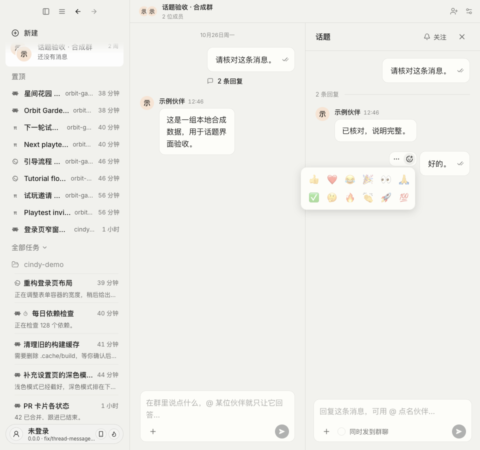
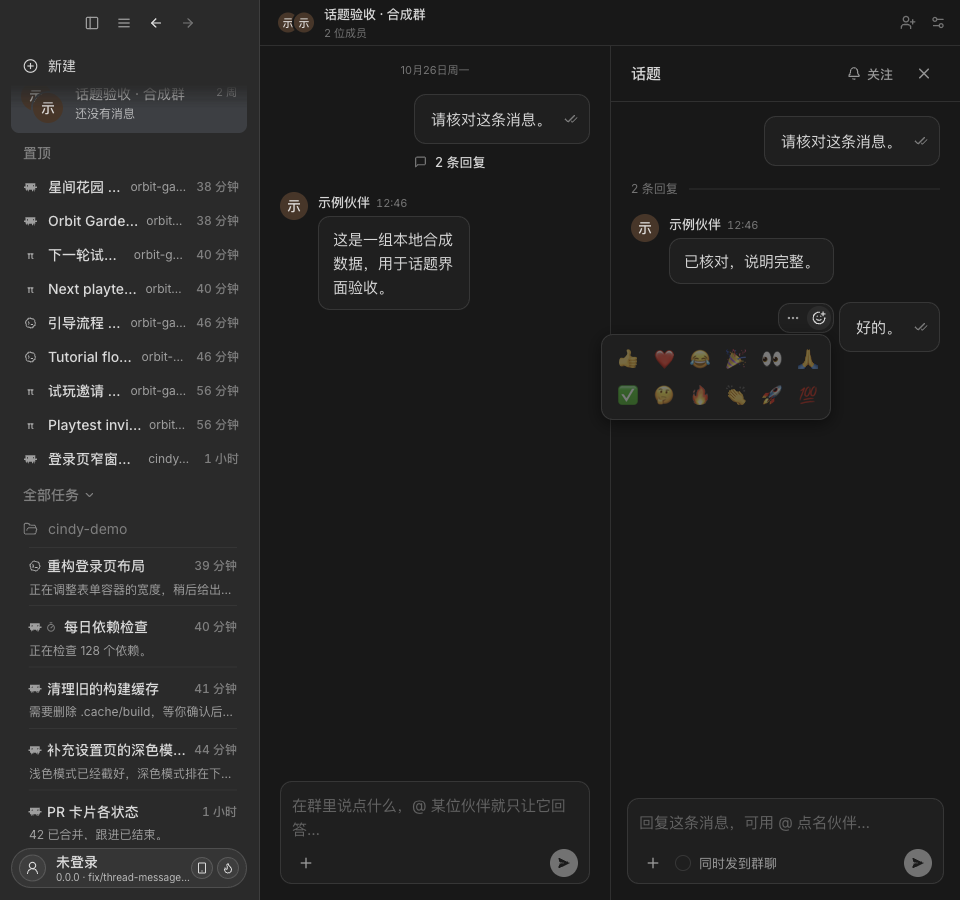
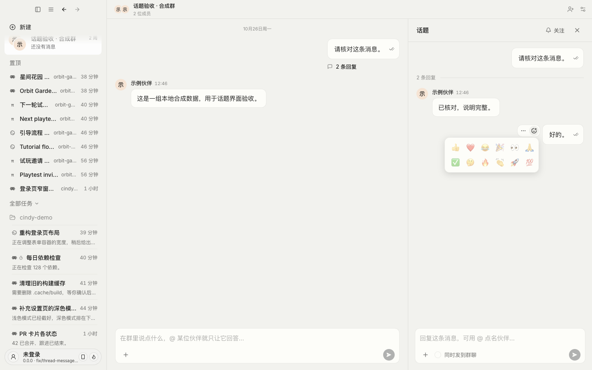
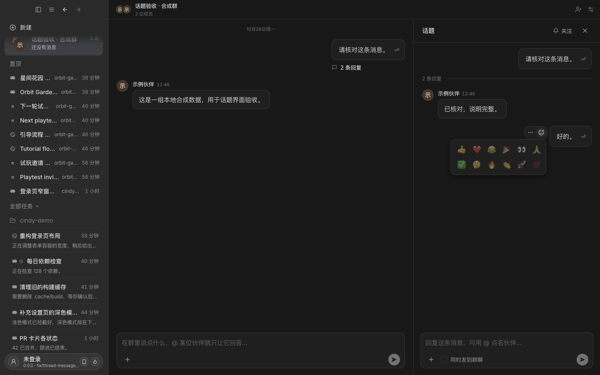

# PR #9182 完整客户端话题验收

## 构建来源和数据边界

生产界面来源为 `6ccad3b10d9ecd4b5a1ba127557f53c68c894aca`，Global Electron 开发客户端，隔离 `--mock --passive`。实际客户端经过侧栏群入口 → 主群消息的「2 条回复」→ 话题面板；未挂载转写 HTML，也没有用单页组件夹具代替本轮导航。

为补齐现有 mock 只有普通任务的缺口，在本次隔离实例临时接入主进程合成数据适配器：主群、主人/伙伴成员、根消息、两条话题回复。数据经真实 renderer → preload → IPC 调用到主进程适配器；测试替代了群/话题服务的数据来源，不验证真实 Chat Server、账号权限、持久化或实时同步。

适配器仅在未打包、隔离 mock 沙箱中启用。仅响应合成群的列表、详情、话题及展示所需读取，其他群/话题调用直接失败，不转发真实服务；未发送消息或提交表情变更。合成群、成员与消息均为虚构数据。它不属于产品改动，验收后已移除，并逐字节核对主进程源码恢复至开始状态；测试实例已停止。适配器补丁、复验脚本和 IPC 日志保留在本任务本地证据中，不随产品发布。

首次启动包装在 120 秒超时；随后同一进程完成启动。再次运行 `desktop:whoami --all` 明确返回来源 MATCH、精确 commit 匹配及 `DESKTOP_DEV_VERDICT=ready`，之后才执行验收。未将首次超时记录覆盖为成功。

## 运行矩阵

| 窗口 | 主题 | 主人根消息/短回复与伙伴回复 | 菜单/表情/键盘 |
| --- | --- | --- | --- |
| 960 × 900 | Light | 通过 | 通过 |
| 960 × 900 | Dark | 通过 | 通过 |
| 1440 × 900 | Light | 通过 | 通过 |
| 1440 × 900 | Dark | 通过 | 通过 |

每组均检查气泡外操作栏不遮住已读符号；悬停后可点击更多并打开菜单、点击表情并打开选择面板；鼠标移走后，键盘聚焦仍能显示操作栏。使用 DOM 实测检查不重叠，并目检截图。截图时已等待弹层动效稳定。未通过强制点击或修改 CSS 绕过真实命中判断。

之前完成的生产组件 Electron 4/4 矩阵、本地 Desktop 类型检查、78 项交互单测在本轮没有重跑；本轮没有修改生产 TypeScript 或 CSS。公开证据提交只新增本目录文档和图片。

## 完整客户端截图

以下均为实际客户端原始截图，包含主群、话题与本地合成数据侧栏；不是 OpenDesign 预览。

### 窄窗口 · Light

### 窄窗口 · Dark

### 宽窗口 · Light

### 宽窗口 · Dark

